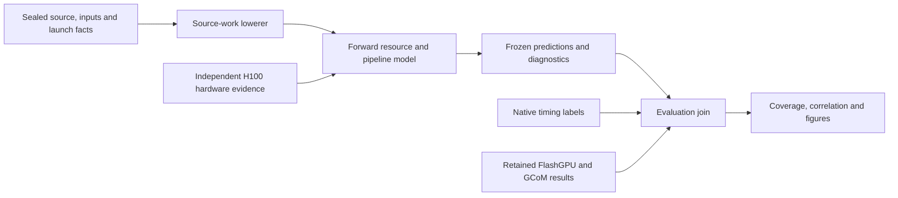

# Uni3Sim Forward alongside FlashGPU-Sim and GCoM on H100

Created: 2026-11-27T00:24:05-08:00

## User request

```text
investigate the archprsim in ~/wk/uni3sim/, especially the 'Forward' model. 
write a plan to include forward model in addition to the FlashGPU and GCoM sims for all the tested kernels.
```


```text
adapt the nvidia_h200 to create nvidia_h100 profile.
```

## Objective and current decision

Add **Uni3Sim Forward** as a third model family for every kernel/program already tested in this project. Preserve FlashGPU PTX, FlashGPU SASS, GCoM and their retained success/failure evidence as distinct lanes. Compare identical source/program/launch identities and explicitly matched timing windows on the same local H100 80GB HBM3 target.

This artifact completes investigation and planning. The initial H100 profile and registry/loader adaptation are implemented. New benchmark measurements and full-cohort Forward predictions remain planned. The existing canonical FlashGPU/GCoM campaign continues independently.

The checkout requested as archprsim is currently branded Uni³Sim and has no `archprsim` package/name in the inspected README, documentation, kernel sources or evaluation paths. The relevant implementation is its Kernel analytical Forward model. Subject revision: `ec4c797f3009f918b21df66555118e39430b8e46`; the checkout was clean during inspection. The [planning inventory](../local_artifacts/uni3sim-forward-h100/planning-inventory.json) stores source hashes and immutable snapshots of the existing benchmark ledgers.

## Investigation findings

| Finding | Evidence and consequence |
| --- | --- |
| Forward is the production analytical path | The evaluator's `--mode forward` calls `src.kernel.kernel_base.predict(..., method="midlayer")`. It derives work from semantics/source/launch and prices compute, memory, dependency pipelines and launch services. |
| H100 profile adaptation completed | The new `nvidia_h100` derived profile loads with H100 physical limits and explicit inherited H200 service provenance. The registry accepts H100; H200-only source launch selectors remain gated. Independent H100 calibration and workload adapters are still required for full validation. |
| H200 provides useful Hopper structure | Its profile has 132 SMs, but its 141GB HBM3e, 4.8TB/s memory service and H200 mechanism measurements are different from this H100. Reuse evidenced architecture/algorithm structure; bind H100 capacities and independent H100 service evidence. |
| Environment needs preparation | GEMM/MoE predictors load `build/lru_sim.so`; it is absent in this checkout. Requirements include NumPy, PyYAML and exactly `zstandard==0.25.0`. Build the CPU helper in an isolated source snapshot before predictor imports. |
| Arbitrary tested CUDA kernels are not pre-bound | `KernelSpec` and `LaunchConfig` enforce source/hardware/variant contracts. Existing production FA/MoE/vector variants cannot stand in for an algorithm merely because names or logical shapes resemble it. |
| Timing and observation paths are distinct | Oracle accepts observation-normalized resource work. Forward must use source/launch and allowed non-duration evidence, with production/native timing columns isolated to evaluation. |
| Cache helpers exist, but scope is limited | `L2ExecutionContext` records same-program operand replays; the C helper offers accounted/stateful LRU traffic. These are candidates for source-defined prefix accounting. The external `MemoryExecutionContext.validate` explicitly rejects integrated pricing because its compute/memory coordinator is not implemented. Prediction-result caches do not represent GPU cache state. |
| Support maturity is explicit | Returned levels are `complete`, `partial`, `aggregate_only`, `compatibility`; unsupported necessary contracts raise. Preserve those levels and limitations rather than treating any finite output as complete support. |

Core references: [model design](../../uni3sim/docs/kernel_performance_model.md), [public Forward API](../../uni3sim/src/kernel/kernel_base.py), [hardware IDs](../../uni3sim/src/kernel/hardware_ids.py), [hardware loader](../../uni3sim/src/kernel/hardware_spec.py), [launch dispatcher](../../uni3sim/src/kernel/launch_config/select_launch_config.py), [pricing core](../../uni3sim/src/kernel/formula.py), [pipeline solver](../../uni3sim/src/kernel/pipeline_model.py), [evaluator](../../uni3sim/evaluation/kernel/evaluation_runner.py), and [memory boundary](../../uni3sim/src/kernel/memory_backend.py).

## Scope: every tested workload receives an outcome

| Cohort | Frozen planning population | Required Forward treatment |
| --- | --- | --- |
| Portable core v2 | 1,155 unique cases; 30 operators; 18 M×N shapes | Use the sealed CUDA realization and oracle/case/program identities. Include every existing outcome, including failures; score only qualified references. |
| Operation and mechanism profiles | Operation Gate v2 reference/development/smoke plus mechanism-control aliases | Preserve aliases and per-profile denominators; global weights remain one per unique case. |
| H3 programs and semantics | Both suite families, development/smoke | Preserve graph topology, explicit state edges, already-emitted unrolling, ports and dtype/layout. Exact historical reference profiles remain `blocked_missing_source`. |
| Separate H3 batch64 protocol | 53 recorded cases | Bind the separately built driver, its exact prefix and 64 target repetitions. Retain incomplete outcomes; do not merge this lane with single-program predictions. |
| Canonical PPP | 137 native-completed cases at the snapshot, across nine families | Model every executed canonical case and its source/library/launch contract. Refresh the execution snapshot before launch and append newly tested cases. |
| Canonical standard manifest | 2,500 primary cases, 2,508 unique including additional source pilots | Keep untested shapes visible as planned/deferred. Forward-only predictions without native labels are coverage evidence, not accuracy pairs. Full-manifest execution is a later explicit expansion of this campaign. |
| H100 feature kernels/windows | MMA, WGMMA, TMA, mbarrier, ldmatrix/stmatrix, cp.async and DSM | Enumerate unique native kernels and named windows from raw receipts/XML/source, not just report rows. Keep functional-only checks distinct from timed windows. |
| Other-architecture and component checks | Includes earlier SM100 TMEM/tcgen05, SM120 feature suites and host component tests | Retain in the all-tested coverage ledger. H100-incompatible ISA becomes `unsupported_isa_target`; non-kernel unit checks become `non_kernel_component_check`. They do not acquire invented H100 timings. |

The feature artifact inventories currently contain 54 feature-study runs and 43 stock-H100 runs. These are **run counts**, not counts of unique kernels; a source/window deduplication pass is required. TMEM/tcgen05 require their declared Blackwell architecture, so any future timing campaign for them needs a separate target/profile. This plan does not retarget their results to H100.

Input roots: [portable corpus](../local_artifacts/flashgpu-portable-v2/corpus/manifest.json), [GCoM portable ledger](../local_artifacts/gcom-portable-v2/case-ledger.json), [canonical manifest](../local_artifacts/canonical-ppp-h100/manifest.json), [canonical ledger](../local_artifacts/canonical-ppp-h100/case-ledger.json), [feature evidence](../local_artifacts/flashgpu-validation/), [stock H100 evidence](../local_artifacts/stock-flashgpu-h100/), and [aligned FlashGPU comparison](../local_artifacts/flashgpu-h100-residency/comparison-aligned-vs-stock.json).

## H100 hardware onboarding

The initial canonical `nvidia_h100` ID and [derived profile](../../uni3sim/configs/hardware/nvidia_h100.yaml) are implemented and validated. The user explicitly requested adaptation from H200; the initial profile therefore retains H200 services as compatibility proxies. Remaining native H100 service calibration and source/launch support proceed under the evidence rules below. Validate the same target used by existing studies: CC9.0, 132 SMs, 2,048 threads, 64 warps and 32 CTAs per SM; 65,536 32-bit registers; 233,472 bytes shared memory per SM; 232,448 opt-in shared bytes per block; 50MiB L2; 80GB HBM3. Confirm these against retained driver attributes and fresh dedicated admission when measurements are needed.

Freeze SM/DRAM/L2 clock domains and capacity/rate units from H100 specification or admitted non-duration clock evidence. Preserve the existing FlashGPU 1500MHz and GCoM 1800MHz model domains in their lanes; their values do not automatically define Forward's deployment clock. No frequency or rate is selected from an accuracy residual.

| Hardware mechanism | Required evidence |
| --- | --- |
| Tensor/MMA and vector/ALU/SFU/reduction service | Typed independent dependency/throughput controls matching dtype, lowering and active-unit domain |
| Cache/HBM paths | Footprint-controlled pointer chasing and read/write streaming, transaction granularity and conditional routing |
| Request concurrency and finite structures | Independent producer/MLP/request-rate controls; distinguish source slots from local queues/credits |
| Shared-memory and async copy | Bank/stride/request-size controls; TMA setup/completion, in-flight depth and buffer ownership |
| Barriers, waits and DSM | Native scope/phase/dependency evidence and matching endpoint/fabric service controls |
| Empty/minimal launches | Exact grid/block/runtime/timer domain; complete duration floors composed by maximum, additive dispatch only when independently identified |

Reuse existing Amora H100 diagnostic evidence only after checking source/binary/software/clock/protocol provenance and evidence-role overlap. Earlier archived diagnostic summaries alone do not provide sufficient production parameter provenance. Missing evidence remains absent/partial; H200 measurements are not relabeled H100.

Keep hardware-parameter measurements and accuracy targets disjoint by source/binary/launch/input/window identity. An existing WGMMA or TMA accuracy window cannot also supply the service parameter used to predict that same window. Parameter-evidence probes still receive ledger entries, labeled `parameter_evidence_not_scored` when reused in that role.

## One source-work adapter above the shared Forward core

Use a shared lowering contract that binds source identity, exact emitted launch, typed operations, source-issued/physical traffic, worker assignment, dependencies, buffers and timed window. Preserve physical strides/offsets, FP16 store/conversion boundaries, FP32 work, disabled FMA contraction, integer operations, deterministic tie/scatter rules and source loop trip counts.

For an existing Uni3Sim variant, use its public `KernelSpec → predict(method="midlayer")` path only after proving its source/ABI/algorithm matches the executed CUDA launch. Otherwise implement a source-program adapter that constructs validated `PredictionInput` and uses the same `PerformanceFormula.predict_kernel` and pipeline solver. This is a **new, explicitly named source frontend**, not already-implemented arbitrary-PTX/SASS support. It must validate hardware identity and all mandatory source/launch fields before pricing; it cannot bypass missing semantics by declaring every kernel an existing VECTOR/GEMM variant.

Prefer capabilities and common resource contracts when sharing Hopper structure. Avoid widening H200-only validators mechanically or introducing per-case duration constants. Unknown mechanisms can motivate one shared physical extension with independent evidence; otherwise retain unsupported/lower-bound results.



The predictor child receives a duration-free allowlist and publishes `forward_duration_observation_consumed=false`. Native durations, simulator errors, target profiler outcome columns and report summaries stay in the evaluator. Source/launch facts and permitted non-duration observations may complete demand, with provenance. Observation-normalized counter-work experiments, if useful, get a separate Oracle-assisted diagnostic identity and never replace the requested Forward lane. Do not populate `resource_time_overrides_ns` from target timings.

## Portable operator mapping

Every operator below is present in the sealed corpus. Reuse exact CUDA lowering and executed launch order from Amora's realization, including internal cast/materialization nodes. Raw mathematical node/unroll fields must not be expanded a second time.

| Source-work class | Exact tested operators | Required work/dependency facts |
| --- | --- | --- |
| Elementwise and nonlinear | `add`, `mul`, `relu`, `half_scale_contract`, `scaled_round_clip`, `dequantize_bias_gelu`, `silu_gated_product` | Typed arithmetic/conversions, clamp/round order and SFU dependency chain; half-scale is multiply-by-0.5 rather than dense GEMM |
| Addressed transforms/stencils | `row_roll`, `rotary_pair_transform`, `bilinear_resample`, `weighted_stencil` | Actual neighboring/pair indices, boundary handling, gathers, trig service and read/write footprint |
| Row reductions/normalization | `row_stat_broadcast`, `row_logsumexp`, `row_variance_normalize`, `causal_masked_softmax` | Executed row worker mapping, serial/reduction stages, mask domain, SFU/division and rereads |
| Counts/segments | `grouped_threshold_count`, `segment_sum4` | Predicate work, exact source grouping/segment length, partial/tail behavior |
| Scans | `affine_state_scan`, `cumulative_max_scan` | Per-row serial loop and directed state recurrence; generic parallel-scan pricing is not source-equivalent |
| Top-k | `row_topk_select` | k=4 corpus contract, actual selection loop, lowest-index tie rule and output layout |
| Gather/embedding bags | `embedding_bag_mean`, `indexed_embedding_sum`, `multi_hash_embedding_sum`, `dual_hash_gather_sum`, `weighted_embedding_bag_mean`, `weighted_embedding_bag_sum` | Deterministic index/weight recipe, repeated-address footprint, hash arithmetic and exact aggregation |
| Indexed groups/scatter | `indexed_group_l2`, `indexed_group_max`, `indexed_group_min`, `indexed_scatter_add` | Actual serial/index search and reduction mapping; deterministic scatter realization must not be priced as an atomic-scatter kernel |

First verify that this table's union equals the frozen 30-operator inventory, then add one source-lowering witness per class/operator, plus dtype, stride/offset, graph edge, shape-tail and state/unroll witnesses. Predictions for operator-containing groups remain whole-program predictions and overlapping groups, not isolated-operator attribution.

## Canonical family mapping

| Canonical family | Source-matched Forward contract |
| --- | --- |
| `aligned_gemm_fp16` | Exact cuBLAS symbol, library/toolkit hash, tile/grid/block, register/shared occupancy and native WMMA/MMA lowering. The pilot uses `cutlass_80_wmma_tensorop_h161616gemm_16x16_128x1_nn_align8` on SM90; do not assume FA3/WGMMA GEMM. A/B are uninitialized, so numerical/input-value equivalence is not claimed. |
| `embedding` | Exact custom lookup/index recipe and footprint. Preserve warmup/128MiB flush omission under `AMORA_GCOM_TRACE`; the whole allocation alone does not establish streamed traffic. |
| `flash_attention_fwd` | Bounded sampled Q/K/V loop and scalar/SFU accumulation; source-specific partial stores. The template does not implement a production FlashAttention QK–softmax–PV pipeline. |
| `flashmla_dense_decode` | The source's fixed hidden=576 and bounded sampled loop, actual source loads/exp work and output subset |
| `gelu` | Source FP16 storage and FP32 cubic/tanh/conversion chain, including actual compiler lowering |
| `gelu_gemm_fp16` | Separate GELU prepass and exact cuBLAS launch; intermediate materialization/cache and the declared fused-component aggregate window |
| `megamoe_fp8` | Unsigned-byte arithmetic, top_k=8 bounded routes and sample_hidden=1024; source data races/partial output limit numerical claims. No invented FP8 Tensor Core GEMM or production expert balancing. |
| `rmsnorm` | Exact CTA reduction, rereads, gamma input, shared-memory/barrier use and register/thread occupancy |
| `rmsnorm_gemm_fp16` | Separate RMS prepass and exact cuBLAS launch, with the same component aggregate and materialization treatment |

Forward can potentially predict a source whose FlashGPU interpreter fails, but that does not erase the interpreter failure or establish arithmetic correctness. Source-work/launch validation and each simulator's execution outcome remain separate.

## Instruction and feature windows

| Feature | Planned Forward work and support boundary |
| --- | --- |
| `mma.sync` | Typed instruction shape/precision/count, dependence/issue service, fragment reads and register occupancy; functional-only cases need native timing before APE |
| WGMMA | Exact issue, wait and total windows, repeated operand/group behavior, finite async queue and completion dependencies. These overlapping windows remain separate. |
| TMA and cp.async | Descriptor/transaction size, maps/strides/swizzles, copy path, in-flight groups and completion barrier; model source-selected timing boundaries |
| mbarrier | Arrival/transaction/phase ownership, local versus remote scope and wait dependencies; a byte-bandwidth estimate alone cannot describe wait latency |
| ldmatrix/stmatrix | Actual fragment shape/transposition, shared-bank/address mapping and issue/dependence service |
| DSM/cluster | Cluster dimensions, cross-SM endpoints, remote store/atomic/arrival operations and fabric/resource contention; unknown topology/service remains a limitation |
| TMEM/tcgen05 | Retain all earlier test outcomes; their Blackwell SM100 requirements are outside H100 ISA support. A future architecture-specific profile/campaign is separate. |

Forward predicts work/timing, so its report does not claim execution of numerical assertions or memory-consistency litmus tests. Non-timed component tests have no synthetic timing row.

## Timing, prefix and eligibility contract

Build an `estimand_key` from source/program/launch identity, target/profile hash, named window, runtime, prefix/warmup/batch, cache policy and host-gap convention. A native reference also includes physical GPU UUID and acquisition epoch. Preserve the old historical GPU7 FlashGPU references separately from the device-matched GCoM references. Canonical cold-process and portable warmup protocols do not share an eligibility pool.

For a multi-kernel program, price every emitted launch exactly once and reconstruct its declared dependency/span. Preserve one stream, materialized outputs, state recurrence and repetitions. An unsupported mandatory node rejects the whole program timing; no zero-duration omission. Native CUPTI body sums, first-to-last program spans and model service timelines remain distinct. KernelPrediction includes launch/floor composition; neither Forward nor GCoM service is relabeled a kernel-body duration without matching-domain evidence.

Use source-derived prefix/address sequences and the existing stateful/accounted LRU capabilities only where their cache contract closes. `same_program_operand_replays` alone does not prove arbitrary graph/gather/batch cache state. Unknown physical partition mappings stay explicit. If the complete prefix/window cannot be represented, publish `unsupported_cache_context` or a separately labeled aggregate bound. Do not silently assume every node is cold or fully resident.

For H3 batch64, account for the driver's exact validation/warmup prefix and 64 selected target repetitions; validate full launch count/order against retained traces. Publish separate per-batch/per-repetition quantities and score the retained native batch estimand. Do not automatically multiply a cold single-program prediction by 64.

Preserve existing native qualification masks/floors/CV rules within each lane. Forward timing admission requires valid source/hardware/window, complete mandatory-launch accounting, finite positive output and a qualified matching native reference. `aggregate_only` and `compatibility` outputs are separate lower-bound/diagnostic cohorts. Partial predictions may be scored descriptively only when limitations do not invalidate the declared timing window; support level remains displayed.

Convert `KernelPrediction.t_total_s` explicitly to seconds/ns/ms; compare instruction cycles only after applying the declared matching clock domain. Record actual CPU prediction runtime separately from modeled GPU duration.

## Implementation ownership

| Owner | Work |
| --- | --- |
| Uni3Sim | Canonical H100 ID/profile and capability admission; source-matched launch/work frontend; shared physics/pipeline/cache extensions and model-contract checks |
| Amora | Proposed `amora/backends/uni3sim_forward/` bridge and `amora/benchmarking/forward_comparison/` campaign/report adapters; unchanged portable/canonical definitions and realized CUDA source |
| gpu-perf | This plan and [tracker](tracker/261127-0024-uni3sim-forward-h100-validation.md); runtime inputs, evidence and predictions under Git-ignored `local_artifacts/uni3sim-forward-h100/`; reports under `reports/`, PNG/SVG under `reports/assets/` |

Run Forward in a separate pinned CPU interpreter/source snapshot, with its working directory at Uni3Sim, to avoid the generic `src` package colliding with Amora imports. Its existing README command operates on the repository's own datasets; it is not yet a runnable AMORA/H100 bridge. Publish the new launch command only after implementation and `--help`/receipt validation.

## Execution stages and tracker acceptance

| Stage | Concrete completion evidence |
| --- | --- |
| Source/evidence seal | Pinned Uni3Sim/Amora commits and dirty overlays, model/docs/tool hashes, refresh of all tested identities, explicit architecture and timing-window ledger |
| CPU environment | Exact dependencies and hashed C LRU helper in isolated snapshot; imports work; parameter/reference files resolve and are not Git-LFS placeholders |
| H100 profile admission | Canonical ID/loader/selector acceptance, physical limits and unit checks, H100 mechanism evidence manifest, missing/out-of-domain behavior |
| Unified source adapters | All 30 operators, all nine canonical families and every feature window have a source-bound input or explicit unsupported disposition; exact work/byte/launch conservation |
| Dependency/cache/label checks | Correct materialization, prefix, state/unroll/batch accounting; forbidden observation inputs cannot affect prediction or cache keys |
| CPU Forward pilot | Simple elementwise, reduction/SFU, gather, scan/top-k, graph/state, cuBLAS/prepass and instruction-window witnesses; preserve every failure and measure CPU/RAM/storage cost |
| Profile/adapter freeze | Freeze admitted formulas/services/variant selection before looking at holdout timing errors; review support completeness/cost, never select a rule by lower APE |
| Full tested-cohort execution | One prediction per unique model/source/launch/profile/protocol key; all 1,155 portable outcomes, 53 batch cases, executed canonical cases and feature checks accounted for; untested canonical manifest remains planned |
| Comparison and closeout | Independently recomputed metrics, explicit common intersections/coverage/missing states, figures, source hashes and resolved links; tracker records every deferred obligation |

Reuse verified identical Forward predictions and existing FlashGPU/GCoM runs, including failures. Adding a model or changing report interpretation does not justify another identical GCoM run. A genuinely changed source/profile/protocol prediction gets a new immutable key and revision, retaining the old result.

CPU prediction scales independently across disjoint NUMA/core allocations, with internal NumPy/BLAS/OpenMP widths bounded to avoid oversubscription. Pilot-derived memory/traffic-generation cost limits worker count and batch size. Respect live foreign CPU load/quota/RAM/storage and the ongoing canonical campaign. Hardware work occurs only for missing admitted labels/mechanism evidence, using as many dedicated idle H100s as available, one monitored worker per UUID. Never kill foreign jobs or transfer one card's timing label to another.

## Meaningful verification

Verify rejected/missing hardware IDs; H100 capacity and clock-unit mismatches; source/hash/launch/tiling mismatches; operation/traffic conservation; index/stride/tail masks; dependency and buffer release; materialization; conversion boundaries; and complete positive prediction diagnostics.

Mutation tests must show that changing/removing native durations, simulator errors and profiler outcome columns cannot change the Forward input, prediction, parameters or cache key. Exact-source changes must change the key. Missing mandatory launch/window/capacity must reject rather than create zeros or a default-hardware fallback.

Use native/oracle checks where already available to establish numerical correctness independently. Canonical timing-only templates retain their lack of an output oracle. Forward arithmetic demand validation does not replace CUDA numerical validation. Check source-defined cache prefixes and batch/unroll factors with launch accounting; only reuse state APIs whose contracts actually cover the workload.

## Comparison outputs

Main lanes: aligned FlashGPU PTX, aligned FlashGPU SASS timing, GCoM and Uni3Sim Forward. Preserve stock FlashGPU as a separately identified historical reference. Report independent populations plus common all-model and pairwise intersections; display how coverage changes rather than silently dropping cases absent from Forward.

Compute APE as `100 × abs(prediction/native − 1)`, equal weights per unique case, MdAPE and linearly interpolated P95 APE. Include signed median bias, Pearson/Spearman/log-duration correlation where at least three varying points exist, eligible/full counts and model support levels. Retain native failure, missing reference/source, unsupported hardware/ISA/source/window/cache, Forward failure and unexecuted states separately.

Produce operator and M×N figures for portable programs; family and M×N×K or B/S/H/D/etc. figures for canonical kernels; distinct H3 batch and feature-window figures. Follow the requested striped-row layout in [the existing portable chart](../reports/assets/portable-v2-stock-aligned-ape-by-operator.svg): overall row, circle/diamond MdAPE/P95 markers, numeric/count columns, percentage grid and readable provenance. Add the Forward lane without conflating PTX and SASS. Resource/worker/memory diagnostics explain residuals; they do not fit corrections.

Output machine-readable case/window/launch crosswalks, frozen inputs/predictions, source/profile/evidence hashes, support/eligibility masks and recomputable comparison CSV/JSON. Update the [combined report](../reports/261126-2130-flashgpu-gcom-h100-comparison-report.md) and create a timestamped Forward comparison report when execution finishes. Cite Uni3Sim's compute-model paper from its README and retain the existing GCoM/Accel-Sim citations.

## Revision History

- 2026-11-27T00:24:05-08:00: Investigated Uni3Sim Forward at the pinned revision, verified H100 identifier rejection and missing helper, mapped all tested cohorts to source/timing contracts, and persisted the integration plan plus tracker and hashed planning snapshots. No Forward implementation, measurement or prediction was launched.

- 2026-11-27T00:28:11-08:00: Verified source and snapshot hashes, complete 30-operator and nine-family mapping, local links, prompt fidelity and filename/heading conventions. Clarified Blackwell component scope and the explicit Forward observation-isolation flag.

- 2026-11-27T01:07:28-08:00: Completed the requested H200-to-H100 profile adaptation, registry aliases, physical-resource rebuilding and Forward compatibility labeling. Preserved H200 reference provenance and source-selector gates; 15 targeted validation checks passed. Native H100 calibration and full-cohort execution remain planned.
