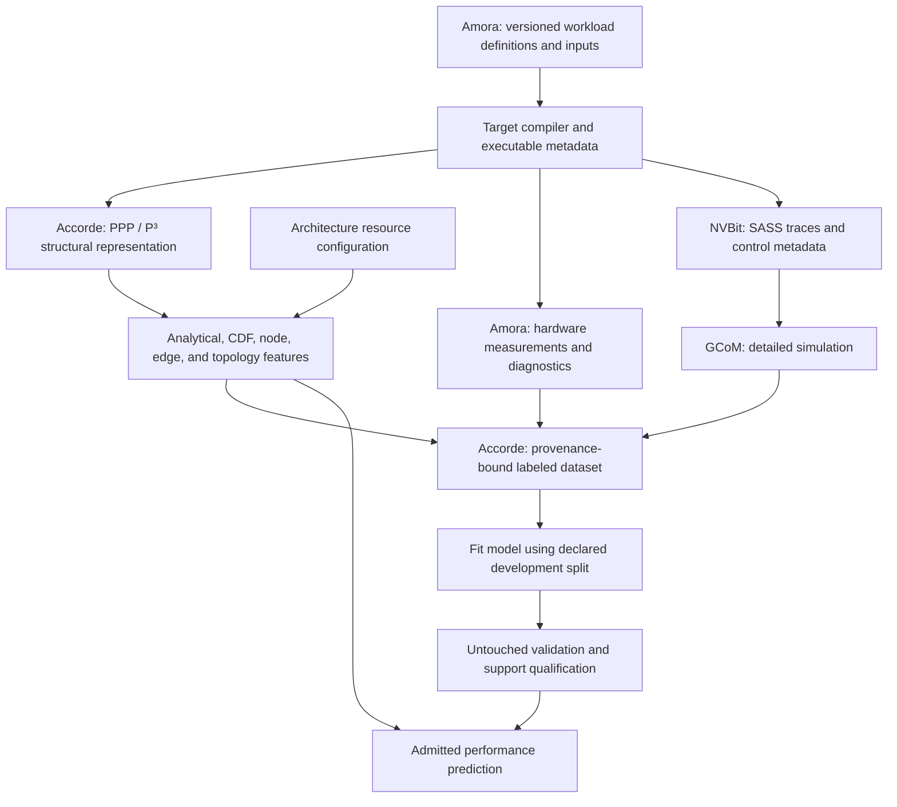
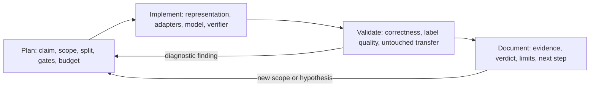

# GPU Performance Modeling: Team Summary and Accorde Development Tutorial

English | [中文](gpu-performance-onboarding-zh.md)

Prepared on 2026-11-11 for a new team member. This guide covers the sibling repositories `modern-gpu-simulator-micro-2025`, `accorde`, `amora`, and `dsh-research`. The owner has selected `dsh-research` to replace autoresearch for research workflow automation. Relative links assume a local `gpu-perf/` checkout beside those repositories under `~/wk/`. The five-goal roadmap below follows the project owner's request; historical reports supply the evidence and its scope.

## What we are building

Accorde aims to predict accelerator performance quickly while generalizing beyond the kernels, shapes, and hardware used to develop the model. Its central idea is to combine explicit descriptions of work and hardware resources with learned performance models. Detailed simulation and hardware measurements supply evidence; a qualified predictor makes subsequent queries much cheaper.

The four repositories divide that work:

| Repository | Responsibility | Main inputs → outputs | Start reading |
|---|---|---|---|
| Modern GPU Simulator, also called GCoM in these projects | Trace-driven, cycle-level GPU modeling; detailed execution and resource diagnostics | Compiled CUDA execution → SASS traces and metadata → simulated cycles and statistics | [Overview](../modern-gpu-simulator-micro-2025/README.md) |
| Amora | Automated Microarchitecture Observation and Reverse-engineering for Accelerators; workload definitions, probes, and measurement adapters | Workload/probe definitions + tool/device context → manifests, observations, normalized measurements, comparisons | [Developer guide](../amora/docs/development/nvidia-baseline-probes.md) |
| Accorde | Structural representation, feature generation, learning, generalization studies, and model qualification | Kernel/operation representation + shape + architecture + labeled evidence → features, fitted models, support decisions, predictions | [PPP implementation guide](../accorde/src/backend/common/ppp/README.md) |
| dsh-research | Planned research workflow replacement for autoresearch; reusable policy and thin helpers over dsh-superagent/DSH | Project goal + frozen manifest + evidence → reviewed checkpoint and next research action | [Architecture and milestone index](../dsh-research/.plan/261105-1555-review-1201-1230-and-milestones.md) |

Amora owns reusable workload definitions and measurement machinery. Accorde owns predictor fitting, scientific splits, qualification decisions, and campaign evidence. The simulator owns detailed execution modeling. dsh-research supplies reusable research workflow policy and helpers; each hosted project, such as Accorde, retains its scientific code, decisions, evidence, budgets, and persistent state. Changes can span repositories, but each artifact should have one clear owner and versioned interfaces to its consumers.

## Accorde's five generalization goals

| Goal | Meaning and example | Current roadmap status | What an evaluation must hold out |
|---|---|---|---|
| 1. Cross-kernel / cross-operation | Predict a new kernel or operation from previously learned resource and composition behavior | **Done**, within qualified scopes | Entire kernel identities or operation categories, including every associated row |
| 2. Cross-(operation + shape) | Predict when both the operation and its tensor shape change; e.g. a new gather composition at a new extent/aspect ratio | **Done**, within qualified scopes | Operation–shape combinations; direct evaluation of their interaction |
| 3. Same generation, cross-chip | Transfer between chips/SKUs within Hopper, whose SM count, memory system, clocks, and resource limits differ | **Ongoing — Hopper** | The target chip/SKU and its measurements, according to a declared zero-shot or few-shot protocol |
| 4. Same ISA, cross-generation | Transfer across the NVIDIA ISA ecosystem: Hopper → Blackwell → Rubin | **Not started** | The target generation, with its own compiler, executable, resource semantics, and measurements |
| 5. Cross-ISA | Transfer to other accelerator ecosystems, including TPU and AMD GPUs through ROCm | **Future goal; broad transfer remains to be qualified** | The target ISA/backend, native execution contract, and target measurements |

“Done” is the roadmap milestone. A released model remains usable only inside the hardware, compiler, semantic, shape, topology, and execution envelope in which it passed. Completion of goals 1 and 2 does not confer goals 3–5.

For goal 4, “same ISA” names the shared NVIDIA programming/ISA ecosystem. It does not mean that a Hopper SASS binary or dynamic trace is identical to a Blackwell or Rubin executable. Recompile and qualify generation-specific lowering and instructions. For goal 5, ROCm is the AMD software stack; its native GPU execution model and ISA must be mapped separately. Adding an `ArchConfig` YAML establishes a descriptive interface, not measured transfer accuracy.

Two useful evidence anchors:

- [Operation Gate v2](../accorde/reports/ppp_ir_mlp/roadmap_b_native_contraction_gather_v1/operation_gate_v2_v1/REPORT.md) passed a fresh ten-category, 240-motif confirmation: it rejected all 91 defined failures and admitted 144 motifs with zero observed failures. This is a support/risk gate at a fixed baseline shape; its 60% coverage and predictor accuracy are separate quantities.
- The [operation-and-shape usability report](../accorde/docs/shape_ood_study_comprehensive_report-en.md) documents a joint graph-edge model on 16 untouched compound cases across eight graph families: MdAPE **1.9899%**, p95 APE **4.8765%**, and **100% coverage**. It also records qualified topology transfer, seven semantic shape routes, and rejected routes. Its environment is frozen H100, compiler/runtime, and CUDA Graph/timing protocols.

The [September technical synthesis](../accorde/docs/multi_isa_generalization/ppp-goals-exploration-tech-report.md) explains earlier failures and representation choices. Its “arbitrary-kernel transfer unsolved” conclusion belongs to that historical scope and date; read it alongside the later qualified routes and this owner's roadmap.

## How the system works



These are available paths, not mandatory stages for every query. A PPP feature query needs a kernel description, shape, and architecture configuration; it can run without a trace or GPU. A new accuracy claim needs suitable independent labels. Hardware duration, simulated cycles, and analytical estimates retain separate provenance.

### Modern GPU Simulator: detailed execution evidence

The MICRO 2025 simulator extends Accel-Sim with a remodeled SM/subcore pipeline, improved memory and dependency handling, SASS control-bit interpretation, instruction-cache changes, static instruction metadata, protobuf traces, and OpenMP parallelism. The local fork also contains Hopper-related work such as TMA handling and asynchronous copy-group repairs.

| Code area | What to inspect |
|---|---|
| [`util/tracer_nvbit/`](../modern-gpu-simulator-micro-2025/simulator-remodeled/util/tracer_nvbit/) | Instrumentation of real CUDA execution |
| [`util/traces_enhanced/`](../modern-gpu-simulator-micro-2025/simulator-remodeled/util/traces_enhanced/) | Static metadata, instruction interpretation, protobuf trace handling |
| [`gpu-simulator/`](../modern-gpu-simulator-micro-2025/simulator-remodeled/gpu-simulator/) | Trace frontend and simulator build |
| [`gpgpu-sim/src/gpgpu-sim/remodeling/`](../modern-gpu-simulator-micro-2025/simulator-remodeled/gpu-simulator/gpgpu-sim/src/gpgpu-sim/remodeling/) | Remodeled SM, subcore, memory, and TMA implementation |
| `gpu-simulator/gpgpu-sim/configs/tested-cfgs/` and `gpu-simulator/configs/tested-cfgs/` | Matching microarchitecture and trace configurations |
| [`APEs/`](../modern-gpu-simulator-micro-2025/APEs/) | Published application/configuration error data |

Simulation requires a trace compatible with its instruction semantics and a matching configuration. Simulator agreement is evidence against that simulator version; silicon accuracy requires hardware comparison. A configured opcode or chip name alone does not qualify optimized kernels using new synchronization, async-copy, or tensor mechanisms.

### Accorde: from trace features to portable structure

The older `src/accorde/` pipeline collects traces, builds a C++ feature generator, runs GCoM, assembles training data, and trains a throughput model. It remains useful for understanding the original dataset flow.

The portable research substrate lives in [`src/backend/common/ppp/`](../accorde/src/backend/common/ppp/). PPP means **Phase-Population Profile**, also written **P³**:

- **Phase:** compute, transfer, synchronization, or collective work, with explicit dependencies and overlap relationships.
- **Population:** which tiles/work intervals exist for a shape and how many there are; this captures interior/edge tiles, causal ramps, and role splits.
- **Architecture:** resource capacities, rates, latencies, fallback bindings, and structural limits in `ArchConfig`.

`evaluate(kernel, shape, arch)` performs capacity checks and produces resource features and analytical estimates. Each standard resource CDF block has 50 percentiles, 50 weighted percentiles, and three summary statistics. The overall feature count varies by schema and route; freeze the actual feature names/order instead of assuming an old fixed dimension.

Serializable PPP-IR and its Gluon-related extensions can retain execution groups, async queues, synchronization objects, footprints, and recurrent dependencies. Their representation/extraction value and their timing accuracy are evaluated separately. Some deterministic timing experiments failed; the existence of those APIs does not promote them.

The later operation-and-shape models use node, directed-edge, and topology structure plus shape-dependent work. They form a route-specific model stack. A caller must select an exact qualified model and check its support contract.

### Amora: observation and reproducible workloads

The current NVIDIA baseline registry contains **36 probes** covering topology, arithmetic, shared memory, caches, scheduler/register behavior, memory pipelines, tensor cores, synchronization, transfers, and interconnect. The root README's early “one implemented plus seven planned” paragraph is historical; inspect the [registry](../amora/amora/probes/nvidia/baseline/__init__.py) and developer guide for the current implementation.

A probe preserves four evidence layers:

| Layer | Purpose |
|---|---|
| `raw_observation` | Original timing/counters, units, and evidence source |
| `normalized_measurement` | Normalized value, fit status, uncertainty, and assumptions |
| `backend_interpretation` | NVIDIA-specific explanation and downgrade reasons |
| `simulator_estimate` | Simulator parameter mapping through an explicit contract |

Kernel probes validate generated SASS; applicable NCU counters come from a separate profiling pass. An unsupported or conditional result is useful information and must retain its status through downstream consumption.

Amora also hosts `ppp_canonical` deterministic CUDA benchmark definitions and [`portable_core`](../amora/benchmark_generators/portable_core/README.md) mathematical workloads. Portable core20/core24/core28 include deterministic inputs, independent oracles, and NumPy/PyTorch/optional-JAX backends. Correctness checks validate mathematical behavior; native lowering, accelerator instruction selection, and performance need additional evidence.

## First hands-on session: CPU only

Use Python 3.11+ for a common environment; Amora itself permits Python 3.10+. Run each command block from the repository root it names. For an existing checkout, inspect `git status --short` and preserve unrelated changes. Run data-writing examples with a fresh output directory each time.

### Set up and inspect Accorde

```bash
cd ../accorde
python3.11 -m venv .venv  # for a new checkout
.venv/bin/python -m pip install -e .
.venv/bin/python -m pip install pytest

git status --short
git rev-parse HEAD
git submodule status
```

Add `.[ml]` only when a task needs the legacy Torch/Optuna trainer; study-specific models may have their own dependency contracts. In a fresh clone, initialize required submodules with `git submodule update --init --recursive`. Do not reset a working checkout's modified submodules to reproduce an example.

Run a trace-free feature query using the installed package namespace:

```bash
PYTHONPATH=src .venv/bin/python - <<'PY'
from backend.common.ppp.canonical.gemm import aligned_gemm_fp16
from backend.common.ppp.loaders import load_arch_config
from backend.common.ppp.evaluator import evaluate

arch = load_arch_config("src/backend/common/ppp/configs/sm_90_h100.yaml")
kernel = aligned_gemm_fp16()
for size in (1024, 4096):
    result = evaluate(kernel, {"M": size, "N": size, "K": size}, arch)
    print(size, result.is_feasible, len(result.cdf_features),
          result.bottleneck_per_kind, len(result.deferred_resources))
PY
```

At the inspected snapshot, both queries are feasible, emit 2,090 features, and identify `compute_matrix` as the interior-tile bottleneck, with zero deferred resources. This exercises analytical feature generation. It neither launches a GEMM nor validates its latency. The aligned factory expects aligned shapes; use a producer with explicit edge handling for non-aligned dimensions.

### Set up Amora and freeze a workload

```bash
cd ../amora
python3.11 -m venv .venv  # for a new checkout
.venv/bin/python -m pip install -e '.[portable-core,test]'

.venv/bin/python -m amora nvidia list
.venv/bin/python -m amora nvidia inspect-capabilities
.venv/bin/python -m amora benchmarks inspect ppp_canonical
.venv/bin/python -m amora benchmarks materialize ppp_canonical \
  --cases 8 --seed 20261111 --output out/onboarding-ppp/manifest.json

.venv/bin/python -m benchmark_generators.portable_core list --tier 20
.venv/bin/python -m benchmark_generators.portable_core freeze \
  --tier 20 --out out/onboarding-core20
.venv/bin/python -m benchmark_generators.portable_core check \
  --frozen out/onboarding-core20 --out out/onboarding-core20-check \
  --backends numpy --device cpu
```

The core20 smoke check covers 152 cases. The frozen package binds workload and runtime-source hashes and refuses overwrite. These CPU exercises help you learn identities, shapes, manifests, and oracles before introducing hardware variability.

## Hardware session: collect and reconcile evidence

Use a Linux NVIDIA host with a compatible driver/CUDA toolchain. NCU, NVBit, disassembly tools, and counter access are task-dependent prerequisites. Simulator builds also need the Accel-Sim dependencies and protobuf compiler/libraries; the simulator README records tested compiler/CUDA combinations.

Start with one probe on H100:

```bash
# From amora/
export AMORA_NVCC_ARCH=sm_90
.venv/bin/python -m amora nvidia run \
  --probe arithmetic_latency.dependent_chain \
  --output out/onboarding-h100-latency.json
```

Inspect device/tool identity, SASS checks, units, fit status, and uncertainty. A successful CLI exit alone does not establish a usable physical constant. Keep profiling and ordinary timing separate; profiler replay can change the measured execution.

For simulator work, from a prepared `modern-gpu-simulator-micro-2025/simulator-remodeled/` checkout:

```bash
# Set CUDA_INSTALL_PATH and PATH for the agreed CUDA installation first.
source ./gpu-simulator/setup_environment_no_git.sh
make -j -C ./gpu-simulator/
```

The executable is `gpu-simulator/bin/release/accel-sim.out`. Tracer build/collection instructions are in the simulator README and require real GPU execution. The enhanced trace bundle includes `dynamic_trace.pb`, static `extra_info/enhanced_execution_info.json`, and threadblock data. Preserve the bundle and its hashes together.

Amora can explicitly use either the standalone simulator or Accorde's pinned copy:

```bash
# From amora/; choose the prepared standalone checkout for this example.
export GCOM_ROOT="$(cd ../modern-gpu-simulator-micro-2025/simulator-remodeled && pwd)"
.venv/bin/python -m amora gcom_cuda inspect-capabilities
```

`GCOM_ROOT` names `simulator-remodeled/`, not its parent repository. Inspect both configuration files and the binary/tracer before a run. `gcom_cuda run` and `compare` provide probe execution and hardware/simulator comparisons; use their `--help` and the selected SKU profile. The inspected Amora profile is `gcom_h100`.

For canonical benchmark campaigns the sequence is:

1. Materialize a frozen manifest.
2. `amora benchmarks classify ppp_canonical --manifest ...` collects basic NCU evidence and a digest-bound size ranking.
3. `detail` collects detailed hardware/GCoM evidence in rank order: small → medium → large.
4. `review` records an explicit evidence decision before the next rank can run; `detail` takes that review marker.

Read the [benchmark CLI examples](../amora/README.md) and [detail implementation](../amora/amora/benchmarking/detailed.py) before a campaign. Preserve rank membership and immutable run directories rather than choosing only easy cases.

For the older Accorde seven-step pipeline, use a fresh disposable checkout:

```bash
# From the disposable accorde/ checkout on a configured NVIDIA Linux host.
source src/accorde/infra/env_docker.sh
docker compose build
docker compose run --rm shell \
  ./src/accorde/infra/test_pipeline.sh MaxFlops
```

This is an integration demonstration, not a five-goal qualification. The script currently removes the selected benchmark's existing `traces/` and recreates its log, which is why the example requires a disposable checkout/output set.

## Typical Accorde workflow: planning → implementation → validation → documentation



### Planning: make the intended claim testable

Read [`AGENTS.md`](../accorde/AGENTS.md), its [rationale](../accorde/.agent/rules-rationale.md), [`.plan/LANDMARKS.md`](../accorde/.plan/LANDMARKS.md), the relevant tracker, and the latest released report. For the replacement workflow, also read dsh-research's [project-state/autonomy/feedback contract](../dsh-research/.plan/261105-1705-contract-project-state-autonomy-and-feedback.md) and [execution tracker](../dsh-research/.plan/tracker/261105-1555-milestone-execution.md). Resolve the canonical hosted-project root and its policy, runtime/profile locks, and current campaign state before choosing a route. Existing campaigns may still depend on [`.autoresearch/program.md`](../accorde/.autoresearch/program.md) and their legacy locks. Historical prompts describe specific campaigns; they do not launch a new one.

Create a concise goal plan, for example `.plan/YYMMDD-HHMM-plan-hopper-chip-transfer.md`, and a compact tracker under `.plan/trackers/`; dsh-research uses the `YYMMDD-HHMM` filename convention. Keep detailed branch plans, run outputs, checkpoints, and raw evidence under the hosted project's declared artifact root. The replacement design uses `local_artifacts/autoresearch/dsh/<goal>/` for those records and `.autoresearch/dsh/` for persistent state. Keep `.plan/` to curated summaries that reference immutable plan/evidence snapshots; release compact reports under `reports/` and reusable guidance under `docs/`.

Freeze these decisions before acquisition:

| Plan item | Concrete requirement |
|---|---|
| Claim | Which of the five goals; zero-shot or explicitly budgeted few-shot |
| Serving contract | Inputs available before execution; semantics, shape, dtype, compiler, execution mode |
| Endpoint | Direct seconds, simulated cycles, or a precisely defined OPC |
| Split | Whole-kernel, operation, operation–shape, chip, generation, or ISA holdout matching the claim |
| Baselines | A simple analytical/scaling model and suitable existing qualified route |
| Admission and gates | Coverage, error/tail/per-group requirements, correctness, label quality, and uncertainty |
| Reproducibility | Source, workload, architecture, compiler, model, environment, and dataset hashes |
| Execution | Hardware identity, complete-unit boundary, acquisition + downstream budget, recovery rules |

Goal 2 needs matched baseline / operation-only / shape-only / joint-change cells; multiplying two marginal successes cannot establish interaction transfer. For goal 3, distinguish target-chip calibration from zero-shot prediction before collecting any target data.

### Implementation: put each change in its owning layer

| Change | Owner and likely files |
|---|---|
| Reusable workload semantics, deterministic inputs, oracle | Amora `benchmark_generators/` |
| CUDA probe, SASS expectation, timing/counter collector | Amora `amora/probes/nvidia/baseline/`, `amora/backends/nvidia/` |
| Simulator instruction/resource/timing behavior | GCoM trace interpretation, remodeled SM, and configuration pair |
| PPP producer, shape population, resource binding | Accorde `canonical/`, `kernel.py`, `phase.py`, `binding.py`, `evaluator.py` |
| Architecture profile or calibration | Accorde `arch_config.py`, `configs/`, `calibration_store.py` |
| Serializable representation and analytical dataset adapter | Accorde `ppp_ir.py`, `ppp_ir_loader.py`, `ir_training.py` |
| Study-specific acquisition/model/verification | Accorde `tools/ppp_profiling/` and existing `tools/autoresearch_ppp/` adapters where a campaign still uses them; retain the frozen scientific contract |
| Reusable research workflow policy, manifest/evidence helpers, automatic review procedure | dsh-research's planned skill/helper package; invoke existing DSH services and project-owned scientific tools |

Keep mathematical equivalence, compiled implementation correspondence, and performance accuracy as separate deliverables. A new profile must define rate scope and units: per SM versus whole device, bytes versus sectors, operations versus instructions, and cycles versus seconds.

Keep identity names for joins/audit/splits, not learned serving shortcuts. Numeric shape information and admitted semantic descriptors can be legitimate features; category names or profiler-derived target information must not leak into them. Preserve labels such as `PPP_ANALYTICAL`, simulator-derived, measured CUDA, or PTO cost-model so a synthetic estimate cannot silently become a silicon observation.

### Validation: earn the exact claim

Validate in increasing cost order:

1. **Contract and correctness:** schema loading, shape/edge populations, operation/byte counts, capacity, dtype, oracles, and compiled realization.
2. **Evidence quality:** device/compiler fingerprint, complete source closure, repeatability, synchronization, warmup/order, attributable labels, and declared failure handling.
3. **Prediction protocol:** freeze the candidate, feature schema, admission decisions, and predictions before opening untouched target measurements.
4. **Generalization:** apply the claimed holdout; report overall and per-operation/shape/chip results, coverage, p95/tails, and absolute time error where relevant.
5. **Decision:** retain the original gate and record pass, diagnostic failure, or not evaluated. Investigate failures with a new prospective study.

Useful focused CPU checks, chosen to match a PPP/configuration change:

```bash
# From accorde/
PYTHONPATH=src .venv/bin/python -m pytest \
  src/backend/common/ppp/tests/test_evaluator.py \
  src/backend/common/ppp/tests/test_capacity.py \
  src/backend/common/ppp/tests/test_arch_config.py

# From amora/, when its workload/probe contracts change:
.venv/bin/python -m pytest -m "not cuda and not ncu and not nvbit"
```

These tests establish software behavior. Hardware qualification still requires the frozen campaign. Existing studies often use MdAPE ≤5% and sometimes p95 APE ≤10%, but a new study must justify and freeze its own gates; unrelated historical timing-cleanliness thresholds are not automatic requirements.

Never improve a failed confirmation by refitting on its targets, dropping difficult rows, adjusting a cutoff after timing, or renaming the holdout. Calibration on a target makes the result few-shot/supervised under its declared protocol.

### Documentation: leave a reproducible decision

Publish the problem, hypothesis, final implementation, exact source/model/data/config hashes, commands, label protocol, split, baseline comparison, coverage, errors, and gate verdict. Include failed or untested routes that materially constrain use and the next valid step.

Accorde requires the user prompt verbatim in artifacts and a timestamped `## Revision History` for amendments. Keep commit messages free of `Co-Authored-By`. Amora planning/design documents use repository-relative paths and record revision history when overwritten. Update affected API/usage docs along with the report.

A change is complete when another person can reproduce the software checks and reconstruct the evidence decision from its artifacts, and consumers know exactly where the model can be used.

### dsh-research: the replacement research workflow

The [minimal rebuild plan](../dsh-research/.plan/261103-1230-plan-dsh-research-plugin-rebuild.md) defines dsh-research as a small skill/policy/helper package over configured dsh-superagent and DSH services. Those services supply workers, jobs, communication, concurrency, recovery, independent review, and native persistence. dsh-research contributes frozen research manifests, domain-evidence checks, checkpoint/next-action policy, and scoped admission checks. Accorde's scientific tools and verifiers retain responsibility for model correctness and qualification.

At the inspected 2026-11-11 snapshot, the [execution tracker](../dsh-research/.plan/tracker/261105-1555-milestone-execution.md) marks M0 documentation ready for review and M1–M6 implementation, qualification, pilot, and cutover as planned. Start by reading the design and current status:

```bash
# From gpu-perf/; read-only replacement-workflow inspection.
cd ../dsh-research
git status --short
git rev-parse HEAD
sed -n '1,100p' .plan/261105-1555-review-1201-1230-and-milestones.md
sed -n '1,100p' .plan/261105-1705-contract-project-state-autonomy-and-feedback.md
sed -n '1,80p' .plan/tracker/261105-1555-milestone-execution.md
```

The [ownership contract](../dsh-research/.plan/261105-1705-contract-project-state-autonomy-and-feedback.md) keeps each research record in its explicitly configured canonical project root, shared across worker directories and worktrees. For Accorde, the qualified replacement route has these target locations:

| Persistent content | Owner and target location |
|---|---|
| Goal plans, compact trackers, scientific decisions | Accorde `.plan/` |
| Frozen manifests, detailed plans, results, verifier/reviewer receipts, feedback snapshots | Accorde `local_artifacts/autoresearch/dsh/<goal>/` |
| Coupled budget/attempt/feedback record; native runtime, Session, and resolved profile state | Accorde `.autoresearch/dsh/` |
| Reusable skills/helpers/templates and package-development plans | dsh-research |

Once qualified, the author runs planning → implementation → validation → documentation with separate agent review at declared checkpoints, then continues or diagnoses/pivots within standing project scope and budget. Team feedback is captured and assessed as adopted, rejected, deferred, or stale; an adopted version links to its changed action, actual effect, and response. Ordinary iterations continue without waiting for human attendance or comments. Human scientific steering follows a separately reviewed finding that the direction is scientifically exhausted; operational holds retain their own limits and recovery rules.

The [M6 cutover plan](../dsh-research/.plan/261105-1555-m6-new-work-cutover-and-continuity.md) separates new-work adoption, fresh confirmation enablement, and legacy retirement. Preserve active legacy runtime pins, existing charges, confirmation-opening history, and immutable evidence until a reconciled single-writer handoff. The existing `.autoresearch/`, `local_artifacts/autoresearch/`, and `tools/autoresearch_ppp/` names remain valid project paths during transition. Changing the workflow package creates no new scientific evidence.

## Worked first contribution: Hopper cross-chip transfer

Suppose the team wants to extend a qualified H100 route to a second available Hopper SKU. This is goal 3. The following is a proposed development exercise, not a reported cross-chip result.

1. **Plan:** choose the actual source and target chip; freeze common operations/shapes, dtype, compiler, execution mode, target holdout, baselines, and gates. Separate pure architecture-aware transfer from any few-shot target calibration.
2. **Implement:** use Amora to record the target's hardware/tool context and relevant probes. Add a provenance-backed Accorde architecture profile and any necessary implementation bindings. Audit whether chip differences change occupancy waves, memory regimes, or lowering; do not assume a clock ratio is sufficient.
3. **Validate:** reproduce source behavior, run workload oracles, generate target predictions before target timing, then collect untouched target labels as complete units. Compare against clock/SM/bandwidth scaling controls. Report per-regime accuracy and coverage, including rejected or unsupported cases.
4. **Document:** publish both chip identities, all version/hash bindings, the split and zero/few-shot budget, error/coverage results, limitations, and a release/admission decision. Version any resulting model and consumer interface.

If the target needs new semantics or its labels fail quality checks, record that boundary and run a diagnostic. If a target generation changes, reclassify the task as goal 4; if the backend becomes TPU or ROCm, it becomes goal 5 with native execution and resource mappings.

## Suggested first week

| Session | Activity | Deliverable |
|---|---|---|
| Day 1 | Read the three scientific overviews, PPP code, the five-goal roadmap, and dsh-research's architecture/tracker | Explain all four repositories, trace versus PPP paths, and replacement-workflow status |
| Day 2 | Run the CPU PPP query and frozen core20 check | Understand shape populations, features, manifests, and oracles |
| Day 3 | Trace one representative result from source through label, prediction, and report | Explain its split, provenance, coverage, and verdict |
| Day 4 | On the assigned GPU host, inspect one probe and its SASS/evidence layers | A bounded observation with explicit units and uncertainty |
| Day 5 | Prepare and implement a small agreed contribution through all four workflow stages | Reviewable change, focused checks, and reproducible report |

## Glossary and common mistakes

| Term | Meaning |
|---|---|
| ISA / SASS / PTX | Instruction-set contract / NVIDIA native machine instructions / NVIDIA virtual instruction representation |
| SM / warp / CTA | Streaming multiprocessor / CUDA execution group / cooperative thread array, usually a thread block |
| TMA / WGMMA | Hopper tensor-memory transfer / warpgroup matrix operation mechanisms |
| Gluon / TTGIR | Triton programming/compiler path and its GPU intermediate representation, used for implementation descriptors |
| OPC / IPC | Operations / instructions per cycle; tensor instructions can contain many arithmetic operations |
| APE / MdAPE / MAPE | Per-case absolute percentage error / its median / its mean |
| OOD | Out of distribution along a declared axis |
| Calibration / confirmation / promotion | Fit on declared calibration data / evaluate untouched evidence / accept an artifact within its gate and scope |
| Admission / coverage | Whether a model supports an input / fraction of the declared population supported |

Frequent mistakes are random row splits that leak kernel identity; treating good shape interpolation as a new-kernel result; inheriting joint success from marginal gates; treating profile existence or NumPy correctness as hardware qualification; and adding NCU/Nsight measurements as serving features to a trace-free predictor.

OPC conversion also needs an explicit counting contract. `cycles = operations / OPC` applies only when both quantities describe the same interval and scope. Direct seconds need a suitable clock and execution protocol. Summing per-kernel times assumes serialization; graphs, overlap, launch overhead, and cache interactions may need a qualified composition model. Stall shares do not automatically add up to causal latency components.

## Source snapshot and tutorial verification

Original tutorial source snapshot (r1–r2): GCoM `511202c4`, Accorde `7c85e754`, and Amora `6955c525`. Accorde's committed simulator gitlink is `3a4189cd`, while its local submodule HEAD is `b15076e8`; the standalone GCoM checkout is a third version. Pin the chosen simulator's actual source, configuration, and binary rather than treating these copies as interchangeable. Unrelated existing workspace changes were preserved.

Original tutorial verification (r1–r2): the two PPP queries; the 36-probe registry and example CLI parsing; eight-case canonical manifest materialization; core20 freezing and **152/152 NumPy correctness checks**; and **15/15 focused PPP evaluator, capacity, and architecture tests**. Amora's existing virtual environment lacked the optional NumPy extra, so the portable checks used Accorde's NumPy-equipped interpreter with Amora on `PYTHONPATH`, in temporary directories. Accorde's environment lacked pytest and pip; its tests reused Amora's installed pure-Python pytest dependencies with plugin autoload and cache writing disabled. Project environments were preserved. All 54 local links across both original guides resolved, and their nine runnable command blocks matched and passed shell syntax checks. No GPU collection, simulator build/run, Docker pipeline, or new generalization campaign was executed for that verification.

Replacement-workflow revision (r3): inspected dsh-research HEAD `9d7dea67`, its minimal rebuild plan, project ownership/autonomy contract, milestone tracker, and M6 cutover procedure. The checkout contains policy/planning artifacts; implementation and cutover remain pending. All 66 local links resolve. The nine Bash blocks per language match after removing comments and pass shell syntax checks; the eight scientific command blocks remain unchanged. The new read-only dsh-research inspection block ran successfully and preserved the source checkout's status. The earlier PPP/Amora scientific checks above belong to r1–r2.

Further reading: [PPP-IR introduction](../accorde/docs/multi_isa_generalization/ppp-ir-intro.md), [training schema](../accorde/docs/training_data_schema.md), [TPU enablement gap analysis](../accorde/docs/multi_isa_generalization/ppp-tpu-v6-v7-v8-enablement-gap-analysis.md), [Amora rules](../amora/RULES.md), and [simulator citation/build guidance](../modern-gpu-simulator-micro-2025/README.md).

## User Prompt, Verbatim

```text
understand ~/wk/modern-gpu-simulator-micro-2025 ~/wk/accorde and ~/wk/amora，write a summary and tutorial to ramp up a new team member in *-en.md and *-zh.md
The goal of accorde is 5 folds:
1. cross-kernels/operations generalization (done)
2. cross-&#40;operation+shape&#41; generalization (done)
3. same generation, cross-chip generalization (ongoing, hopper generation)
4. same ISA, crosss-generation generalization (not started, hopper/blackwell/rubin)
5. cross-isa generalization (TPU, ROCm, etc)
In the tutorial, please describe the typical workflow for developing with accorde (planning -> impl -> validation -> doc).
```

Additional request (r3):

```text
add ~wk/dsh-research to the gpu-performance markdowns. it will replace autoresearch.
```

## Revision History

| Revision | Date | Change |
|---|---|---|
| r1 | 2026-11-11 | Created a repository-grounded summary and onboarding tutorial using the owner's five goals, current PPP/Amora code, operation-and-shape qualification reports, and verified CPU examples. |
| r2 | 2026-11-11 21:55 UTC | Recorded passing focused PPP tests, bilingual command parity, local-link checks, and the existing-environment dependency workarounds. |
| r3 | 2026-11-11 22:10 UTC | Added dsh-research as the planned autoresearch replacement, its project-owned state and autonomous review/feedback workflow, read-only inspection commands, and separate adoption/confirmation/retirement gates; corrected the checkout location to gpu-perf, preserved the new request verbatim, and verified 66 links and bilingual commands. |
