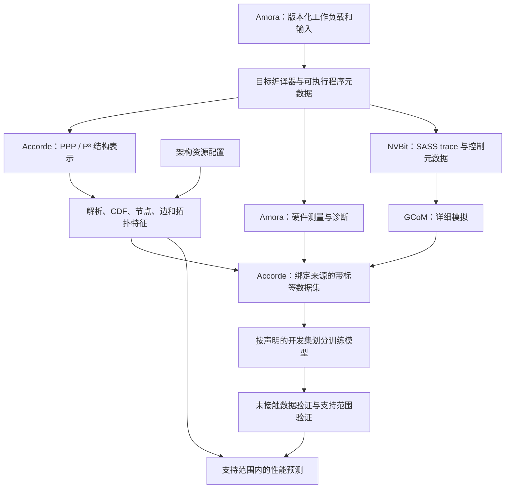
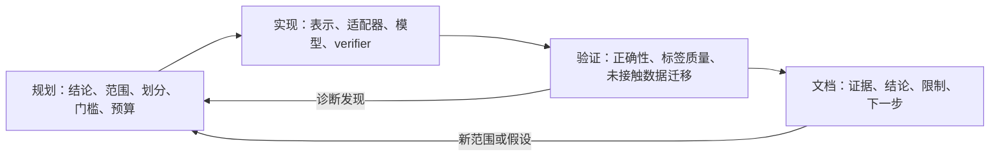

# GPU 性能建模：团队项目概览与 Accorde 开发入门

中文 | [English](gpu-performance-onboarding-en.md)

本文于 2026-11-11 为新团队成员编写，覆盖四个同级仓库：`modern-gpu-simulator-micro-2025`、`accorde`、`amora` 和 `dsh-research`。负责人已选择由 `dsh-research` 接替 autoresearch，负责研究工作流自动化。相对链接假定本地 `gpu-perf/` 与这些仓库同位于 `~/wk/`。下面的五项目标及其状态以项目负责人的本次要求为准；历史报告用于解释具体证据及其适用范围。

## 我们要构建什么

Accorde 的目标是快速预测加速器性能，并逐步泛化到开发模型时没有见过的 kernel、operation、shape 和硬件。核心方法是把工作量、依赖关系与硬件资源的显式描述结合起来，再用学习模型预测性能。详细模拟与硬件测量提供证据；通过验证的预测器让后续查询更便宜。

四个仓库分工如下：

| 仓库 | 职责 | 主要输入 → 输出 | 推荐起点 |
|---|---|---|---|
| Modern GPU Simulator，在这些项目中也称为 GCoM | 基于 trace 的 GPU 周期级建模，以及详细执行和资源诊断 | CUDA 编译程序的真实执行 → SASS trace 与元数据 → 模拟周期和统计量 | [项目概览](../modern-gpu-simulator-micro-2025/README.md) |
| Amora | Automated Microarchitecture Observation and Reverse-engineering for Accelerators；工作负载定义、微架构探针、测量适配器 | 工作负载/探针定义 + 工具与设备上下文 → manifest、原始观察、归一化测量和比较报告 | [开发指南](../amora/docs/development/nvidia-baseline-probes.md) |
| Accorde | 结构表示、特征生成、学习模型、泛化实验与模型资格验证 | kernel/operation 表示 + shape + 架构 + 带标签证据 → 特征、模型、支持范围判断与预测 | [PPP 实现指南](../accorde/src/backend/common/ppp/README.md) |
| dsh-research | 计划接替 autoresearch 的研究工作流；复用 dsh-superagent/DSH，提供通用策略与薄层 helper | 项目目标 + 冻结 manifest + 证据 → 经审阅的 checkpoint 与下一步研究行动 | [架构与里程碑索引](../dsh-research/.plan/261105-1555-review-1201-1230-and-milestones.md) |

Amora 维护可复用的工作负载定义和测量机制；Accorde 维护预测器、科学实验划分、资格判断与实验记录；模拟器维护详细执行模型。dsh-research 提供可复用的研究工作流策略与 helper；每个宿主项目（例如 Accorde）保留自己的科学代码、决策、证据、预算和持久状态。一项修改可以跨仓库，但每个产物应有明确的维护方，消费者通过版本化接口使用它。

## Accorde 的五项泛化目标

| 目标 | 含义与例子 | 当前路线图状态 | 评估时必须留出的对象 |
|---|---|---|---|
| 1. 跨 kernel / operation 泛化 | 根据已有资源与组合行为，预测新的 kernel 或 operation | **已完成**，限于通过验证的范围 | 完整 kernel identity 或 operation 类别，以及其全部相关数据行 |
| 2. 跨（operation + shape）联合泛化 | operation 与张量 shape 同时改变，例如新的 gather 组合和新的规模/长宽比 | **已完成**，限于通过验证的范围 | operation–shape 组合；直接验证两者的交互效应 |
| 3. 同代、跨芯片泛化 | 在 Hopper 代的不同芯片/SKU 之间迁移，处理 SM 数量、存储系统、频率和资源限制差异 | **进行中——Hopper** | 目标芯片/SKU 及其测量；预先声明零样本或少样本协议 |
| 4. 同 ISA、跨代泛化 | 在 NVIDIA 编程/ISA 体系内，从 Hopper 迁移到 Blackwell、Rubin | **尚未开始** | 目标代，以及对应编译器、可执行程序、资源语义和测量 |
| 5. 跨 ISA 泛化 | 迁移到其他加速器生态，包括 TPU，以及通过 ROCm 使用的 AMD GPU | **后续目标；广泛迁移仍需验证** | 目标 ISA/backend、原生执行契约与目标测量 |

“已完成”指路线图里程碑。具体发布模型仍受其通过验证时的硬件、编译器、语义、shape、拓扑和执行方式约束。目标 1、2 的完成不能代替目标 3–5 的证据。

目标 4 中的“同 ISA”表示共享 NVIDIA 编程/ISA 体系，不表示 Hopper 的 SASS 二进制或动态 trace 与 Blackwell、Rubin 完全相同。必须重新编译，并验证每代的 lowering 和指令语义。目标 5 中，ROCm 是 AMD 软件栈，对应 GPU 的原生执行模型与 ISA 需要单独映射。新增一个 `ArchConfig` YAML 建立的是描述接口，性能迁移精度还需要实测。

两项便于入门的证据：

- [Operation Gate v2](../accorde/reports/ppp_ir_mlp/roadmap_b_native_contraction_gather_v1/operation_gate_v2_v1/REPORT.md) 在十个新类别、240 个 motif 的独立确认中通过：拒绝全部 91 个按实验定义判定的失败，接纳 144 个 motif，其中观察到的失败为零。这是固定基准 shape 下的支持/风险门控；其 60% 覆盖率与预测器精度是不同指标。
- [operation 与 shape 可用性报告](../accorde/docs/shape_ood_study_comprehensive_report-zh.md) 记录 joint graph-edge 模型在八个图家族的 16 个未接触 compound case 上，MdAPE 为 **1.9899%**、p95 APE 为 **4.8765%**、覆盖率为 **100%**。报告还包括通过验证的拓扑迁移、七条语义 shape 路线及被拒绝的路线。其环境限定为冻结的 H100、编译器/runtime，以及 CUDA Graph/计时协议。

[九月技术总结](../accorde/docs/multi_isa_generalization/ppp-goals-exploration-tech-report-zh.md) 解释了早期失败和表示选择。其中“任意 kernel 泛化尚未解决”的结论属于当时的日期与研究范围，应结合后续通过验证的路线和本次路线图阅读。

## 系统如何协作



图中是可选择的路径，每次查询不必经过全部阶段。PPP 特征查询只需要 kernel 描述、shape 和架构配置，可以不使用 trace 或 GPU。新的精度结论需要合适的独立标签。硬件时间、模拟周期和解析估计必须保留各自来源。

### Modern GPU Simulator：详细执行证据

MICRO 2025 模拟器在 Accel-Sim 基础上改造了 SM/subcore 流水线、存储与依赖处理、SASS control bit 解释、指令缓存、静态指令元数据、protobuf trace 和 OpenMP 并行执行。本地 fork 还包含 TMA 处理、异步 copy-group 修复等 Hopper 相关工作。

| 代码区域 | 阅读目的 |
|---|---|
| [`util/tracer_nvbit/`](../modern-gpu-simulator-micro-2025/simulator-remodeled/util/tracer_nvbit/) | 对真实 CUDA 执行插桩 |
| [`util/traces_enhanced/`](../modern-gpu-simulator-micro-2025/simulator-remodeled/util/traces_enhanced/) | 静态元数据、指令解释、protobuf trace |
| [`gpu-simulator/`](../modern-gpu-simulator-micro-2025/simulator-remodeled/gpu-simulator/) | trace frontend 与模拟器构建 |
| [`gpgpu-sim/src/gpgpu-sim/remodeling/`](../modern-gpu-simulator-micro-2025/simulator-remodeled/gpu-simulator/gpgpu-sim/src/gpgpu-sim/remodeling/) | 改造后的 SM、subcore、存储和 TMA 实现 |
| `gpu-simulator/gpgpu-sim/configs/tested-cfgs/` 与 `gpu-simulator/configs/tested-cfgs/` | 成对的微架构与 trace 配置 |
| [`APEs/`](../modern-gpu-simulator-micro-2025/APEs/) | 已发布的应用/配置误差数据 |

模拟要求 trace 的指令语义与模拟器兼容，并使用匹配配置。与某版本模拟器一致，只能说明对该模拟器的准确性；硅片精度还需要硬件比较。配置里出现了某 opcode 或芯片名称，不能自动说明使用新同步、异步复制或 tensor 机制的优化 kernel 已通过验证。

### Accorde：从 trace 特征到可移植结构

较早的 `src/accorde/` 流程负责采集 trace、构建 C++ 特征生成器、运行 GCoM、组装训练数据和训练吞吐量模型，适合了解原始数据流。

可移植研究的基础代码位于 [`src/backend/common/ppp/`](../accorde/src/backend/common/ppp/)。PPP 是 **Phase-Population Profile**，也写作 **P³**：

- **Phase（阶段）**：计算、传输、同步或 collective 工作，以及显式依赖和重叠关系。
- **Population（工作区间群体）**：某个 shape 下有哪些 tile/工作区间、各有多少个，用来描述内部/边缘 tile、因果 attention 的工作量斜坡、角色划分等。
- **Architecture（架构）**：`ArchConfig` 中的资源容量、速率、延迟、fallback 和结构限制。

`evaluate(kernel, shape, arch)` 检查容量，生成资源特征和解析估计。每个标准资源 CDF 块包含 50 个分位数、50 个加权分位数和三个统计量。整体维度随 schema 与路线变化，应冻结实际特征名称和顺序，不应套用旧文档里的固定维度。

可序列化 PPP-IR 及 Gluon 相关扩展可保留执行分组、异步队列、同步对象、footprint 和循环依赖。表示/提取是否有效，与计时是否准确，要分别评估。部分确定性计时实验失败过，API 存在并不代表它已通过性能验证。

后期 operation–shape 模型结合节点、有向边、拓扑与 shape 相关工作量，形成多条路线组成的模型集合。调用方需要选择确切的已验证模型，并检查其支持契约。

### Amora：观察与可复现工作负载

当前 NVIDIA baseline registry 注册了 **36 个探针**，覆盖拓扑、算术、shared memory、cache、scheduler/register 行为、memory pipeline、tensor core、同步、传输和互连。根 README 开头“一个已实现、七个计划中”的描述属于早期状态；当前实现应参考 [registry](../amora/amora/probes/nvidia/baseline/__init__.py) 和开发指南。

每个探针保留四层证据：

| 层 | 用途 |
|---|---|
| `raw_observation` | 原始计时/counter、单位与证据来源 |
| `normalized_measurement` | 归一化值、fit status、不确定性和假设 |
| `backend_interpretation` | NVIDIA 特定解释与降级原因 |
| `simulator_estimate` | 通过显式契约映射到模拟器参数 |

kernel 探针验证生成的 SASS；适用的 NCU counter 来自独立 profiling pass。`unsupported` 或带条件的结果也是有效信息，下游必须保留其状态。

Amora 还维护确定性的 `ppp_canonical` CUDA benchmark 和 [`portable_core`](../amora/benchmark_generators/portable_core/README.md) 数学工作负载。core20/core24/core28 包含确定性输入、独立 oracle 和 NumPy/PyTorch/可选 JAX backend。正确性检查验证数学行为；原生 lowering、加速器指令选择和性能需要额外证据。

## 第一次动手：仅使用 CPU

建议两个项目统一使用 Python 3.11+；Amora 本身支持 Python 3.10+。每个命令块从注明的仓库根目录执行。已有 checkout 先检查 `git status --short`，保留无关修改。写入数据的示例每次使用新的输出目录。

### 配置并检查 Accorde

```bash
cd ../accorde
python3.11 -m venv .venv  # 用于新 checkout
.venv/bin/python -m pip install -e .
.venv/bin/python -m pip install pytest

git status --short
git rev-parse HEAD
git submodule status
```

任务需要旧 Torch/Optuna trainer 时再安装 `.[ml]`；具体研究模型可能有独立依赖契约。新 clone 可执行 `git submodule update --init --recursive` 初始化所需 submodule。不要为复现示例而重置已有工作区里被修改的 submodule。

用实际安装包命名空间执行无需 trace 的查询：

```bash
PYTHONPATH=src .venv/bin/python - <<'PY'
from backend.common.ppp.canonical.gemm import aligned_gemm_fp16
from backend.common.ppp.loaders import load_arch_config
from backend.common.ppp.evaluator import evaluate

arch = load_arch_config("src/backend/common/ppp/configs/sm_90_h100.yaml")
kernel = aligned_gemm_fp16()
for size in (1024, 4096):
    result = evaluate(kernel, {"M": size, "N": size, "K": size}, arch)
    print(size, result.is_feasible, len(result.cdf_features),
          result.bottleneck_per_kind, len(result.deferred_resources))
PY
```

在本次检查的版本中，两次查询都可行，输出 2,090 个特征，内部 tile 瓶颈为 `compute_matrix`，deferred resource 数量为零。它验证的是解析特征生成，没有运行 GEMM，也没有验证延迟。aligned factory 要求对齐 shape；非对齐尺寸应使用显式处理边缘 tile 的 producer。

### 配置 Amora 并冻结工作负载

```bash
cd ../amora
python3.11 -m venv .venv  # 用于新 checkout
.venv/bin/python -m pip install -e '.[portable-core,test]'

.venv/bin/python -m amora nvidia list
.venv/bin/python -m amora nvidia inspect-capabilities
.venv/bin/python -m amora benchmarks inspect ppp_canonical
.venv/bin/python -m amora benchmarks materialize ppp_canonical \
  --cases 8 --seed 20261111 --output out/onboarding-ppp/manifest.json

.venv/bin/python -m benchmark_generators.portable_core list --tier 20
.venv/bin/python -m benchmark_generators.portable_core freeze \
  --tier 20 --out out/onboarding-core20
.venv/bin/python -m benchmark_generators.portable_core check \
  --frozen out/onboarding-core20 --out out/onboarding-core20-check \
  --backends numpy --device cpu
```

core20 smoke check 覆盖 152 个 case。冻结包绑定工作负载与 runtime source 的 hash，并拒绝覆盖。先通过 CPU 练习理解 identity、shape、manifest 和 oracle，再引入硬件波动。

## 硬件练习：采集与核对证据

使用具备兼容 driver/CUDA 工具链的 Linux NVIDIA 主机。NCU、NVBit、反汇编工具和 counter 权限按任务需要准备。模拟器还需要 Accel-Sim 依赖和 protobuf 编译器/库；其 README 记录了测试过的编译器与 CUDA 组合。

先在 H100 上运行一个探针：

```bash
# 从 amora/ 执行
export AMORA_NVCC_ARCH=sm_90
.venv/bin/python -m amora nvidia run \
  --probe arithmetic_latency.dependent_chain \
  --output out/onboarding-h100-latency.json
```

检查设备/工具 identity、SASS 验证、单位、fit status 和不确定性。CLI 成功退出不能单独证明某个物理常数可用。普通计时和 profiling 应分别采集，因为 profiler replay 可能改变执行行为。

模拟器构建从准备好的 `modern-gpu-simulator-micro-2025/simulator-remodeled/` 执行：

```bash
# 先为约定的 CUDA 安装设置 CUDA_INSTALL_PATH 和 PATH
source ./gpu-simulator/setup_environment_no_git.sh
make -j -C ./gpu-simulator/
```

可执行文件为 `gpu-simulator/bin/release/accel-sim.out`。tracer 构建/采集见模拟器 README，需要真实 GPU 执行。增强 trace bundle 包括 `dynamic_trace.pb`、静态 `extra_info/enhanced_execution_info.json` 和 threadblock 数据；应一起保留并绑定 hash。

Amora 可以显式选择独立模拟器 checkout 或 Accorde 固定的副本：

```bash
# 从 amora/ 执行；本例选择准备好的独立模拟器 checkout
export GCOM_ROOT="$(cd ../modern-gpu-simulator-micro-2025/simulator-remodeled && pwd)"
.venv/bin/python -m amora gcom_cuda inspect-capabilities
```

`GCOM_ROOT` 指向 `simulator-remodeled/`，不是上层仓库。运行前检查成对配置、binary 和 tracer。`gcom_cuda run`、`compare` 提供探针执行和硬件/模拟器比较；按所选 SKU profile 阅读 `--help`。本次检查的 Amora profile 是 `gcom_h100`。

canonical benchmark campaign 的顺序是：

1. 生成冻结 manifest。
2. `amora benchmarks classify ppp_canonical --manifest ...` 采集基础 NCU 证据，生成绑定 digest 的尺寸排序。
3. `detail` 按 small → medium → large 顺序采集详细硬件/GCoM 证据。
4. `review` 记录明确的证据判断，下一档 `detail` 需要对应 review marker。

启动前阅读 [benchmark CLI 示例](../amora/README.md) 和 [detail 实现](../amora/amora/benchmarking/detailed.py)。保留尺寸分档成员和不可覆盖的运行目录，不应只选择容易完成的 case。

体验旧 Accorde 七步流程时，使用新的可丢弃 checkout：

```bash
# 从已配置的 NVIDIA Linux 主机上的可丢弃 accorde/ checkout 执行
source src/accorde/infra/env_docker.sh
docker compose build
docker compose run --rm shell \
  ./src/accorde/infra/test_pipeline.sh MaxFlops
```

这是集成演示，不是五项目标的资格验证。当前脚本会删除所选 benchmark 已有的 `traces/` 并重建日志，因此本例要求使用可丢弃的 checkout/输出。

## Accorde 的典型开发流程：规划 → 实现 → 验证 → 文档



### 规划：把目标变成可检验的结论

先读 [`AGENTS.md`](../accorde/AGENTS.md)、[规则依据](../accorde/.agent/rules-rationale.md)、[`.plan/LANDMARKS.md`](../accorde/.plan/LANDMARKS.md)、相关 tracker 和最新已发布报告。接替工作流还要读 dsh-research 的[项目状态/自主执行/反馈契约](../dsh-research/.plan/261105-1705-contract-project-state-autonomy-and-feedback.md)与[执行 tracker](../dsh-research/.plan/tracker/261105-1555-milestone-execution.md)。选择执行路线前，解析宿主项目的 canonical root、项目策略、runtime/profile lock 与当前 campaign state。已有 campaign 仍可能依赖 [`.autoresearch/program.md`](../accorde/.autoresearch/program.md) 及其旧 runtime lock。历史 prompt 对应特定实验，不是启动新实验的指令。

建立简洁的目标计划，例如 `.plan/YYMMDD-HHMM-plan-hopper-chip-transfer.md`，并在 `.plan/trackers/` 建立精简 tracker；dsh-research 使用 `YYMMDD-HHMM` 文件名约定。详细分支计划、运行输出、checkpoint 和原始证据放到宿主项目声明的 artifact root。接替方案使用 `local_artifacts/autoresearch/dsh/<goal>/` 保存这些记录，使用 `.autoresearch/dsh/` 保存持久状态。`.plan/` 保留引用不可变计划/证据快照的精选摘要；精简报告放 `reports/`，可复用指南放 `docs/`。

采集前冻结以下决策：

| 计划项 | 具体要求 |
|---|---|
| 结论 | 对应五项目标中的哪项；零样本还是明确预算的少样本 |
| Serving 契约 | 执行前可获得的输入；语义、shape、dtype、编译器和执行方式 |
| Endpoint | 直接秒数、模拟周期，或严格定义的 OPC |
| 数据划分 | 与结论一致的完整 kernel、operation、联合 operation–shape、chip、generation 或 ISA holdout |
| Baseline | 简单解析/缩放模型，以及适用的已有已验证路线 |
| 支持与门槛 | 覆盖率、误差/尾部/分组要求、正确性、标签质量、不确定性 |
| 可复现性 | source、workload、architecture、compiler、model、environment 和 dataset hash |
| 执行 | 硬件 identity、完整实验单元边界、采集 + 后续建模总预算、恢复规则 |

目标 2 需要匹配的 baseline、仅 operation 改变、仅 shape 改变、二者共同改变四组 cell。两个边际结果相乘不能建立联合交互泛化。目标 3 必须在采集目标数据前区分目标芯片 calibration 与零样本预测。

### 实现：让修改落在正确的维护层

| 修改 | 维护方与常见文件 |
|---|---|
| 可复用工作负载语义、确定性输入、oracle | Amora `benchmark_generators/` |
| CUDA probe、SASS expectation、计时/counter collector | Amora `amora/probes/nvidia/baseline/`、`amora/backends/nvidia/` |
| 模拟器指令/资源/计时行为 | GCoM trace 解释、remodeled SM、成对配置 |
| PPP producer、shape population、资源绑定 | Accorde `canonical/`、`kernel.py`、`phase.py`、`binding.py`、`evaluator.py` |
| 架构 profile 或 calibration | Accorde `arch_config.py`、`configs/`、`calibration_store.py` |
| 可序列化表示、解析数据集适配 | Accorde `ppp_ir.py`、`ppp_ir_loader.py`、`ir_training.py` |
| 实验专用采集/模型/验证 | Accorde `tools/ppp_profiling/`，以及仍被 campaign 使用的既有 `tools/autoresearch_ppp/` adapter；保留冻结的科学契约 |
| 通用研究工作流策略、manifest/证据 helper、自动审阅流程 | dsh-research 计划中的 skill/helper package；调用既有 DSH 服务与项目自己的科学工具 |

分别交付数学等价性、编译实现对应性和性能精度。新 profile 必须定义速率范围与单位：每 SM 还是整卡，byte 还是 sector，operation 还是 instruction，cycle 还是 second。

identity 名称用于 join、审计和划分，不能成为模型学习的 serving 捷径。数值 shape 和通过支持契约接纳的语义描述符可以是合法特征；类别名称和 profiler 提供的目标信息不能泄漏进去。保留 `PPP_ANALYTICAL`、模拟器标签、CUDA 实测、PTO cost-model 等来源，使合成估计不会被悄悄当作硅片观察。

### 验证：为确切结论取得证据

按成本从低到高验证：

1. **契约与正确性**：schema 加载、shape/边缘 population、operation/byte 数量、容量、dtype、oracle、编译实现。
2. **证据质量**：device/compiler fingerprint、完整 source closure、重复性、同步、warmup/顺序、标签可归因性、预先声明的失败处理。
3. **预测协议**：在接触目标测量前冻结 candidate、feature schema、admission 决策与预测。
4. **泛化**：按所宣称的 holdout 评估；报告总体与各 operation/shape/chip 指标、覆盖率、p95/尾部，以及适用时的绝对时间误差。
5. **判断**：保留原门槛，记录通过、诊断性失败或未评估。用新的预先设计实验调查失败。

针对 PPP/configuration 修改，可选择以下 CPU 检查：

```bash
# 从 accorde/ 执行
PYTHONPATH=src .venv/bin/python -m pytest \
  src/backend/common/ppp/tests/test_evaluator.py \
  src/backend/common/ppp/tests/test_capacity.py \
  src/backend/common/ppp/tests/test_arch_config.py

# 从 amora/ 执行，适用于工作负载/探针契约修改
.venv/bin/python -m pytest -m "not cuda and not ncu and not nvbit"
```

这些测试验证软件行为。硬件资格仍需要冻结 campaign。已有实验常用 MdAPE ≤5%，部分路线使用 p95 APE ≤10%；新实验必须预先论证并冻结自己的门槛，不能自动继承无关历史实验的计时洁净度要求。

不能通过用 confirmation 目标重新训练、删除困难数据行、计时后调 cutoff 或重命名 holdout 来改善失败的确认。使用目标数据 calibration 后，结果属于声明协议下的少样本/监督迁移。

### 文档：留下可复现的决策

发布问题、假设、最终实现、确切 source/model/data/config hash、命令、标签协议、划分、baseline 比较、覆盖率、误差与门槛判断。说明影响使用范围的失败或未测试路线，以及下一步有效行动。

Accorde 要求 artifact 保留用户 prompt 原文，修改既有 artifact 时增加带时间戳的 `## Revision History`；commit message 不含 `Co-Authored-By`。Amora 的规划/设计 Markdown 使用仓库相对路径，覆盖文档时记录 revision history。API/使用文档应随报告一起更新。

当其他成员能复现软件检查、从 artifact 重建证据决策，并明确模型可以在哪里使用时，一项修改才算完成。

### dsh-research：接替 autoresearch 的研究工作流

[最小重建计划](../dsh-research/.plan/261103-1230-plan-dsh-research-plugin-rebuild.md)将 dsh-research 定义为运行于已配置 dsh-superagent 与 DSH 服务之上的小型 skill/policy/helper package。既有服务提供 worker、job、通信、并发、恢复、独立审阅与原生持久化；dsh-research 提供冻结研究 manifest、领域证据检查、checkpoint/下一步行动策略与限定范围的 admission 检查。模型正确性与资格验证仍由 Accorde 的科学工具和 verifier 负责。

在本次检查的 2026-11-11 版本中，[执行 tracker](../dsh-research/.plan/tracker/261105-1555-milestone-execution.md)将 M0 标为文档已准备供审阅，M1–M6 的实现、资格验证、pilot 与切换仍为 planned。先阅读设计与当前状态：

```bash
# 从 gpu-perf/ 执行；只读检查接替工作流。
cd ../dsh-research
git status --short
git rev-parse HEAD
sed -n '1,100p' .plan/261105-1555-review-1201-1230-and-milestones.md
sed -n '1,100p' .plan/261105-1705-contract-project-state-autonomy-and-feedback.md
sed -n '1,80p' .plan/tracker/261105-1555-milestone-execution.md
```

[归属契约](../dsh-research/.plan/261105-1705-contract-project-state-autonomy-and-feedback.md)要求研究记录留在显式配置的 canonical project root，各 worker 目录与 worktree 共用该根目录。对 Accorde，通过验证的接替路线使用以下目标位置：

| 持久内容 | 维护方与目标位置 |
|---|---|
| 目标计划、精简 tracker、科学决策 | Accorde `.plan/` |
| 冻结 manifest、详细计划、结果、verifier/reviewer receipt、反馈快照 | Accorde `local_artifacts/autoresearch/dsh/<goal>/` |
| 耦合的预算/attempt/反馈记录；原生 runtime、Session 与已解析 profile 状态 | Accorde `.autoresearch/dsh/` |
| 可复用 skill/helper/template，以及 package 自身的开发计划 | dsh-research |

通过验证后，author 按规划 → 实现 → 验证 → 文档推进，在声明的 checkpoint 接受独立 agent 审阅，然后在项目既有授权范围与预算内继续，或诊断并调整方向。团队反馈被捕获并评估为 adopted、rejected、deferred 或 stale；采用的版本关联到修改后的行动、实际执行效果与回复。常规迭代无需等待人工到场或留言。只有科学方向耗尽并经过独立审阅后，才请求人工科学 steering；操作性 hold 保留各自的限制与恢复规则。

[M6 切换计划](../dsh-research/.plan/261105-1555-m6-new-work-cutover-and-continuity.md)分别处理新任务采用、启用新鲜 confirmation 与旧依赖退役。经核对的单 writer 交接完成前，保留活跃旧 campaign 的 runtime pin、既有消耗、confirmation-opening 历史和不可变证据。`.autoresearch/`、`local_artifacts/autoresearch/` 与 `tools/autoresearch_ppp/` 在过渡期间仍是有效的项目路径。更换工作流 package 本身不会产生新的科学证据。

## 首项贡献示例：Hopper 跨芯片迁移

假设团队要把一条已验证的 H100 路线扩展到另一款可用 Hopper SKU。这属于目标 3。下面是建议的开发练习，不是已取得的跨芯片结果。

1. **规划**：选择实际源芯片与目标芯片，冻结共同 operation/shape、dtype、compiler、执行方式、目标 holdout、baseline 与门槛。区分纯架构感知迁移和任何少样本目标 calibration。
2. **实现**：用 Amora 记录目标硬件/工具上下文并采集相关 probe；新增带来源依据的 Accorde architecture profile 和必要实现绑定。检查芯片差异是否改变 occupancy wave、存储 regime 或 lowering，不能假定频率比例足够。
3. **验证**：复现源端行为、运行 workload oracle，在目标计时前生成预测，再按完整单元采集未接触目标标签。与频率/SM/带宽缩放 control 比较，报告各 regime 的精度和覆盖率，包括被拒绝或不支持的 case。
4. **文档**：发布两颗芯片 identity、全部版本/hash 绑定、数据划分、零/少样本预算、误差/覆盖率结果、限制，以及 release/admission 决策。模型与消费者接口都应版本化。

如果目标需要新语义，或标签未通过质量检查，记录边界后做诊断。目标变为新一代时，任务归入目标 4；backend 变为 TPU 或 ROCm 时，归入目标 5，并补齐原生执行与资源映射。

## 建议的第一周安排

| 阶段 | 活动 | 产出 |
|---|---|---|
| 第一天 | 阅读三个科学项目概览、PPP 代码、五项目标，以及 dsh-research 架构/tracker | 能解释四个仓库、trace 与 PPP 路径，以及接替工作流的当前状态 |
| 第二天 | 运行 CPU PPP 查询与冻结 core20 check | 理解 shape population、feature、manifest 和 oracle |
| 第三天 | 追踪一个代表性结果，从 source 到 label、prediction、report | 能解释其划分、来源、覆盖率与结论 |
| 第四天 | 在分配的 GPU 主机上检查一个 probe 和 SASS/证据层 | 带明确单位和不确定性的有限观察 |
| 第五天 | 通过四阶段完成一项小型、已约定贡献 | 可审阅修改、针对性检查和可复现报告 |

## 术语与常见错误

| 术语 | 含义 |
|---|---|
| ISA / SASS / PTX | 指令集契约 / NVIDIA 原生机器指令 / NVIDIA 虚拟指令表示 |
| SM / warp / CTA | Streaming multiprocessor / CUDA 执行组 / cooperative thread array，通常对应 thread block |
| TMA / WGMMA | Hopper tensor-memory 传输机制 / warpgroup 矩阵操作机制 |
| Gluon / TTGIR | 用于实现描述的 Triton 编程/编译路径及其 GPU 中间表示 |
| OPC / IPC | 每周期 operation / instruction；一条 tensor 指令可包含大量算术操作 |
| APE / MdAPE / MAPE | 单 case 绝对百分比误差 / 其中位数 / 其均值 |
| OOD | 沿预先声明轴的分布外输入 |
| Calibration / confirmation / promotion | 在声明 calibration 数据上拟合 / 用未接触证据确认 / 在门槛与范围内接受 artifact |
| Admission / coverage | 模型是否支持某输入 / 在声明总体中支持的比例 |

常见错误包括：随机按行划分泄漏 kernel identity；把 shape 插值成功当作新 kernel 泛化；把边际 gate 成功当作联合成功；把 profile 存在或 NumPy 正确性当作硬件资格；给无需 trace 的预测器加入 NCU/Nsight 实测 serving 特征。

OPC 转换也需要明确计数契约。`cycles = operations / OPC` 只适用于分子、分母描述同一区间和范围的情况；转换为秒还需要合适频率和执行协议。相加 per-kernel 时间隐含串行假设，图执行、重叠、launch 开销和 cache 交互可能需要已验证的组合模型。stall share 也不能自动相加成因果延迟分量。

## 来源版本与教程验证

原始教程来源版本（r1–r2）为 GCoM `511202c4`、Accorde `7c85e754`、Amora `6955c525`。Accorde commit 固定的模拟器 gitlink 是 `3a4189cd`，本地 submodule HEAD 为 `b15076e8`，独立 GCoM checkout 又是第三个版本。应固定实际所选模拟器 source、config 和 binary，不能把这些副本视作可互换。保留了工作区已有的无关修改。

原始教程验证（r1–r2）包括：两次 PPP 查询、36-probe registry 和示例 CLI 参数、八 case canonical manifest、core20 freeze、**152/152 NumPy 正确性检查通过**，以及 PPP evaluator、capacity、architecture 的 **15/15 针对性测试通过**。Amora 现有 virtual environment 缺少可选 NumPy extra，因此 portable 检查使用 Accorde 已有 NumPy 的解释器，将 Amora 加入 `PYTHONPATH`，并在临时目录运行。Accorde 环境缺少 pytest 和 pip；测试复用了 Amora 已安装的纯 Python pytest 依赖，禁用 plugin autoload 和 cache 写入，保留了项目环境。当时两份原始指南的 54 个本地链接均有效，九个可执行命令块一致并通过 shell 语法检查；该次验证没有执行 GPU 采集、模拟器构建/运行、Docker pipeline 或新的泛化 campaign。

接替工作流修订（r3）检查了 dsh-research HEAD `9d7dea67`、最小重建计划、项目归属/自主执行契约、里程碑 tracker 与 M6 切换流程。该 checkout 包含策略和规划 artifact，实现与切换仍待执行。全部 66 个本地链接有效；每种语言的九个 Bash 命令块移除注释后完全一致，并通过 shell 语法检查，其中八个科学命令块保持原样。新增的只读 dsh-research 检查命令块执行成功，来源 checkout 的状态保持原样。上述 PPP/Amora 科学检查属于 r1–r2。

延伸阅读：[PPP-IR 介绍](../accorde/docs/multi_isa_generalization/ppp-ir-intro.md)、[训练 schema](../accorde/docs/training_data_schema.md)、[TPU enablement 差距分析](../accorde/docs/multi_isa_generalization/ppp-tpu-v6-v7-v8-enablement-gap-analysis.md)、[Amora 规则](../amora/RULES.md)、[模拟器引用与构建说明](../modern-gpu-simulator-micro-2025/README.md)。

## User Prompt, Verbatim

```text
understand ~/wk/modern-gpu-simulator-micro-2025 ~/wk/accorde and ~/wk/amora，write a summary and tutorial to ramp up a new team member in *-en.md and *-zh.md
The goal of accorde is 5 folds:
1. cross-kernels/operations generalization (done)
2. cross-&#40;operation+shape&#41; generalization (done)
3. same generation, cross-chip generalization (ongoing, hopper generation)
4. same ISA, crosss-generation generalization (not started, hopper/blackwell/rubin)
5. cross-isa generalization (TPU, ROCm, etc)
In the tutorial, please describe the typical workflow for developing with accorde (planning -> impl -> validation -> doc).
```

新增要求（r3）：

```text
add ~wk/dsh-research to the gpu-performance markdowns. it will replace autoresearch.
```

## Revision History

| Revision | 日期 | 修改 |
|---|---|---|
| r1 | 2026-11-11 | 根据负责人的五项目标、当前 PPP/Amora 代码、operation–shape 验证报告和已运行 CPU 示例，创建仓库依据明确的中文项目概览与入门教程。 |
| r2 | 2026-11-11 21:55 UTC | 补充通过的 PPP 针对性测试、双语命令一致性、本地链接检查，以及已有环境依赖的验证处理方式。 |
| r3 | 2026-11-11 22:10 UTC | 新增计划接替 autoresearch 的 dsh-research、项目自有状态、自主审阅/反馈流程、只读检查命令，以及独立的新任务采用/confirmation/旧依赖退役门槛；将本地目录更正为 gpu-perf，保留新增要求原文，并验证 66 个链接与双语命令。 |
