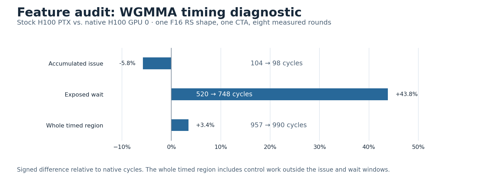
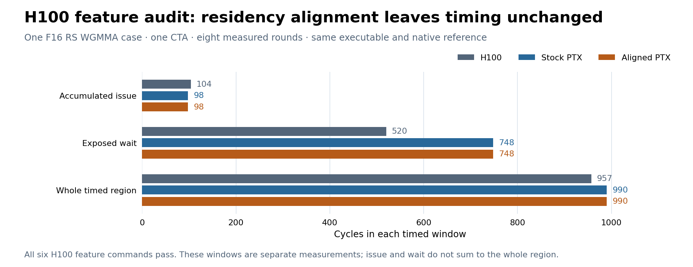

# FlashGPU-Sim GPU-feature validation report

## Verdict

The advertised feature list has substantial executable support, but it describes
**implemented subsets**, not complete PTX coverage or generally validated cycle
accuracy. TMA, selected MMA/WGMMA, CTA mbarrier, and shared matrix transfers pass
the executed suites. Independent checks expose **TMEM allocation/capacity gaps,
incorrect DSM atomic results, and tcgen05 frontend failures**.

The investigation is complete at the pinned revision. A failing feature check is
a finding, not an unfinished validation step. Fixing the subject simulator is a
separate task.

The H100 residency-aligned follow-up now completes all six feature replay
commands, with the same eight-round WGMMA timing windows. H200 and Blackwell
findings retain their original scope; see the separate H100 follow-up below.

## User requests

```text
investigate ~/wk/FLashGPU-Sim, validate the claims on
GPU features: TMA, TMEM, DSM, tcgen05, mbarrier, mma, wgmma, ldmatrix/stmatrix, etc.
persist the validation plan in .plan/ and execute it with a tracker.
```

```text
naming convention for the markdowns: {YYMMDD}-{HHMM}-*.md
```

```text
re-org the code layout. or better, add the code to ~/wk/amora/
```

```text
read amora's readme and docs for the best code layout
```

```text
any readable reports with figures for local_artifacts/stock-flashgpu-h100 and local_artifacts/flashgpu-validation?
```

```text
re-execute the 3 experiments with flashGPU-SIm simulated H100 config aligned with the real H100.
```

```text
update the two reports?
```
```text
move the reports to ./reports/, and the linked jpg/svg to ./reports/assets/
```

## Subject, method and environment

- Requested path resolves to `../FlashGPU-Sim` (case differs from the prompt).
  Branch `flash`, commit `01bdef86caf4b9b6432abcbe3c04b38b86675cdc`, clean tracked source before and after.
- Claim: [README feature table and DSM caveat](https://github.com/FlashGPU-Sim/FlashGPU-Sim/blob/01bdef86caf4b9b6432abcbe3c04b38b86675cdc/README.md#L27).
  Feature names are a union across frontends and presets, not a guarantee that
  every listed feature executes on every architecture.
- Used CUDA 13.3.73, GCC 11.3.0 and Python 3.11.2. Eight H100 80GB GPUs were
  available; native checks used GPU 0. Driver: 595.71.05.
- Built the simulator and selected suites from source. Used fresh run directories,
  explicit presets and timeouts. Native runs load CUDA's runtime; simulator runs
  load FlashGPU-Sim's replacement runtime.
- Compared exact Hopper binaries against the same CPU assertions on hardware and
  simulator where possible. SM120-only test sources were additionally compiled
  for `sm_90a/compute_90a` in a separate build directory for native checks.
- Fetched NVIDIA PTX ISA **9.5** documentation. The HTML SHA-256 and 11 exact
  feature sections are retained in [reference excerpts](../local_artifacts/flashgpu-validation/nvidia-ptx-excerpts.json).
  Current documentation adds variants beyond this simulator's declared scope;
  these additions are not treated as evidence of regressions.
- No B200 or RTX 5090 was available. Blackwell component/functional results and
  archived hardware measurements do not become fresh Blackwell silicon evidence.

Source/configuration hashes and detected tool/device identities are in
[source inventory](../local_artifacts/flashgpu-validation/source-inventory.json). Full case outcomes,
including initial invocation failures and later corrected runs, are in
[structured results](../local_artifacts/flashgpu-validation/results.json).

## Feature matrix

| Feature | Functional verdict and executed scope | Limits and timing verdict |
| --- | --- | --- |
| TMA | **Validated subset.** All 38 SM120 PTX cases pass: bulk stores/groups, transaction accounting, producer/consumer, host/device maps, rank 1–5 mapping, negative coordinates and F32/F32_FTZ reduction. Eleven selected H200 multicast cases pass. Native H100 passes 35 initial cases plus both reduction cases in a fresh process. | Native device-created-map negative-coordinate test raises illegal instruction; see exception below. Tensor reduction timing reuses stores without destination atomic/read/serialization cost. Multicast fans out functionally with fixed added latency and no DSM-fabric contention. Full proxy ordering is not established. |
| TMEM | **Partial; capacity contract contradicted.** 27 component cases pass; a four-warp x1 store/load round trip passes when automatic SASS guidance is disabled. | Manager allocates 1024 live columns, accepts column 512 and row 128, and returns base 1024 after deallocation. NVIDIA specifies 512 columns × 128 rows per CTA on SM100 and blocking allocation when capacity is unavailable. No banking, contention or independent TMEM byte-rate model. |
| DSM | **Partial; standard cluster atomic path contradicted.** Forty existing cluster/DSM/mbarrier cases pass; 44 endpoint/fabric component cases pass. Independent native H100 tests pass 5/5. Simulator passes remote store and standard remote-arrive/owner-wait, but fails 3/5 independent cases involving remote atomic add. | Failure persists with explicit cluster fence and with PTX guidance disabled. Only H200 preset enables DSM; architecture topology is inferred. Other atomic kinds and reductions, cross-GPC DSM, preferred cluster dimensions and cluster scheduling policy are outside scope. General H200 workload timing remains unqualified. |
| tcgen05 | **Partial; tested default kernel admission fails.** Eight async timing component cases and two F16 MMA computation cases inside the TMEM component suite pass. Four-warp TMEM transfer is executable after a config override. | Default SM100 preset aborts on a missing `tcgen05.st` SASS guide anchor. Independent MMA candidate crashes in control-flow preprocessing even with both reorder options disabled. Shared descriptors are linearized, ignoring strides/swizzles. Execution is restricted to `cta_group::1`, dense F16/BF16 → F32, M=64/128, N=8..256 by 8, K=16. No two-CTA, sparse, block-scaled or additional precision support. B200 uses a fixed 160-cycle tail and unlimited async queue; other timing tables are provisional. |
| mbarrier | **Validated subset.** 22/23 SM120 PTX cases pass, with one documented skip; all 23 native Hopper cases pass. Standard remote arrival with owner-local wait passes independently. | Phase/arrival/transaction counts and lane-divergent waits are covered. The model suspends a whole warp and uses deterministic hint deadlines/provisional defaults. Remote try-wait is a simulator extension. A module document still says cluster synchronization is unsupported despite the gated implementation. |
| mma.sync | **Validated subset.** All 29 SM120 PTX and all 29 native H100 cases pass. F16: m16n8k8/m16n8k16/m8n8k4; BF16: m16n8k8/m16n8k16; TF32: m16n8k4/m16n8k8; S8: m16n8k16/m16n8k32/m8n8k16. | FP64, S4/U4 and B1 are absent in this path; extra U8/F16 branches are not qualified by this suite. Floating conversion/accumulation approximations and tolerance-based checks do not establish all hardware rounding/exceptional behavior. No general per-shape timing qualification. |
| wgmma | **Validated subset.** All 25 Hopper native/PTX cases pass: dense F16 including register/shared and shared/shared paths, BF16, TF32, FP8, integer and B1 minimal shapes. Nine strict-SASS F16 cases and two detailed-SASS timing cases pass. | F16 implementation accepts N=8..256 by 8; other dense families are limited to m64n8. Sparse and F16 accumulator-output variants are unsupported. NVIDIA's instruction requires SM90a. One matched timing point exposes wait error despite close total cycles; see below. |
| ldmatrix/stmatrix | **Validated subset.** Eight matrix cases pass as part of 16 native/PTX matrix/cp.async checks: m8n8.b16 x1/x2/x4 without transpose, x1 transpose. Two x4 strict-SASS checks pass. | PTX transpose x2/x4 is accepted but lacks the current integration checks. Other Blackwell shapes/packed widths are outside implemented shape scope. Natural row alignment is not validated by the simulator. No independent matrix-transfer timing accuracy claim. |
| Related mechanisms | **Validated selected checks.** cp.async source-size/zero-fill cases pass on H100 and PTX; 24 bulk-group component cases pass; cluster rank/launch and selected multicast checks execute. | Proxy fences, dynamic register allocation, multicast transport and shared-atomic timing have documented approximation boundaries. “Etc.” is not interpreted as complete support for unenumerated PTX instructions or memory-consistency behavior. |

Detailed support boundaries are in the subject's
[TMA notes](https://github.com/FlashGPU-Sim/FlashGPU-Sim/blob/01bdef86caf4b9b6432abcbe3c04b38b86675cdc/src/gpgpu-sim/flash/tma.md#L1),
[TMEM/tcgen05 notes](https://github.com/FlashGPU-Sim/FlashGPU-Sim/blob/01bdef86caf4b9b6432abcbe3c04b38b86675cdc/src/gpgpu-sim/flash/tcgen05/README.md#L1),
[cluster notes](https://github.com/FlashGPU-Sim/FlashGPU-Sim/blob/01bdef86caf4b9b6432abcbe3c04b38b86675cdc/docs/cluster_noc/README.md#L1),
[MMA notes](https://github.com/FlashGPU-Sim/FlashGPU-Sim/blob/01bdef86caf4b9b6432abcbe3c04b38b86675cdc/src/gpgpu-sim/flash/mma/README.md#L1),
[numerical model](https://github.com/FlashGPU-Sim/FlashGPU-Sim/blob/01bdef86caf4b9b6432abcbe3c04b38b86675cdc/src/gpgpu-sim/flash/mma/tensor_mma.md#L1),
[matrix-transfer notes](https://github.com/FlashGPU-Sim/FlashGPU-Sim/blob/01bdef86caf4b9b6432abcbe3c04b38b86675cdc/src/gpgpu-sim/flash/ld_st_matrix.md#L1) and
[SASS coverage](https://github.com/FlashGPU-Sim/FlashGPU-Sim/blob/01bdef86caf4b9b6432abcbe3c04b38b86675cdc/src/gpgpu-sim/flash/sass/COVERAGE.md#L1).

## Findings that change the support claim

### TMEM has no finite allocation/reuse contract

The independent host probe calls the production manager directly. It reports:

```text
two_live_512_column_allocations first=0 second=512 count=2
column_512_readback=305419896
allocation_after_dealloc base=1024
row_128_readback=2271560481
```

The primary capacity finding uses two legal 512-column allocation requests:
the second returns instead of blocking for unavailable capacity. Additional
out-of-range row/column accesses demonstrate missing validation; they are not
claimed to be legal PTX accesses.

[Production allocation](https://github.com/FlashGPU-Sim/FlashGPU-Sim/blob/01bdef86caf4b9b6432abcbe3c04b38b86675cdc/src/gpgpu-sim/flash/tcgen05/tmem.cc#L35)
increments `next_base` against a 16-bit address limit, rather than a 512-column
resource. Deallocation retains retired storage for replay and never reuses the
column range. The existing `RetiredAllocationRemainsAccessibleUntilCtaClear`
case explicitly accepts accesses after deallocation.

NVIDIA's [TMEM contract](https://docs.nvidia.com/cuda/parallel-thread-execution/index.html#tensor-memory)
and [allocation contract](https://docs.nvidia.com/cuda/parallel-thread-execution/index.html#tcgen05-instructions-tcgen05-alloc-dealloc-relinquish-alloc-permit)
establish the capacity and blocking behavior. The raw observations reproduce
both before and after moving the code into Amora.

### DSM atomic add does not update peer memory in the independent standard path

The reproducer uses a real two-CTA CUDA cluster, `cluster.map_shared_rank`,
remote stores/`atomicAdd`, and cluster synchronization around initialization
and readback. Each lane addresses a different word. Its generated PTX contains
`atom.shared::cluster.add.u32`; this is not the documented unsupported
`red` path.

| Independent case | Native H100 | H200 PTX simulator |
| --- | --- | --- |
| Remote store only | 2000 + lane | 2000 + lane: pass |
| Remote atomic only | 1007 + lane | 1000 + lane: fail |
| Remote store then atomic | 2007 + lane | 2000 + lane: fail |
| Remote store, fence.sc.cluster, atomic | 2007 + lane | 2000 + lane: fail |
| Remote mbarrier arrival, owner-local wait | Every owner lane gets 1 | Pass |

The atomic-only mismatch persists after disabling automatic SASS guidance.
The explicit fence case means a simple missing producer fence does not explain
the observation. Root cause is not asserted: both frontend admission and the
atomic request/completion path need investigation. Existing fabric tests and
other integration forms passing do not qualify this instruction/addressing form.

### tcgen05 frontend admission blocks the independent MMA check

The independent candidate is accepted by CUDA 13.3's SM100a compiler. The
default SM100 preset then aborts at module registration:

```text
SASS-guided reorder fatal: ordered anchor 'tcgen05.st'
at original index 14 has no primary SASS guide item
```

Disabling `gpgpu_ptx_reorder_sass_guided` lets the four-warp TMEM round trip pass.
The subsequent MMA candidate crashes. It also crashes when selected alone and
when `gpgpu_ptx_reorder=0` is additionally set. GDB locates the failure before
tensor arithmetic:

```text
SIGSEGV
function_info::connect_basic_blocks at ptx_ir.cc:597
function_info::do_pdom
cudaLaunchInternal
```

This is a reproduced control-flow preprocessing failure, not a demonstrated
MMA arithmetic error. The candidate uses uniform inputs, so even successful
execution would not qualify descriptor layout. Separately,
[shared-operand reads](https://github.com/FlashGPU-Sim/FlashGPU-Sim/blob/01bdef86caf4b9b6432abcbe3c04b38b86675cdc/src/gpgpu-sim/flash/tcgen05.cc#L242) explicitly
read contiguous words while ignoring descriptor leading/stride offsets and
swizzles. This is narrower than general dense descriptor-based tcgen05 support.

### TMA native test exception and context contamination

The full SM120 PTX suite passes 38/38. On H100, the unchanged test suite compiled
for SM90a passes its first 35 cases, then
`TmaEdgeCasesTest.NegativeCoordinateZeroFillsLeadingElements` returns CUDA
error 715 (illegal instruction) at device synchronization. The following two
reduction tests fail allocation because that process's CUDA context is poisoned.

Fresh-process checks reproduce the edge failure and pass both reduction cases.
The result is therefore **37 unique native TMA case passes and one edge-case
failure**, not three independent feature failures. This edge test constructs a
tensor map on device; its failure does not establish that negative-coordinate
TMA is unsupported by Hopper silicon. It leaves that exact construction/encoding
path unvalidated against hardware.

### Some module documentation is stale or broader than execution

The [mbarrier module limits](https://github.com/FlashGPU-Sim/FlashGPU-Sim/blob/01bdef86caf4b9b6432abcbe3c04b38b86675cdc/src/gpgpu-sim/flash/mbarrier.md#L64)
say only CTA-scoped barriers are supported, while the
[cluster module](https://github.com/FlashGPU-Sim/FlashGPU-Sim/blob/01bdef86caf4b9b6432abcbe3c04b38b86675cdc/docs/cluster_noc/README.md#L11) and executed independent
standard test confirm gated remote arrival with owner-local wait. The cluster
document correctly labels remote try-wait as an extension.

README architecture names, parser tokens and static SASS decode counts should
not be used as complete execution qualification. Report actual frontend,
preset, instruction form and asserted contract.

## Timing observation

Ran the existing `wgmma_fp16_rs_g1_bench.cc` with the same SM90a executable:
one CTA, eight measured rounds, one warmup round,
`f16_rs_n64_g1_o1_same`, one committed operation before each wait.
Both runs pass. The hardware run was not clock-locked and is a single diagnostic
point, not a calibration campaign.


[Vector figure](assets/wgmma-timing-diagnostic.svg) ·
[Plot script](../local_artifacts/stock-flashgpu-h100/figures/plot_cycle_reports.py).
This figure is the H100-only timing point within the broader feature audit;
SM90_H200, SM100 and SM120 functional results are not H100 timings. The
[stock H100 report](261120-2307-stock-flashgpu-h100-report.md) adds longer and
wider WGMMA points plus TMA and cp.async, with both shipped timing presets.

| Timed region | Native H100 cycles | PTX model cycles | Difference |
| --- | ---: | ---: | ---: |
| Accumulated issue windows | 104 | 98 | -5.77% |
| Accumulated exposed wait windows | 520 | 748 | +43.85% |
| Whole timed region | 957 | 990 | +3.45% |

The benchmark's whole region includes instructions outside the issue/wait
windows, so its total is not their simple sum. The near total-cycle match
does not validate the modeled completion/wait mechanism.
[Native CSV](../local_artifacts/flashgpu-validation/wgmma-timing-native.csv) and
[model CSV](../local_artifacts/flashgpu-validation/wgmma-timing-ptx.csv) preserve the exact values.

The README's two RTX 5090 NCU comparison points are archived evidence for those
workloads. They do not qualify every listed feature, and were not freshly
remeasured in this investigation. No general timing-accuracy threshold was
preregistered or retroactively invented.

## H100 residency-aligned follow-up

All six H100 replay commands completed successfully with 2,048 thread slots,
64 warp slots and 32 CTA slots per SM. The runner changed only
`gpgpu_shader_core_pipeline=2048:32` and `gpgpu_shader_cta=32` in private copies
of the original H100 presets. Source, binaries, CC 9.0, 132 SMs, clocks, native
H100 references and the remaining model parameters were held fixed.

| H100 replay | Mode | Aligned outcome |
| --- | --- | --- |
| WGMMA integration | PTX cycle | 25/25 pass |
| Matrix/cp.async integration | PTX cycle | 16/16 pass |
| Selected F16 WGMMA | Strict SASS functional | 9/9 pass |
| x4 matrix load/store | Strict SASS functional | 2/2 pass |
| Two selected WGMMA cases | SASS cycle | 2/2 pass |
| Eight-round WGMMA timing control | PTX cycle | 1/1 pass; all three timing windows unchanged |

Strict SASS functional checks do not become cycle-accuracy measurements. Counts
are per replay and overlap with the original coverage; they are not additional
unique ISA qualification.

| WGMMA window | Native H100 cycles | Original PTX cycles | Aligned PTX cycles | Aligned difference |
| --- | ---: | ---: | ---: | ---: |
| Accumulated issue | 104 | 98 | 98 | -5.77% |
| Exposed wait | 520 | 748 | 748 | +43.85% |
| Whole timed region | 957 | 990 | 990 | +3.45% |


[Vector figure](assets/feature-residency-aligned-timing.svg).

For this one-CTA diagnostic, matching the residency ceilings does not change
the earlier conclusion: close whole-region timing coexists with a 43.85%
exposed-wait error. It does not establish full resource, instruction or timing
parity with H100. The shared stock reruns also reproduce the H100 DSM launch
rejection and SASS `LD.E.STRONG.SYS` support boundary; see the
[completed stock H100 follow-up](261120-2307-stock-flashgpu-h100-report.md#residency-aligned-h100-follow-up).

These reruns address the H100 portion of the feature audit. TMEM/tcgen05
Blackwell cases and DSM/multicast runs under the H200 preset were not rerun
with an H100 configuration. Their recorded contradictions and scope limits
remain as previously documented. The separate portable_core v2 rerun is now complete. Its matched PTX MdAPE /
P95 APE is 61.39% / 96.09% versus stock 63.01% /
100.72%, on 1,041 identical qualified native references. See the
[complete rerun report](261124-2322-flashgpu-h100-residency-report.md) for its program-span estimand and
process-sharding limitation; these figures are separate from this report's
microbenchmark cycle measurements.

[Completed-panel data](../local_artifacts/flashgpu-h100-residency/completed-panels.json),
[original versus effective config hashes](../local_artifacts/flashgpu-h100-residency/admission.json),
[feature replay receipts](../local_artifacts/flashgpu-h100-residency/feature/) and the
[figure script](../local_artifacts/flashgpu-h100-residency/figures/plot_completed_panels.py)
retain the paired evidence. The effective configs use SHA-256
`804b86ab33f5…` for PTX/strict-SASS functional and `8a190d259d05…` for SASS timing,
verified against each completed command. The [rerun tracker](../.plan/tracker/261124-2322-flashgpu-h100-residency.md)
keeps overall execution status.

## Executed validation ledger

Counts are per run. Repeats diagnose failures or validate relocation; do not sum
them into unique ISA coverage.

| Run or check | Result |
| --- | --- |
| Simulator source build | Pass |
| Configured build of selected suites | Pass |
| SM100 component suite | 186/186 pass, including 27 TMEM and 8 tcgen05 timing cases |
| SM120 component suite | 537/537 pass |
| SM120 PTX TMA | 38/38 pass |
| Focused TMA rank/edge/reduction rerun | 9/9 pass |
| SM120 PTX MMA | 29/29 pass |
| H100 native MMA | 29/29 pass |
| SM120 PTX mbarrier | 22 pass, 1 skip (`MBarrierSanityTest.TMA`) |
| H100 native mbarrier | 23/23 pass |
| H100 native/PTX WGMMA | 25/25 pass in each |
| H100 native/PTX matrix and cp.async | 16/16 pass in each |
| H100 strict-SASS WGMMA | 9/9 pass |
| H100 strict-SASS x4 matrix transfers | 2/2 pass |
| H100 detailed-SASS WGMMA | 2/2 pass |
| H200 existing cluster/DSM/mbarrier checks | 40/40 pass |
| H200 selected multicast checks | 11/11 pass |
| Independent DSM isolation | Native: 5/5; simulator: 2 pass, 3 fail |
| Independent DSM atomic with guidance disabled | 1 fail |
| Independent tcgen05 default admission | Abort |
| Independent TMEM round trip with guidance disabled | Pass before the subsequent MMA crash |
| Independent MMA alone, with guidance disabled / both reorder options disabled | SIGSEGV in both |
| TMEM capacity probe | Executes; observed capacity/reuse violates the modeled resource contract |
| WGMMA timing sample | Both execute; scope-specific discrepancies above |
| Amora backend and existing CLI checks | 15/15 pass |
| Amora wheel | All three probe source files packaged |
| Relocated probe/reference verification | Native DSM 5/5; TMEM observations reproduced; reference extraction hash reproduced |

Initial setup failures remain visible: a parallel clean-checkout build raced the
GoogleTest download; a subsequent invocation omitted `setup_environment`;
initial component runs used scratch outside the repository and could not locate
source/config fixtures. Corrected invocations pass. One initial NVCC timing
build command used an unsupported language-reset option and was corrected.
These are invocation/setup outcomes, not feature failures.

## Reusable code and reproduction

After reading Amora's README, repository rules and development guide, moved the
reusable code to:

- [Backend adapter](../../amora/amora/backends/flashgpu_sim/runner.py):
  command receipts, source/config/binary hashes, bounded process groups, runtime
  isolation and XML accounting.
- [NVIDIA feature tests](../../amora/amora/probes/nvidia/feature_validation/):
  DSM, tcgen05/TMEM and host capacity probes, plus exact reference extraction.
- [Amora usage guide](../../amora/docs/development/261120-2155-flashgpu-feature-validation.md):
  build/run commands and scope.

From Amora, build the independent probe and use the returned binary path:

```bash
python -m amora flashgpu_sim build \
  --probe dsm --sim-root ../FlashGPU-Sim \
  --cuda-root "$CUDA_INSTALL_PATH" \
  --build-root ../gpu-perf/build/flashgpu \
  --evidence-root ../gpu-perf/local_artifacts/flashgpu-validation

python -m amora flashgpu_sim run \
  --binary <returned-binary> --sim-root ../FlashGPU-Sim \
  --cuda-root "$CUDA_INSTALL_PATH" \
  --evidence-root ../gpu-perf/local_artifacts/flashgpu-validation \
  --label dsm-new-run --preset SM90_H200 --mode ptx

python -m amora flashgpu_sim summarize \
  --evidence-root ../gpu-perf/local_artifacts/flashgpu-validation \
  --output ../gpu-perf/local_artifacts/flashgpu-validation/results.json
```

The [plan](../.plan/261120-2136-flashgpu-feature-validation-plan.md) and
[tracker](../.plan/tracker/261120-2136-flashgpu-feature-validation.md) retain requests,
decisions and execution state. Initial commands refer to scripts/probes under
`.plan/`; those paths were superseded by the Amora layout. New backend receipts
record the final code path and explicit roots. Raw verbose output is compressed
losslessly when large; the evidence index records stored and uncompressed hashes.

## Recommended next work

Prioritize the reproduced failures before broadening timing claims:

- Repair DSM atomic execution for the standard cluster-address instruction,
  then require the five independent native/simulator comparisons to pass.
- Repair tcgen05 guide coverage and control-flow preprocessing. Validate dense
  MMA with nonuniform descriptor-stride/swizzle inputs on matching Blackwell
  hardware before admitting general FA4 workloads.
- Model finite TMEM capacity, allocation waiting and reclamation; separate
  deferred replay storage from architectural accessibility and resources.
- Add the tested instruction/frontends/preset scopes to the public feature
  table and reconcile mbarrier documents.
- Qualify timing through matched mechanism windows and independent workloads,
  including TMEM/multicast contention and reduction serialization.

No subject-source fixes, commits or pushes were made. Amora's pre-existing output
deletions and untracked plans/traces were preserved.

## Revision History

- 2026-11-20 21:57 -0800: Completed pinned-source feature investigation; recorded executable subsets, reproduced failures, hardware comparisons, timing diagnostics and Amora integration.
- 2026-11-20 23:11 -0800: Moved raw validation evidence to Git-ignored local_artifacts and updated links; historical command paths remain in receipts.
- 2026-11-24 23:10 -0800: Added a figure from the original WGMMA timing CSVs, distinguished it from the cross-architecture functional checks, and linked the expanded stock H100 PTX/SASS timing report.
- 2026-11-25 00:46 -0800: Added all six completed H100 residency-aligned replays, the unchanged WGMMA window comparison, an aligned timing figure and verified evidence links; retained H200/Blackwell findings and pending portable-cycle scope.
- 2026-11-25 00:55 -0800: Moved report to reports/, relocated linked figures to reports/assets/, and rebased local links.
- 2026-11-25 01:47 -0800: Linked the completed portable_core v2 rerun and removed the stale pending-cycle status; the scoped probe results remain unchanged.
