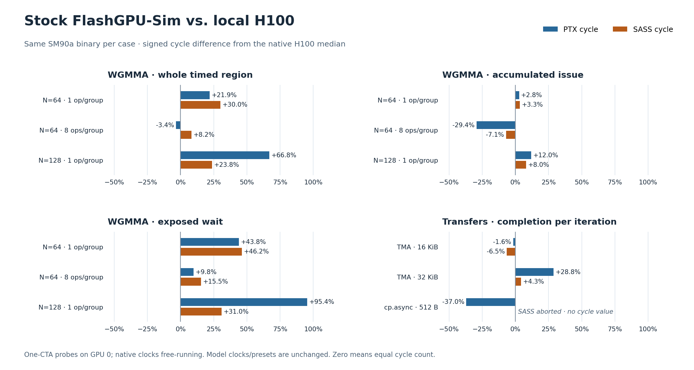
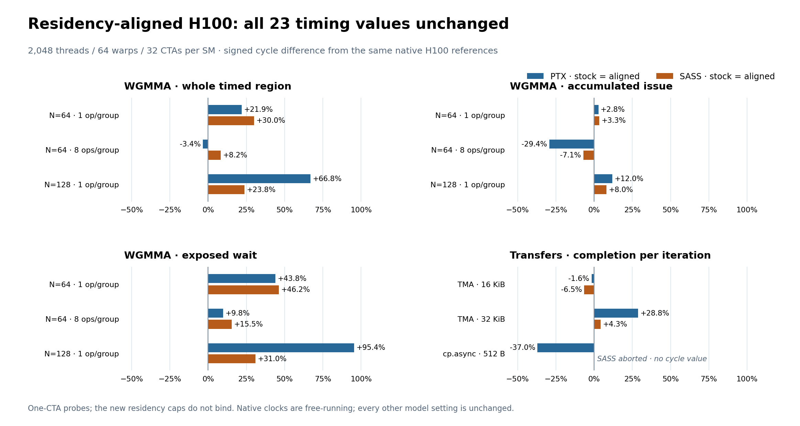

# Stock FlashGPU-Sim against the local H100

## Result

The unchanged stock H100 profile executes the tested MMA, WGMMA, CTA mbarrier
and matrix/cp.async cases successfully. Its H100 qualification is **partial**:
the default profile rejects native two-CTA clusters, some SASS instruction
forms are missing, and timing agreement varies substantially by instruction
shape, batching and frontend.

The earlier cross-architecture report is not the basis for H100-only numerical
conclusions. This report pairs the same SM90a binary on the local H100 with
the shipped H100 presets. TMEM and tcgen05 are outside H100 silicon scope.

The residency-aligned follow-up for this report is complete: all 23 comparable
cycle measurements remain exactly equal to stock, and the known DSM launch
rejection and SASS cp.async abort reproduce. The follow-up changes only the
per-SM thread/warp and CTA capacities; see the separate results below.

## User requests

```text
I mean the report for "stock flashgpu-sim code " against the H100 we have here
```

```text
move the .plan/flashgpu-validation and .plan/stock-flashgpu-h100 to ./local_artifacts, which should be git ignored.
```

```text
Please confirm that the flashGPU-SIM is configured to be H100
any readable reports with figures for local_artifacts/stock-flashgpu-h100 and local_artifacts/flashgpu-validation?
why the difference? (H100 HW vs FlashGPU-PTX vs FlashGPU-SASS)
Resident threads per SM 2,048 1,536 1,536
Resident warps per SM 64 48 48
Resident CTAs per SM 32 24 24
```

```text
re-execute the 3 experiments with flashGPU-SIm simulated H100 config aligned with the real H100.
```

```text
update the two reports?
```
```text
move the reports to ./reports/, and the linked jpg/svg to ./reports/assets/
```

## Stock and hardware identity

| Item | Identity |
| --- | --- |
| Simulator code | Clean `flash` checkout at `01bdef86caf4b9b6432abcbe3c04b38b86675cdc`; matches local `origin/flash` |
| Primary preset | Shipped, unchanged `SM90_H100`; PTX execution |
| Separate SASS preset | Shipped, unchanged `SM90_H100_SASS_FRONTEND`; detailed SASS timing |
| Local device | GPU 0, NVIDIA H100 80GB HBM3, 132 SMs, CC 9.0 |
| Device UUID | `GPU-c80fe196-e3ba-82ff-7233-d9804f701864` |
| Driver / toolkit | NVIDIA 595.71.05 / CUDA 13.3.73 |
| Simulator host | GCC 11.3.0; four OpenMP threads per run |
| Code/config changes | None in FlashGPU-Sim; no parameter fitting or retuning |

Amora owns external probe/run support. The independent tests and stock
calibration programs do not replace or modify simulator implementation.
Exact source revision, preset contents/hashes and native CUDA device attributes
are retained in [inventory](../local_artifacts/stock-flashgpu-h100/inventory.json).

The two effective `gpgpusim.config` hashes in the checked command receipts match
shipped [`SM90_H100`](../../FlashGPU-Sim/configs/SM90_H100/gpgpusim.config)
(`33f466ab5f33…`, PTX cycle) and
[`SM90_H100_SASS_FRONTEND`](../../FlashGPU-Sim/configs/SM90_H100_SASS_FRONTEND/gpgpusim.config)
(`c64c4305d250…`, execution-driven SASS timing), with no configuration overrides.
Both configure compute capability 9.0 and 132 SMs (132 simulator clusters ×
one SM per cluster). The config hashes also match the separate portable_core v2
campaign on GPU 7. This confirms the H100 target, not exact hardware parity.
The SASS preset has its own core, cache/fabric and memory settings; the timing
comparison varies both the execution frontend and those settings.

## Paired functional results

The compared executable contains SM90a code and PTX. Its directory name may
contain `sm120` because existing test sources were built in a separate
`hopper-audit` tree with `sm_90a/compute_90a` overrides. The executable is
identical between each native/simulator pair.

| Feature / cases | Local H100 | Stock H100 PTX | Interpretation |
| --- | ---: | ---: | --- |
| mma.sync | 29/29 pass | 29/29 pass | Tested F16/BF16/TF32/S8 shapes meet their CPU assertions |
| CTA mbarrier | 23/23 pass | 22 pass, 1 skip | `MBarrierSanityTest.TMA` is skipped in PTX; the remaining arrival/phase/wait checks pass |
| WGMMA | 25/25 pass | 25/25 pass | Tested dense Hopper type/shape and register/shared operand paths work |
| ldmatrix/stmatrix and cp.async | 16/16 pass | 16/16 pass | Eight matrix fragment cases plus eight async-copy cases |
| TMA | 37 unique passes; one native edge failure | 38/38 pass | Existing native device-created-map edge case needs the disposition below |
| Independent two-CTA DSM / cluster launch | Native suite: 5/5 pass | Selected atomic case rejected at launch, error 912 | Stock H100 profile cannot admit this native cluster configuration |

WGMMA and matrix/cp.async pairs reuse prior runs after verifying that their
configuration bytes exactly match the shipped H100 preset. Their XML,
timestamps, command and preset hashes are referenced in
[reuse manifest](../local_artifacts/stock-flashgpu-h100/reuse-manifest.json).
MMA, mbarrier and TMA simulator pairs were rerun using the same native SM90a
binaries and the stock H100 preset.

Separate strict-SASS checks pass 9/9 F16 WGMMA and 2/2 x4 matrix-transfer cases.
Two numerical WGMMA cases also pass under the shipped detailed-SASS preset.
These are bounded instruction/form checks.

### TMA native edge disposition

The existing
`TmaEdgeCasesTest.NegativeCoordinateZeroFillsLeadingElements` test constructs
a tensor map on device and produces CUDA error 715 (illegal instruction) on
H100. It was reproduced in a fresh process. In the full native suite, the
following two reduction cases fail allocations because this process's CUDA
context is poisoned; both reduction cases pass when run separately.

Thus the native result is **37 distinct TMA passes and one failing edge
construction**, not three independent feature failures. This observation leaves
that exact descriptor/construction path unqualified. It does not establish a
general failure of Hopper negative-coordinate TMA.

### DSM stock-profile boundary

The selected independent standard two-CTA test fails at
`cudaLaunchKernelExC` with `cudaErrorInvalidClusterSize` (912), before
remote atomic execution. Native H100 accepts the two-CTA launch.

The shipped H100 profile has 132 simulator clusters with one SM each and does
not enable the DSM fabric. The repository enables DSM only in
`SM90_H200`. The earlier H200-profile DSM atomic mismatches are not attributed
to the stock H100 preset here. H100 cluster/DSM functionality needs a separately
qualified H100 topology/configuration before it can be compared numerically.

## Fresh timing comparison

All timing comparisons use the same SM90a executable and the same kernel
parameters. Native runs were sequential on idle GPU 0. Hardware clocks were
left free-running; the stock simulator clock domains remain unchanged at
1500:1700:1700:2617 MHz.

These are **observed cycle differences with the stock presets**, not a
clock-matched calibration study. The local driver's nominal core clock is
1980 MHz; memory-dependent latency in core cycles can depend on active clocks.
No new accuracy threshold is inferred from these measurements.


[Vector figure](assets/h100-cycle-differences.svg) ·
[Plot script](../local_artifacts/stock-flashgpu-h100/figures/plot_cycle_reports.py) ·
[Cross-architecture feature audit](261120-2157-flashgpu-feature-validation-report.md).
The figure uses signed differences relative to the H100 medians and checks its
inputs against the archived CSVs. The SASS cp.async abort has no scored value.

### WGMMA whole timed region

One CTA, 64 measured rounds, 16 warmup rounds, F16 register/shared operands,
same accumulator, one committed group before each wait. Each native point has
five independent process runs. Whole-region cycle values were identical across
the five repetitions.

| Shape and operations per group | H100 cycles | Stock PTX cycles | Difference | Stock SASS cycles | Difference |
| --- | ---: | ---: | ---: | ---: | ---: |
| m64n64k16, 1 operation | 6,277 | 7,654 | +21.94% | 8,159 | +29.98% |
| m64n64k16, 8 operations | 22,764 | 21,990 | -3.40% | 24,635 | +8.22% |
| m64n128k16, 1 operation | 8,271 | 13,797 | +66.81% | 10,241 | +23.82% |

The three cases are distinct execution contracts, not an application accuracy
suite. More operations per committed group can change the apparent total
agreement.

### WGMMA exposed wait windows

The benchmark separately accumulates issue and wait windows. Whole-region
cycles include other control instructions and are not their simple sum.

| Shape and operations per group | H100 wait cycles | PTX wait cycles | Difference | SASS wait cycles | Difference |
| --- | ---: | ---: | ---: | ---: | ---: |
| m64n64k16, 1 operation | 4,160 | 5,984 | +43.85% | 6,080 | +46.15% |
| m64n64k16, 8 operations | 15,296 | 16,800 | +9.83% | 17,664 | +15.48% |
| m64n128k16, 1 operation | 6,208 | 12,128 | +95.36% | 8,130 | +30.96% |

For the eight-operation case, PTX issue windows are 4,333 versus 6,134 native
cycles (-29.36%) while wait is +9.83%; its -3.40% total therefore hides
opposing component differences. The earlier eight-round single point with a
near total match does not qualify the longer or wider cases.

### TMA and cp.async completion

Each native transfer case has three process runs and 32 measured iterations
after eight warmup iterations. The table uses the median of the three
process-mean cycle counts. All use one CTA and a hot working set.

| Stock program / timed operation | H100 cycles | PTX cycles | Difference | SASS cycles | Difference |
| --- | ---: | ---: | ---: | ---: | ---: |
| TMA a16: serial 16 KiB completion | 1,065.00 | 1,047.59 | -1.63% | 995.94 | -6.48% |
| TMA b32: serial 32 KiB completion | 1,218.53 | 1,569.25 | +28.78% | 1,271.44 | +4.34% |
| cp.async: one group, 32 lanes × 16 bytes, completion | 675.66 | 425.53 | -37.02% | Execution abort | Missing SASS form |

The measured TMA sink totals agree between hardware and both simulator
frontends. The cp.async sink agrees between hardware and PTX. These sink
checks accompany timing; they are not a substitute for the full assertion
suites.

The SASS cp.async program fails explicitly at
`LD.E.STRONG.SYS`: no functional semantics for that exact opcode form.
A failure is retained rather than converted to a cycle value or PTX fallback.

Raw CSVs, native dispersion, exact per-run arguments and signed differences are
in [timing comparison](../local_artifacts/stock-flashgpu-h100/timing-comparison.json).
WGMMA used `wgmma_fp16_rs_g1_bench.cc`; transfer probes used the stock
`tma_completion_latency_bench.cu` and `cp_async_latency_bench.cu`.

## Native resource limits versus stock profiles

Queried GPU 0 through the native CUDA driver for this campaign. A read-only
driver attribute query on GPU 7 also confirms CC 9.0, 132 SMs and the same
native residency caps. These are **maximum capacities**, not measured occupancy
for the probes.

| Resource | H100 driver | Stock H100 PTX | Stock H100 SASS |
| --- | ---: | ---: | ---: |
| SMs | 132 | 132 | 132 |
| Resident threads per SM | 2,048 | 1,536 | 1,536 |
| Resident warps per SM | 64 | 48 | 48 |
| Resident CTAs per SM | 32 | 24 | 24 |
| 32-bit registers per SM | 65,536 | 65,536 | 65,536 |
| Shared memory per SM, bytes | 233,472 | 233,472 | 233,472 |
| Opt-in shared memory per block, bytes | 232,448 | 232,448 | 232,448 |
| L2 capacity | 50 MiB | 50 MiB aggregate configured | 50 MiB aggregate configured |

### Why the capacity differs

Both shipped H100 presets explicitly contain:

```text
-gpgpu_shader_core_pipeline 1536:32
-gpgpu_shader_cta 24
```

The first setting is **1,536 thread slots with 32 lanes per warp**, so
[initialization](https://github.com/FlashGPU-Sim/FlashGPU-Sim/blob/01bdef86caf4b9b6432abcbe3c04b38b86675cdc/src/gpgpu-sim/shader.h#L2178-L2220)
derives `1536 / 32 = 48` warp slots. The second setting independently caps
resident blocks (CTAs) at 24. PTX and SASS use the same
[CTA admission limits](https://github.com/FlashGPU-Sim/FlashGPU-Sim/blob/01bdef86caf4b9b6432abcbe3c04b38b86675cdc/src/gpgpu-sim/shader.cc#L6614-L6644):
threads (rounded to whole warps per block), registers, shared memory and CTA
slots can each limit residency. The 48 warps are not an independent setting,
and none of the three values is a measurement of native H100 occupancy.

The values already appear in the [initial Hopper preset](https://github.com/FlashGPU-Sim/FlashGPU-Sim/commit/75dba8cffa8bf59a0f649f8ec7474d1c3491832a).
The [initial H100 preset](https://github.com/FlashGPU-Sim/FlashGPU-Sim/commit/4dfcbf132c9a56b1f252aa39bf4f2a3a8a23b557)
carried both lines forward unchanged, and the SASS preset retained them from its
frozen FA3 baseline when the [SASS frontend was added](https://github.com/FlashGPU-Sim/FlashGPU-Sim/commit/f6718228529a0594e74c730a0ba31845ff490d5d).
The inspected history does not give a rationale for those original numbers.
They are preset choices, not the simulator's compile-time maxima, which are
2,048 threads and 32 CTAs in `abstract_hardware_model.h`.

The stock presets therefore expose **25% fewer slots** than H100 hardware on
these three limits. For example, with ample grid size and no tighter register
or shared-memory constraint, 128-thread blocks are capped at **12 versus 16
blocks per SM**. Workloads already limited by another resource may see no
residency change. This is not a prediction of 25% runtime error and cannot
explain the PTX–SASS differences in the single-CTA measurements above. A test
with `2048:32` and `32` CTAs is reported below as a separate sensitivity
experiment; the historical stock values remain fixed.

## Residency-aligned H100 follow-up

This panel completed all 16 replay commands against the same native H100
references and pinned CUDA executables. Only two runner-copy settings changed:

```text
-gpgpu_shader_core_pipeline 2048:32
-gpgpu_shader_cta 32
```

Both variants retain CC 9.0, 132 SMs and `1500:1700:1700:2617` clock domains.
The native GPU 0 reference samples were reused; simulator visibility stays
restricted to GPU 7. Shipped preset files and simulator source were unchanged.
This is alignment of the residency ceilings, not full H100 calibration.

| Resource per SM | H100 | Original PTX / SASS | Aligned PTX / SASS |
| --- | ---: | ---: | ---: |
| Thread slots | 2,048 | 1,536 | 2,048 |
| Warp slots | 64 | 48 | 64 |
| CTA slots | 32 | 24 | 32 |

| Compared timing windows | Paired values | Changed after alignment |
| --- | ---: | ---: |
| WGMMA accumulated issue, three cases × two frontends | 6 | 0 |
| WGMMA exposed wait, three cases × two frontends | 6 | 0 |
| WGMMA whole region, three cases × two frontends | 6 | 0 |
| TMA/cp.async completion with available timings | 5 | 0 |
| **Total** | **23** | **0** |

Every cycle count and signed hardware difference in the original timing tables
therefore also applies to the aligned variant. The SASS cp.async abort remains
unscored; it is not a zero-error timing pair.


[Vector figure](assets/stock-residency-aligned-timing.svg).

| Functional or admission replay | Aligned outcome |
| --- | --- |
| MMA suite | 29/29 pass |
| CTA mbarrier suite | 22 pass, 1 skip, no failure |
| TMA suite | 38/38 pass |
| Selected two-CTA DSM atomic launch | Same `cudaErrorInvalidClusterSize` (912), before remote execution |
| SASS cp.async completion program | Same missing functional semantics for `LD.E.STRONG.SYS` |

The unchanged timings are consistent with the capacity limits not binding in
these one-CTA probes. This experiment does not isolate an occupancy-heavy
application effect, resolve DSM topology or qualify additional SASS forms.
The two frontends retain their original distinct core and memory presets.

The [completed-panel ledger](../local_artifacts/flashgpu-h100-residency/completed-panels.json)
contains all stock versus aligned cycle values, outcomes and verified source,
config and output identities. The effective PTX config SHA-256 is
`804b86ab33f5ea25bb9bbc5021c82bc5a1f61e20ddf12ce44abd4411d0ad172e`;
the effective SASS config SHA-256 is
`8a190d259d05d0e4ccc4885f8cf6fb351656047df1d037d57b30fe92bf9b07e3`.
Both match their completed command receipts. See the
[rerun plan](../.plan/261124-2322-flashgpu-h100-residency-plan.md),
[tracker](../.plan/tracker/261124-2322-flashgpu-h100-residency.md),
[raw replay receipts](../local_artifacts/flashgpu-h100-residency/stock/) and
[figure script](../local_artifacts/flashgpu-h100-residency/figures/plot_completed_panels.py).

The separate portable_core v2 rerun is now complete. Its matched PTX MdAPE /
P95 APE is 61.39% / 96.09% versus stock 63.01% /
100.72%, on 1,041 identical qualified native references. See the
[complete rerun report](261124-2322-flashgpu-h100-residency-report.md) for its program-span estimand and
process-sharding limitation; these figures are separate from this report's
microbenchmark cycle measurements.

## Scope and follow-up

This report establishes the executed subset and the behavior of the shipped
H100 profiles on the local machine. Numerical assertions passing do not qualify
all PTX/SASS shapes, types, exceptional values or memory-consistency variants.

For stronger H100 timing qualification, match hardware clocks to the chosen
profile, expand shape/group/concurrency panels and compare issue/completion
windows as well as total execution. Add an H100 cluster topology and DSM
configuration through a separate qualification step; do not silently substitute
the H200 preset. Application-wide FA3/FA2 timing remains a separate measurement.

## Artifacts and reproduction

- [Execution plan](../.plan/261120-2307-stock-flashgpu-h100-plan.md).
- [Tracker](../.plan/tracker/261120-2307-stock-flashgpu-h100.md).
- [H100 evidence](../local_artifacts/stock-flashgpu-h100/).
- [Amora CLI guide](../../amora/docs/development/261120-2155-flashgpu-feature-validation.md).

Both raw evidence trees are under Git-ignored `local_artifacts/`. Plans and
trackers remain in `.plan/`; reports live in `reports/` and their figures in
`reports/assets/`. Historical receipts retain the output paths used
at execution time. The relocation manifest preserves the mapping.

Example stock H100 run from Amora:

```bash
python -m amora flashgpu_sim run \
  --binary <same-sm90a-binary-used-natively> \
  --sim-root ../FlashGPU-Sim --cuda-root "$CUDA_INSTALL_PATH" \
  --evidence-root ../gpu-perf/local_artifacts/stock-flashgpu-h100 \
  --label h100-new-run --preset SM90_H100 --mode ptx
```

No FlashGPU-Sim source or preset changes were made. Amora's adapter was extended
to pass standalone program arguments through the same recorded runtime contract;
the targeted backend and existing CLI checks pass 16 tests.

## Revision History

- 2026-11-20 23:18 -0800: Created the dedicated stock-code versus local-H100 report with exact-preset pairs, repeated timing, hardware resource limits and scoped failure dispositions; full TMA run still in progress.
- 2026-11-20 23:21 -0800: Completed the full stock-H100 TMA suite (38/38), finalized native DSM same-binary provenance, verified the adapter wheel, and removed the temporary evidence redirect. All planned H100 runs are complete.
- 2026-11-20 23:23 -0800: Verified 43 new command receipts, 13 reused XML records and unchanged source/preset identities; compressed verbose output losslessly and checked all document links and Git ignore rules.
- 2026-11-24 23:11 -0800: Confirmed effective H100 preset hashes from receipts, rechecked native GPU 7 residency attributes, traced the lower stock limits through source and preset history, and added the cycle comparison figure from archived CSVs.
- 2026-11-25 00:46 -0800: Added the completed residency-aligned H100 replay, all 23 unchanged timing pairs, verified config/output identities and a new figure. Corrected the original PTX mbarrier count to 22 passes and one skip from both archived and replay XML.
- 2026-11-25 00:55 -0800: Moved report to reports/, relocated linked figures to reports/assets/, and rebased local links.
- 2026-11-25 01:47 -0800: Linked the completed portable_core v2 rerun and removed the stale pending-cycle status; the scoped probe results remain unchanged.
