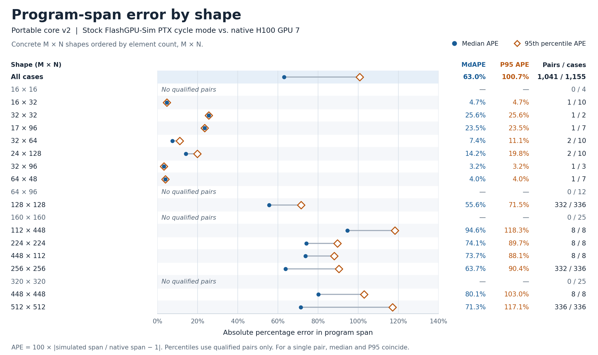
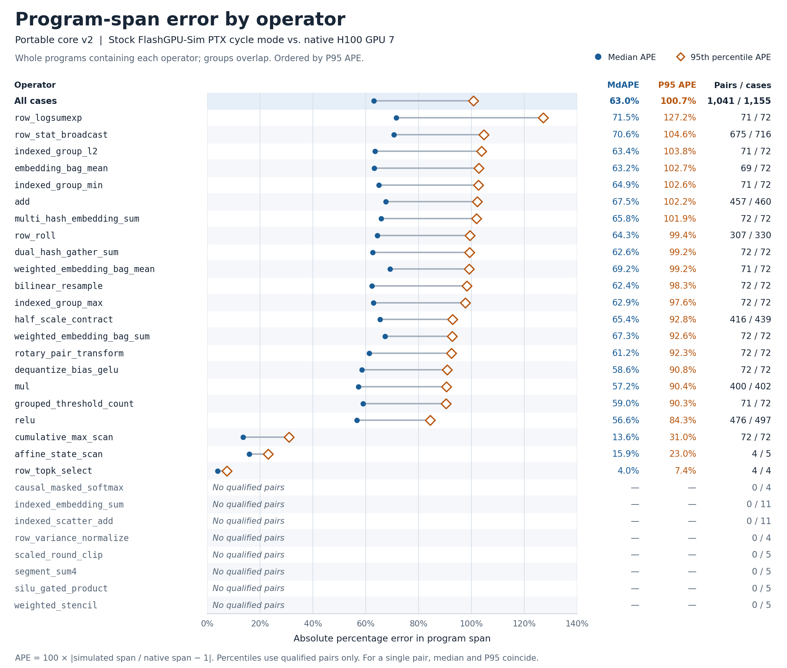
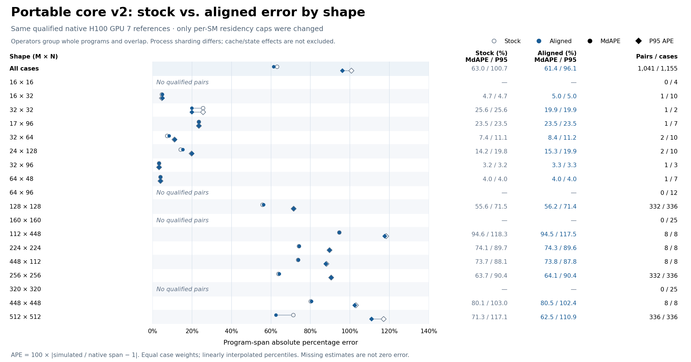
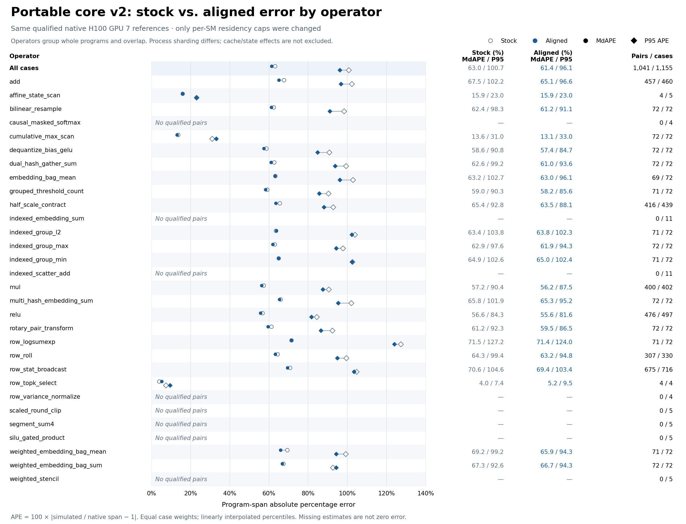
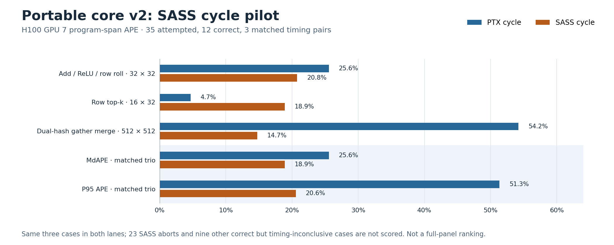

# FlashGPU-Sim portable_core v2 validation report

## Validated result

The source-available validation panel is complete. Stock FlashGPU-Sim PTX passes
all 1,155 portable_core v2 cases in functional and cycle modes using the same
CUDA executable and frozen inputs as native H100 GPU 7.

Timing differs substantially: across 1,041 cases with qualified native timing,
the median simulated/native program-span ratio is **1.630**, with **63.0% median
absolute difference** and **100.7% p95 absolute difference**. Only 70/1,041 cases
(6.7%) are within 25% of native spans. The measured quantity includes stream
submission gaps, so this result applies to this explicit-node program realization.

| Lane | Coverage | Result |
| --- | ---: | --- |
| Existing v2 CPU release matrix | 1,505 required checks | All pass |
| Native H100 GPU 7 pilot | 35 operator/layout witnesses | All pass |
| Native H100 GPU 7 full corpus | 1,155 cases × 3 independent runs | All pass |
| Stock PTX functional mode | 1,155 cases | All pass; timing unavailable |
| Stock PTX cycle mode | 1,155 cases | All pass; every required outcome accounted for |
| Qualified native/PTX timing pairs | 1,041 cases | Median simulated span 1.630× native |
| Native timing inconclusive | 114 cases | Numerical passes retained; excluded from timing comparison |
| Stock H100 SASS timing pilot | 35 cases | 12 pass; 23 unsupported forms/projections |

All 30 singleton retries passed after 12 partially timed-out initial shards.
No simulation or continuation remains pending. Functional-mode zero event spans
are discarded, and batch timeouts are recorded as incomplete execution rather
than numerical mismatches.

The separately recorded H100 residency-aligned rerun is also complete: both
full PTX lanes pass all 1,155 cases. Matched timing changes from stock
63.01% / 100.72% MdAPE / P95 APE to 61.39% /
96.09%; see the follow-up below. The original stock measurements and
figures retain their original meaning.

## User request and target corrections

```text
validate FlashGPU-Sim using H100 (this machine) and ~/wk/amora portable_core v2 kernels and shapes.
```

```text
use the free GPU gpu7...
```

```text
continue
```

The earlier SSH target was superseded by the local-machine clarification.

Visualization requests:

```text
visualize the MdAPE and P95 APE for portable core v2.
```

```text
visualize FlashGPU-Sim portable_core v2 report, the MdAPE and P95 APE for operations and shape sizes.
```

```text
what about SASS cycle model?
```
```text
move the reports to ./reports/, and the linked jpg/svg to ./reports/assets/
```

## Pinned subjects

- Hardware: physical GPU 7, NVIDIA H100 80GB HBM3,
  `GPU-b356e84d-b220-a33c-dd68-3ea01ec109ea`.
- `CUDA_VISIBLE_DEVICES=7` maps this target to logical CUDA device 0.
  Native driver UUID is checked against the selected physical GPU.
- FlashGPU-Sim: stock
  `01bdef86caf4b9b6432abcbe3c04b38b86675cdc`, unchanged `SM90_H100`.
  Separate SASS lane uses shipped `SM90_H100_SASS_FRONTEND`.
- Amora source: `56749f4ed228ce1daece388195a882caf101083f`.
  The hashed `expanded/v2/*.py` CPU program/schema/oracle files remain unchanged.
- Native executable: CUDA 13.3.73, SM90a plus compute_90a PTX, C++17/O2,
  `--fmad=false` and line information.
- CPU qualification: existing Python 3.13 environment with Torch 2.8.0 and
  NumPy 2.3.3; accelerator visibility disabled for CPU checks.

[Inventory](../local_artifacts/flashgpu-portable-v2/inventory.json) and
[build identity](../local_artifacts/flashgpu-portable-v2/builds.json) preserve
source, target, executable and configuration hashes.

## Corpus coverage

The union of all source-available suite/profile selections contains:

- 1,155 unique case IDs/hashes.
- 381 canonical program hashes.
- 18 concrete shapes and 30 operators.
- 5,215 node occurrences.
- 2,418 deduplicated input/oracle byte banks.

| Suite/profile | Cases before alias deduplication |
| --- | ---: |
| operation-gate-v2 reference | 720 |
| operation-gate-v2 development | 288 |
| operation-gate-v2 smoke | 10 |
| mechanism-controls reference | 288, aliases of the development-source cases |
| mechanism-controls development | 9 |
| mechanism-controls smoke | 3 |
| h3-semantics development | 40 |
| h3-semantics smoke | 7 |
| h3-programs development | 84 |
| h3-programs smoke | 6 |

Repeated case identities retain their suite/profile aliases and are not counted
as extra qualification. Exact H3 reference profiles remain
`blocked_missing_source`: approved historical per-case exports are absent.
Development controls do not close those reference rows.

[Coverage inventory](../local_artifacts/flashgpu-portable-v2/coverage-inventory.json)
contains family, shape and node/operator counts. Frozen snapshots, input hashes,
physical layouts and source crosswalks are retained in the
[corpus](../local_artifacts/flashgpu-portable-v2/corpus/).

## CUDA realization and numerical checks

V2 currently supplies CPU mathematical programs. For the simulator comparison,
the task adds the separately named `cuda-explicit-node-boundaries-v1`
standalone realization. It is not the proposed eager Torch CUDA backend.

Each already-unrolled node executes once in topological order on one CUDA stream.
The same executable and input/oracle banks are used natively and in simulation.

The realization preserves:

- FP32 working operations and explicit FP16 temporary/store rounding.
- Typed output ports, including exact int32 top-k indices.
- Physical input row padding, offsets and non-aliasing rather than packing views.
- Deterministic indexed scatter and lowest-index top-k ties.
- Explicit node storage and recurrence edges.

Every node output is compared to the independent v2 FP64/scalar oracle.
Tolerance is 0.001 absolute / 0.005 relative for FP16 and 2e-5 / 2e-4 for FP32.
Integer and discrete outputs are exact. Inputs are checked unchanged after
execution. Native checks run before and after measurement.

The half-scale contraction fixture right-multiplies by a constant half identity;
it lowers to scaling. This corpus realization does not establish dense GEMM,
TMA, WGMMA, tensor-core, compiler-fusion or archived CUDA RNG qualification.

## Timing contract

Native measurements retain 30 samples per case in each of three independent
process runs, after three warmup invocations. Preparation, allocation, transfers
and output checks are outside the measured body.

The metric is a CUDA stream **program span**, including launch-submission gaps.
It is not a single-kernel duration or an SM-cycle counter. Model event spans are
labeled simulation and use stock model clocks. Hardware clocks are free-running.

Native timing quality requires:

- Three successful correctness runs with at least 30 samples each.
- Median span at least 10 microseconds.
- Relative median absolute deviation at most 5% within each repeat and across
  repeat medians.

1,041 native cases meet these rules; 114 remain timing-inconclusive. Numerical
passes are retained independently of timing quality.

The cycle-mode panel validates the same prepared program and measures one
post-validation execution. Functional mode is a separate numerical lane with
timing unavailable. Timing differences are published only for successful
cycle-mode rows with accepted native timing quality.

[Comparison data](../local_artifacts/flashgpu-portable-v2/comparison.json)
retain native samples and repeat medians, all simulator observations, deterministic
selected observation paths, case/program hashes and grouped summaries.
A completed observation outranks any incomplete retry; date and path order resolve
equally complete observations. Every selected full-panel PTX row passed.

| Program-span statistic | Result |
| --- | ---: |
| Eligible cases | 1,041 / 1,155 |
| Median simulated/native ratio | 1.630 |
| 5th–95th percentile ratio | 1.176–2.007 |
| Minimum–maximum ratio | 0.955–2.591 |
| Median signed difference | +63.0% |
| Median absolute difference | 63.0% |
| 95th percentile absolute difference | 100.7% |
| Mean absolute difference | 62.4% |
| Within 25% of native | 70 / 1,041 (6.7%) |
| Within a factor of two | 988 / 1,041 (94.9%) |
| Simulated span greater than native | 1,034 / 1,041 (99.3%) |
| Median native program span | 17.328 µs |
| Median simulated program span | 28.775 µs |

Percentiles use linear interpolation over equally weighted cases. The two
marginal median spans are reported separately from the median of per-case ratios.
The span scatter plot is available as [SVG](assets/timing-comparison.svg)
and [PNG](assets/timing-comparison.png).

For the grouped charts below, per-case APE is `100 × |simulated span / native span − 1|`.
MdAPE is its median and P95 APE its 95th percentile. Both charts use the same
scale and label qualified pairs versus total cases. A group with no qualified
pairs has no error estimate, not zero error. The [plot script](../local_artifacts/flashgpu-portable-v2/ape-figures/plot_ape.py)
regenerates both charts from the audited comparison without rerunning any cases.

## Shape coverage and timing

Every listed shape passes both full PTX lanes and all three native runs.
Timing statistics use only admitted native/PTX pairs. A dash means no case at
that shape meets the declared native timing rules.


[Shape chart (SVG)](assets/ape-by-shape.svg).

| Shape M × N | Cases / numerical passes | Timing pairs | Median sim/native | Median absolute difference |
| --- | ---: | ---: | ---: | ---: |
| 16 × 16 | 4 | 0 | — | — |
| 16 × 32 | 10 | 1 | 1.047 | 4.7% |
| 17 × 96 | 7 | 1 | 1.235 | 23.5% |
| 24 × 128 | 10 | 2 | 1.142 | 14.2% |
| 32 × 32 | 2 | 1 | 1.256 | 25.6% |
| 32 × 64 | 10 | 2 | 1.074 | 7.4% |
| 32 × 96 | 3 | 1 | 1.032 | 3.2% |
| 64 × 48 | 7 | 1 | 1.040 | 4.0% |
| 64 × 96 | 12 | 0 | — | — |
| 112 × 448 | 8 | 8 | 1.946 | 94.6% |
| 128 × 128 | 336 | 332 | 1.556 | 55.6% |
| 160 × 160 | 25 | 0 | — | — |
| 224 × 224 | 8 | 8 | 1.741 | 74.1% |
| 256 × 256 | 336 | 332 | 1.637 | 63.7% |
| 320 × 320 | 25 | 0 | — | — |
| 448 × 112 | 8 | 8 | 1.737 | 73.7% |
| 448 × 448 | 8 | 8 | 1.801 | 80.1% |
| 512 × 512 | 336 | 336 | 1.713 | 71.3% |

The main square panel has 336 cases at each of 128², 256² and 512². Its median
ratios rise from 1.556 to 1.637 to 1.713. Several small/control shapes have no
qualified timing; their numerical passes do not establish timing accuracy.

## Operator coverage and timing

Each row counts complete programs containing that operator. Groups overlap;
the span is for the whole program, so differences cannot be attributed to an
individual operator. All operator witnesses pass native and both PTX lanes.


[Operator chart (SVG)](assets/ape-by-operator.svg).

| Operator | Programs containing operator / passes | Timing pairs | Median sim/native | p95 absolute difference |
| --- | ---: | ---: | ---: | ---: |
| `add` | 460 | 457 | 1.675 | 102.2% |
| `affine_state_scan` | 5 | 4 | 1.159 | 23.0% |
| `bilinear_resample` | 72 | 72 | 1.624 | 98.3% |
| `causal_masked_softmax` | 4 | 0 | — | — |
| `cumulative_max_scan` | 72 | 72 | 1.136 | 31.0% |
| `dequantize_bias_gelu` | 72 | 72 | 1.586 | 90.8% |
| `dual_hash_gather_sum` | 72 | 72 | 1.626 | 99.2% |
| `embedding_bag_mean` | 72 | 69 | 1.632 | 102.7% |
| `grouped_threshold_count` | 72 | 71 | 1.590 | 90.3% |
| `half_scale_contract` | 439 | 416 | 1.654 | 92.8% |
| `indexed_embedding_sum` | 11 | 0 | — | — |
| `indexed_group_l2` | 72 | 71 | 1.634 | 103.8% |
| `indexed_group_max` | 72 | 72 | 1.629 | 97.6% |
| `indexed_group_min` | 72 | 71 | 1.649 | 102.6% |
| `indexed_scatter_add` | 11 | 0 | — | — |
| `mul` | 402 | 400 | 1.572 | 90.4% |
| `multi_hash_embedding_sum` | 72 | 72 | 1.658 | 101.9% |
| `relu` | 497 | 476 | 1.566 | 84.3% |
| `rotary_pair_transform` | 72 | 72 | 1.612 | 92.3% |
| `row_logsumexp` | 72 | 71 | 1.715 | 127.2% |
| `row_roll` | 330 | 307 | 1.643 | 99.4% |
| `row_stat_broadcast` | 716 | 675 | 1.706 | 104.6% |
| `row_topk_select` | 4 | 4 | 1.040 | 7.4% |
| `row_variance_normalize` | 4 | 0 | — | — |
| `scaled_round_clip` | 5 | 0 | — | — |
| `segment_sum4` | 5 | 0 | — | — |
| `silu_gated_product` | 5 | 0 | — | — |
| `weighted_embedding_bag_mean` | 72 | 71 | 1.692 | 99.2% |
| `weighted_embedding_bag_sum` | 72 | 72 | 1.673 | 92.6% |
| `weighted_stencil` | 5 | 0 | — | — |

## Graph coverage and timing

Nodes are already unrolled in the frozen program and each executes once.
These groups count explicit graph size rather than inferred compiler fusion.
All listed programs pass numerical checks in all required lanes.

| Nodes per program | Cases / passes | Timing pairs | Median sim/native | Median absolute difference |
| --- | ---: | ---: | ---: | ---: |
| 1 | 59 | 8 | 1.063 | 6.3% |
| 2 | 54 | 0 | — | — |
| 3 | 254 | 249 | 1.445 | 44.5% |
| 4 | 252 | 251 | 1.589 | 58.9% |
| 5 | 126 | 126 | 1.611 | 61.1% |
| 6 | 386 | 383 | 1.710 | 71.0% |
| 7 | 8 | 8 | 1.707 | 70.7% |
| 16 | 8 | 8 | 1.836 | 83.6% |
| 17 | 4 | 4 | 1.867 | 86.7% |
| 20 | 4 | 4 | 2.003 | 100.3% |

The 126 programs with one declared state edge and unroll metadata 2 include
123 qualified pairs, with median ratio 1.710. The remaining 1,029 programs
have no state edge and unroll metadata 1; 918 pairs qualify, with median ratio
1.612. Full case families, state-edge counts and unroll groups are in the
comparison summary. These are descriptive groups of the sealed corpus.

## Residency-aligned full-panel follow-up

The separate rerun uses the same sealed corpus, executable and native H100 GPU 7
reference samples. Its two overrides set 2,048 threads / 64 warps and 32 CTAs
per SM; the other model settings and source remain fixed.

| Lane or measurement | Stock | Residency aligned |
| --- | ---: | ---: |
| Full PTX functional numerical passes | 1,155 / 1,155 | 1,155 / 1,155 |
| Full PTX cycle numerical passes | 1,155 / 1,155 | 1,155 / 1,155 |
| Admitted native/PTX timing pairs | 1,041 | 1,041 |
| Native timing inconclusive | 114 | 114 |
| PTX MdAPE | 63.01% | 61.39% |
| PTX P95 APE | 100.72% | 96.09% |
| SASS pilot passes / attempts | 12 / 35 | 12 / 35 |
| SASS matched timing pairs | 3 | 3 |
| SASS matched MdAPE / P95 APE | 18.91% / 20.58% | 18.91% / 20.58% |

All 36 unfinished cycle cases from 12 partial initial timeouts passed singleton
recovery. No cycle outcome remains pending. The same 23 SASS support failures
remain accounted for; neither timeouts nor functional-mode spans are scored as
timing errors.


[Shape comparison (SVG)](assets/portable-v2-stock-aligned-ape-by-shape.svg).


[Operator comparison (SVG)](assets/portable-v2-stock-aligned-ape-by-operator.svg).

The observed full-panel change is modest and does not remove the large span
error. At 512 × 512, MdAPE changes from 71.31% to 62.45%; at 128 × 128 and
256 × 256 it changes from 55.59% to 56.16% and 63.71% to 64.11%, respectively.
Operator groups contain whole programs and overlap; they do not isolate an
operator's execution cost.

Process grouping differs between the stock and aligned portable runs, including
singleton timing for three cases that originally ran in batches. The changes
therefore do not exclude cache/process-state carryover and do not identify a
pure residency-cap effect. The H100-only microbenchmark and feature control
windows, which each use one CTA, are unchanged. SASS's three-point intersection
is too small and support selected to establish a full-panel accuracy ranking.

The [complete rerun report](261124-2322-flashgpu-h100-residency-report.md),
[paired case data](../local_artifacts/flashgpu-h100-residency/comparison-aligned-vs-stock.json),
[identity/coverage audit](../local_artifacts/flashgpu-h100-residency/identity-audit.json)
and [rerun tracker](../.plan/tracker/261124-2322-flashgpu-h100-residency.md) retain the final scope and evidence.

## SASS pilot findings

All 35 witnesses pass natively. The shipped SASS timing lane passes 12 and
rejects 23. Singleton replays account for every case after the original batch
was interrupted by its first unsupported instruction.

| Failure category | Cases |
| --- | ---: |
| Unsupported timing projection: FCHK | 18 |
| Unsupported timing projection: FRND.FLOOR | 2 |
| Missing functional semantics: MUFU.RSQ | 1 |
| Missing functional semantics: MUFU.SIN | 1 |
| Missing functional semantics: FSET.BF.GT.AND | 1 |

These are exact-form coverage boundaries for this executable/toolchain,
not failures of the portable mathematical programs. No PTX fallback is used.

### Matched cycle timing on the successful subset

Only **three of the 12 SASS passes** meet the native timing gate and have a
positive program span in both cycle lanes. The other nine correct cases are
timing-inconclusive. The table compares the same cases to the same native
medians; each shape has just one eligible observation.

| Portable_core v2 program | Shape | PTX APE | SASS APE |
| --- | --- | ---: | ---: |
| Add/ReLU/row-roll chain | 32 × 32 | 25.6% | 20.8% |
| Row top-k | 16 × 32 | 4.7% | 18.9% |
| Dual-hash gather independent merge | 512 × 512 | 54.2% | 14.7% |
| **MdAPE, matched trio** | | **25.6%** | **18.9%** |
| **P95 APE, matched trio** | | **51.3%** | **20.6%** |


[Vector figure](assets/sass-pilot-matched-ape.svg) ·
[Plot script](../local_artifacts/stock-flashgpu-h100/figures/plot_cycle_reports.py).

SASS is closer on two of the three cases. The P95 is interpolated from three
support-selected points; it is not tail accuracy evidence. There is no
full-panel SASS score or defensible operator/shape distribution to compare with
the 1,041-pair PTX charts. The stock presets differ in more than frontend, so
neither this comparison nor the microbenchmarks in the
[stock H100 report](261120-2307-stock-flashgpu-h100-report.md) isolate the frontend effect.

## Execution accounting

Initial two-thread batches were stopped with explicit interruption provenance
after preserving 100 completed driver observations. The remaining 1,055 cases
ran in 66 initial shards with 16 workers, eight CPU threads each, chunk size 16
and a 1,800-second bound. Source, executable, inputs and stock presets stayed
fixed. Of those cases, 1,025 completed in initial shards; 12 partial timeouts
left 30 cases, all of which passed singleton retries under the existing controller.

The final total is 100 retained checkpoint cases + 1,025 initial-shard successes
+ 30 singleton successes = 1,155 successful cycle outcomes, with zero remaining
cases and zero observed cycle numerical failures. Retained checkpoints link to
the original driver rows and scheduler interruption record. No exit receipt was
fabricated for a manually stopped batch.

- [Controller summary](../local_artifacts/flashgpu-portable-v2/simulation/ptx-full-fast-summary.json).
- [Interruption provenance](../local_artifacts/flashgpu-portable-v2/scheduler-interruption.json).
- [Closed recovery ledger](../local_artifacts/flashgpu-portable-v2/pending-cycle-recovery.json).
- [Functional full-panel summary](../local_artifacts/flashgpu-portable-v2/simulation/ptx-functional-full-summary.json).

## Evidence integrity and scope

The [closeout audit](../local_artifacts/flashgpu-portable-v2/closeout-audit.json)
passed source, executable, build-contract, configuration, selection and raw-row
checks. It verified all 2,418 input/oracle banks, every validation result,
163 command-output hashes and all 69 losslessly compressed outputs. Original
receipt hashes refer to uncompressed bytes; stored archive hashes and mappings
are in [compressed outputs](../local_artifacts/flashgpu-portable-v2/compressed-outputs.json).
The four native placement records identify physical GPU 7's UUID and logical
CUDA device 0. The stock simulator tracked tree is clean.

| Subject | SHA-256 |
| --- | --- |
| Corpus manifest | `ce380730ad0f21d1724eb454ccd80b47dd8bde029259b92350b248d62f9e29d7` |
| Admitted CUDA executable | `2790ce58621d9f97cf6e1a6892e666fbf8ad93196b689155738e68c128ea9a3e` |
| CUDA realization source | `89fdf9fb284a3980e6fff63b2ced3facb3e74e52cc3d3ab0e3251be4b8278979` |
| Final comparison | `a43546da08fa49112dd383de7b56152844968d0205ef8aa74daf25342a849ea3` |

Reporting now retains source observation paths and native raw samples, and
prevents an incomplete singleton from overwriting completed evidence. The
[recorded regression run](../local_artifacts/flashgpu-portable-v2/portable-v2-closeout-tests.receipt.json)
passes all 51 corpus, evidence, workload-contract, backend and public-CLI tests.
The CPU release matrix separately passes 1,505/1,505 checks in its pinned
Torch/NumPy environment.

This validates the source-available mathematical corpus through the separately
identified CUDA realization. Exact historical H3 reference profiles remain
`blocked_missing_source`. The identity-matrix contraction fixture does not
establish dense GEMM or Tensor Core lowering. TMA, TMEM, DSM, `tcgen05`,
`mbarrier`, `mma`, `wgmma`, `ldmatrix` and `stmatrix` require their own direct
instruction witnesses; this panel does not extend the earlier feature report's
coverage. The 23 SASS failures remain exact-form support boundaries. Timing
results quantify this program-span estimand with free-running H100 clocks.

Reusable code stays in Amora; plans and trackers stay in this project's `.plan/`.
Reports live in `reports/` and their figures in `reports/assets/`.
Raw evidence is Git ignored under `local_artifacts/flashgpu-portable-v2/`.
No simulator changes or parameter fitting were made. No commits or pushes
were performed. The pending session continuation was cancelled after completion.

## Reusable code and reproduction

- [Corpus/scheduler code](../../amora/amora/benchmarking/portable_v2/).
- [CUDA realization](../../amora/amora/backends/nvidia/portable_core_v2.py).
- [Usage guide](../../amora/docs/development/261124-1712-portable-core-v2-flashgpu-validation.md).
- [Plan](../.plan/261124-1630-flashgpu-portable-v2-plan.md).
- [Tracker](../.plan/tracker/261124-1630-flashgpu-portable-v2.md).

The public CLI is `amora flashgpu_sim portable-v2`. From Amora, refresh the
closed evidence with:

```bash
python3 -m amora flashgpu_sim portable-v2 report \
  --root ../gpu-perf/local_artifacts/flashgpu-portable-v2
```

The audit is reproducible from this project with:

```bash
python3 local_artifacts/flashgpu-portable-v2/closeout_audit.py
```

Use a new root for independent campaigns; the completed root retains the original
selection, checkpoints, failures and source identities.

## Revision History

- 2026-11-24 17:34 -0800: Recorded complete native/functional numerical validation and the fully accounted SASS pilot. Preserved the separate pending cycle-mode scope and continuation requirement.
- 2026-11-24 17:44 -0800: Updated verified cycle progress and explicit timeout-retry scope; retained provisional timing status.
- 2026-11-24 17:54 -0800: Recorded 418 cycle successes/309 eligible comparisons and lossless log archival; timing remains in progress.
- 2026-11-24 18:08 -0800: Updated 620 cycle successes/511 eligible comparisons and pending partial-timeout recovery; retained provisional full-panel scope.
- 2026-11-24 18:22 -0800: Recorded 715 cycle successes/605 eligible comparisons and verified evidence identities; kept timing scope provisional.

- 2026-11-24 19:35 -0800: Closed all 1,155 PTX cycle cases and 30 singleton recoveries; added 1,041 timing-pair statistics, complete shape/operator/graph summaries, checked source/archive hashes and evidence links, and cancelled the completed campaign continuation.
- 2026-11-24 22:44 -0800: Added matched-scale MdAPE and P95 APE charts for all 30 operators and 18 shapes. Recomputed both percentiles from the 1,041 qualified pairs to verify the audited summaries; groups without qualifying pairs are labeled rather than plotted as zero.
- 2026-11-24 23:10 -0800: Added the SASS cycle pilot figure and matched-three-case comparison to PTX from audited evidence; kept SASS admission and full-panel PTX timing scope separate.
- 2026-11-25 00:55 -0800: Moved report to reports/, relocated linked figures to reports/assets/, and rebased local links.
- 2026-11-25 01:47 -0800: Added the complete residency-aligned full panel, matched APE comparisons, shape/operator figures and verified recovery/identity evidence; retained the original stock results and sharding limitation.
