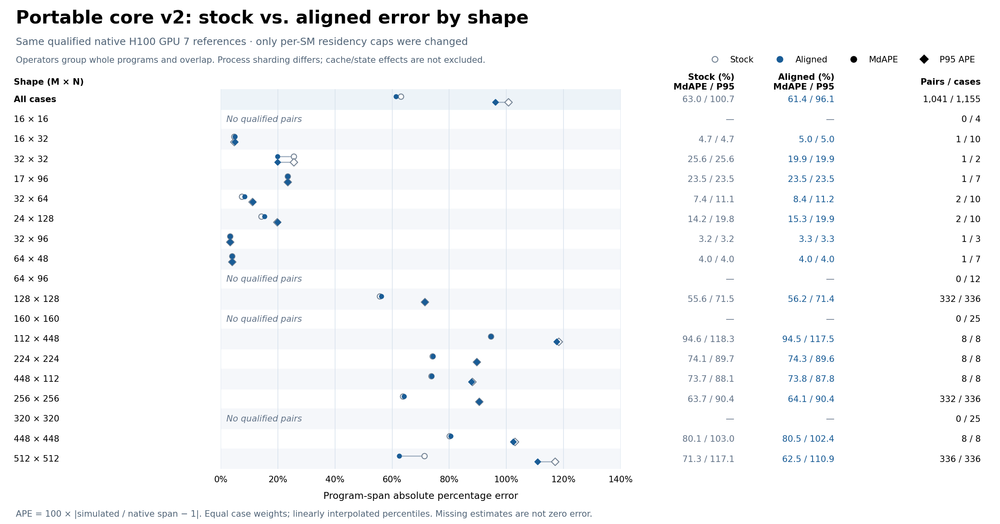
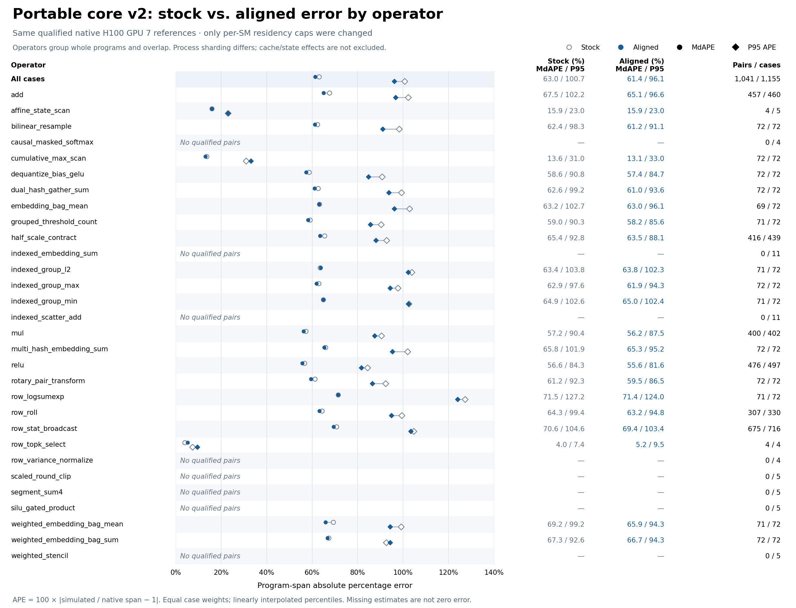

# FlashGPU-Sim H100 residency-aligned rerun report

## User request

```text
re-execute the 3 experiments with flashGPU-SIm simulated H100 config aligned with the real H100.
```

```text
move the reports to ./reports/, and the linked jpg/svg to ./reports/assets/
```

## Result and scope

Both full portable_core v2 PTX lanes pass **1,155/1,155 cases**. On the same
**1,041 qualified timing pairs**, MdAPE changes from **63.01% to
61.39%**, and P95 APE from **100.72% to 96.09%**.
The observed reduction is 1.62 percentage points in MdAPE and
4.63 points in P95 APE; substantial program-span error remains.
All 36 singleton retries pass, leaving zero pending cycle cases.

All 23 comparable stock microbenchmark cycle values and the feature-audit
WGMMA windows are unchanged. The SASS pilot still has 12 passes and 23
unsupported cases. Only three SASS cases meet the timing gate: their MdAPE /
P95 APE remains 18.91% / 20.58%; one individual span changed.
That pilot does not establish a full SASS accuracy distribution.

All scheduled runs have terminal outcomes. Only the two residency limits
were changed: 2,048 threads (64 warps) and 32 CTAs per SM. Native references,
simulator source and shipped preset files are unchanged; model clocks and all
other parameters retain their original settings.
Validated 205 per-run config and log hashes; 36 singleton retries were scheduled.

## Pinned configuration and references

- Simulator commit: `01bdef86caf4b9b6432abcbe3c04b38b86675cdc`; tracked source unchanged.
- PTX effective config SHA-256: `804b86ab33f5ea25bb9bbc5021c82bc5a1f61e20ddf12ce44abd4411d0ad172e`.
- SASS effective config SHA-256: `8a190d259d05d0e4ccc4885f8cf6fb351656047df1d037d57b30fe92bf9b07e3`.
- Both presets retain CC 9.0, 132 SMs and stock model clocks. The only model
  overrides are `gpgpu_shader_core_pipeline=2048:32` and `gpgpu_shader_cta=32`.
- Portable executable SHA-256: `2790ce58621d9f97cf6e1a6892e666fbf8ad93196b689155738e68c128ea9a3e`.
- Native samples are the unchanged prior GPU 0 microbenchmarks and GPU 7
  portable measurements; no fresh hardware timings are claimed by this rerun.

## Stock H100 probes

These are per-window cycle counts, not portable program spans. A dash marks
missing simulation timing; consult the recorded command outcome.

| Case | Metric | H100 | PTX stock | PTX aligned | SASS stock | SASS aligned |
| --- | --- | ---: | ---: | ---: | ---: | ---: |
| f16_rs_n64_g1_o1_same | median_issue_cycles | 790.000 | 812.000 | 812.000 | 816.000 | 816.000 |
| f16_rs_n64_g1_o1_same | median_wait_cycles | 4,160.000 | 5,984.000 | 5,984.000 | 6,080.000 | 6,080.000 |
| f16_rs_n64_g1_o1_same | median_total_cycles | 6,277.000 | 7,654.000 | 7,654.000 | 8,159.000 | 8,159.000 |
| f16_rs_n64_g1_o8_same | median_issue_cycles | 6,134.000 | 4,333.000 | 4,333.000 | 5,700.000 | 5,700.000 |
| f16_rs_n64_g1_o8_same | median_wait_cycles | 15,296.000 | 16,800.000 | 16,800.000 | 17,664.000 | 17,664.000 |
| f16_rs_n64_g1_o8_same | median_total_cycles | 22,764.000 | 21,990.000 | 21,990.000 | 24,635.000 | 24,635.000 |
| f16_rs_n128_g1_o1_same | median_issue_cycles | 726.000 | 813.000 | 813.000 | 784.000 | 784.000 |
| f16_rs_n128_g1_o1_same | median_wait_cycles | 6,208.000 | 12,128.000 | 12,128.000 | 8,130.000 | 8,130.000 |
| f16_rs_n128_g1_o1_same | median_total_cycles | 8,271.000 | 13,797.000 | 13,797.000 | 10,241.000 | 10,241.000 |
| tma-a16 | mean_cycles_per_iteration | 1,065.000 | 1,047.594 | 1,047.594 | 995.938 | 995.938 |
| tma-b32 | mean_cycles_per_iteration | 1,218.531 | 1,569.250 | 1,569.250 | 1,271.438 | 1,271.438 |
| cp-async-complete | mean_cycles_per_iteration | 675.656 | 425.531 | 425.531 | — | — |

## H100 feature audit

The eight-round WGMMA control is kept separate from the longer stock probes.

| Window | H100 cycles | Stock PTX cycles | Aligned PTX cycles |
| --- | ---: | ---: | ---: |
| median_issue_cycles | 104.000 | 98.000 | 98.000 |
| median_wait_cycles | 520.000 | 748.000 | 748.000 |
| median_total_cycles | 957.000 | 990.000 | 990.000 |

### Functional and admission outcomes

| Command | Result | Numerical case passes / tests |
| --- | --- | ---: |
| stock/cp-async-complete-ptx | passed | — |
| stock/cp-async-complete-sass-timing | crashed | — |
| stock/stock-h100-dsm-admission | failed | 0 / 1 |
| stock/stock-h100-mbarrier | passed; 1 skipped | 22 / 23 |
| stock/stock-h100-mma | passed | 29 / 29 |
| stock/stock-h100-tma | passed | 38 / 38 |
| stock/tma-a16-ptx | passed | — |
| stock/tma-a16-sass-timing | passed | — |
| stock/tma-b32-ptx | passed | — |
| stock/tma-b32-sass-timing | passed | — |
| stock/wgmma-f16_rs_n128_g1_o1_same-ptx | passed | 1 / 1 |
| stock/wgmma-f16_rs_n128_g1_o1_same-sass-timing | passed | 1 / 1 |
| stock/wgmma-f16_rs_n64_g1_o1_same-ptx | passed | 1 / 1 |
| stock/wgmma-f16_rs_n64_g1_o1_same-sass-timing | passed | 1 / 1 |
| stock/wgmma-f16_rs_n64_g1_o8_same-ptx | passed | 1 / 1 |
| stock/wgmma-f16_rs_n64_g1_o8_same-sass-timing | passed | 1 / 1 |
| feature/h100-matrix-copy-ptx | passed | 16 / 16 |
| feature/h100-matrix-sass | passed | 2 / 2 |
| feature/h100-wgmma-ptx | passed | 25 / 25 |
| feature/h100-wgmma-sass | passed | 9 / 9 |
| feature/h100-wgmma-sass-timing | passed | 2 / 2 |
| feature/h100-wgmma-timing-ptx | passed | 1 / 1 |

## Portable_core v2

| Lane | Outcome | Cases |
| --- | --- | ---: |
| ptx | pass | 1155 |
| sass-timing | pass | 12 |
| sass-timing | unsupported FCHK | 18 |
| sass-timing | unsupported FRND.FLOOR | 2 |
| sass-timing | unsupported FSET.BF.GT.AND | 1 |
| sass-timing | unsupported MUFU.RSQ | 1 |
| sass-timing | unsupported MUFU.SIN | 1 |
| ptx-functional | pass | 1155 |

### Matched timing pairs

APE compares CUDA stream program spans to the unchanged qualified native medians.
Only the intersection with accepted stock and aligned timing is compared.
Process groupings are not identical: the portable panel was resharded, including
early singleton runs for three PTX cases previously measured in batches. The
paired changes do not exclude process-state or cache carryover effects.

| Lane | Pairs | Stock MdAPE / P95 APE | Aligned MdAPE / P95 APE | Changed spans |
| --- | ---: | ---: | ---: | ---: |
| ptx | 1041 | 63.01% / 100.72% | 61.39% / 96.09% | 1008 |
| sass-timing | 3 | 18.91% / 20.58% | 18.91% / 20.58% | 1 |


[Shape figure (SVG)](assets/portable-v2-stock-aligned-ape-by-shape.svg).


[Operator figure (SVG)](assets/portable-v2-stock-aligned-ape-by-operator.svg).


### Shape and operator breakdowns

Operator rows contain whole programs and overlap. Missing or unqualified
groups are not scored as zero. Values use matched PTX pairs only.

| Group | Pairs | Stock MdAPE / P95 APE | Aligned MdAPE / P95 APE |
| --- | ---: | ---: | ---: |
| shape: 17 × 96 | 1 | 23.47% / 23.47% | 23.47% / 23.47% |
| shape: 24 × 128 | 2 | 14.15% / 19.76% | 15.28% / 19.87% |
| shape: 32 × 64 | 2 | 7.37% / 11.06% | 8.43% / 11.16% |
| shape: 64 × 48 | 1 | 3.98% / 3.98% | 3.98% / 3.98% |
| shape: 112 × 448 | 8 | 94.58% / 118.32% | 94.52% / 117.53% |
| shape: 224 × 224 | 8 | 74.09% / 89.66% | 74.29% / 89.62% |
| shape: 448 × 112 | 8 | 73.73% / 88.09% | 73.83% / 87.81% |
| shape: 448 × 448 | 8 | 80.07% / 102.97% | 80.50% / 102.35% |
| shape: 32 × 32 | 1 | 25.56% / 25.56% | 19.88% / 19.88% |
| shape: 16 × 32 | 1 | 4.69% / 4.69% | 5.00% / 5.00% |
| shape: 32 × 96 | 1 | 3.23% / 3.23% | 3.34% / 3.34% |
| shape: 512 × 512 | 336 | 71.31% / 117.06% | 62.45% / 110.93% |
| shape: 256 × 256 | 332 | 63.71% / 90.39% | 64.11% / 90.42% |
| shape: 128 × 128 | 332 | 55.59% / 71.46% | 56.16% / 71.41% |
| operator: affine_state_scan | 4 | 15.93% / 23.01% | 15.93% / 23.01% |
| operator: add | 457 | 67.53% / 102.25% | 65.07% / 96.65% |
| operator: relu | 476 | 56.63% / 84.34% | 55.63% / 81.61% |
| operator: row_roll | 307 | 64.33% / 99.44% | 63.16% / 94.84% |
| operator: row_stat_broadcast | 675 | 70.65% / 104.63% | 69.39% / 103.39% |
| operator: row_topk_select | 4 | 3.98% / 7.44% | 5.19% / 9.46% |
| operator: dual_hash_gather_sum | 72 | 62.59% / 99.24% | 61.00% / 93.64% |
| operator: half_scale_contract | 416 | 65.45% / 92.77% | 63.52% / 88.09% |
| operator: mul | 400 | 57.20% / 90.44% | 56.17% / 87.52% |
| operator: embedding_bag_mean | 69 | 63.16% / 102.74% | 62.99% / 96.14% |
| operator: indexed_group_max | 72 | 62.93% / 97.64% | 61.85% / 94.31% |
| operator: weighted_embedding_bag_sum | 72 | 67.31% / 92.64% | 66.74% / 94.28% |
| operator: bilinear_resample | 72 | 62.39% / 98.30% | 61.24% / 91.08% |
| operator: cumulative_max_scan | 72 | 13.56% / 30.98% | 13.07% / 33.01% |
| operator: dequantize_bias_gelu | 72 | 58.59% / 90.78% | 57.41% / 84.72% |
| operator: grouped_threshold_count | 71 | 59.02% / 90.30% | 58.19% / 85.55% |
| operator: indexed_group_l2 | 71 | 63.42% / 103.81% | 63.80% / 102.26% |
| operator: indexed_group_min | 71 | 64.88% / 102.58% | 64.96% / 102.44% |
| operator: multi_hash_embedding_sum | 72 | 65.84% / 101.95% | 65.31% / 95.23% |
| operator: rotary_pair_transform | 72 | 61.24% / 92.34% | 59.54% / 86.49% |
| operator: row_logsumexp | 71 | 71.48% / 127.18% | 71.40% / 123.97% |
| operator: weighted_embedding_bag_mean | 71 | 69.23% / 99.18% | 65.92% / 94.29% |

## Evidence

- [Final identity and coverage audit](../local_artifacts/flashgpu-h100-residency/identity-audit.json).
- [Reproduce closeout checks](../local_artifacts/flashgpu-h100-residency/verify_closeout.py).

- [Case-level aligned versus stock comparison](../local_artifacts/flashgpu-h100-residency/comparison-aligned-vs-stock.json).
- [Aligned coverage and timing](../local_artifacts/flashgpu-h100-residency/comparison.json).
- [Execution and outcome ledger](../local_artifacts/flashgpu-h100-residency/execution-summary.json).
- [Admission, selections and config hashes](../local_artifacts/flashgpu-h100-residency/admission.json).
- [Plan](../.plan/261124-2322-flashgpu-h100-residency-plan.md) and [tracker](../.plan/tracker/261124-2322-flashgpu-h100-residency.md).

## Revision History

- 2026-11-25 01:42 -0800: Closed all three H100 panels; recorded paired timings, support failures, timeouts and exact evidence hashes.
- 2026-11-25 01:47 -0800: Independently audited all 205 outputs and 2,381 validation rows, recomputed the grouped percentiles, reviewed figure layout and closed every recovery case. Clarified the mbarrier skip and retained process-sharding limits on causal interpretation.
- 2026-11-25 01:48 -0800: Recorded pinned effective configuration identities, final recovery state and closed continuation bookkeeping.
