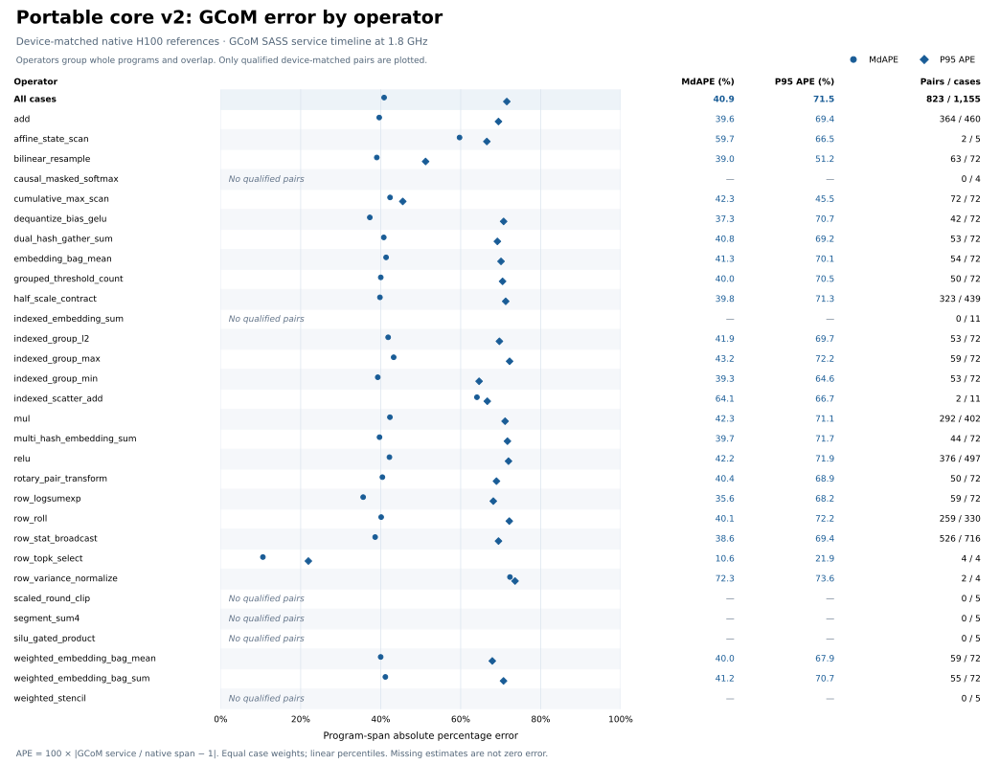
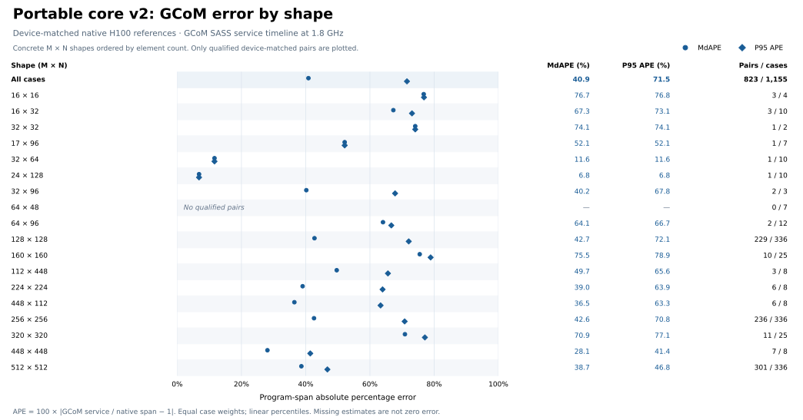
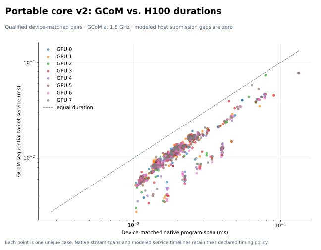

# GCoM portable_core v2 against H100

Updated: 2026-11-27T05:15:00.371043+00:00

**1141 / 1,155 cases have admitted replay; 823 cases qualify for timing comparison.**

## User requests

```text
persist a plan to run the same validation/correlation experiments for portable_core v2 (both the op gates and H3 gates) with GCoM ~/wk/modern-gpu-simulator-micro-2025/ with same H100 target.
```

```text
use as any many GPUs as possible as long as it's dedicated (no loads).
```

```text
and use as many CPU as possible for GCoM's data points.
```

```text
execute the plan
```

```text
can the gcom report use the layout of reports/assets/portable-v2-stock-aligned-ape-by-operator.svg for its figures?
```

## Coverage and current execution

| Stage | Cases |
| --- | ---: |
| native correct | 1147 / 1,155 |
| trace complete | 1141 / 1,155 |
| replay admitted | 1141 / 1,155 |
| timing qualified | 823 / 1,155 |

Case states: `{"hardware_not_completed": 14, "replay_complete": 1141}`.

The panel covers operation-gate-v2 and both H3 development/smoke families. Exact historical H3 references remain `blocked_missing_source`; formal gate decisions remain `gate_not_evaluated`.

## Model and measurement contract

The pinned GCoM source is `122f91afac2155b80fe9f5e5d46d2817d8f09571`. Its H100 80 GB config uses CC 9.0, 132 SMs, 2,048 threads, 64 warps and 32 CTAs per SM, and a 1.8 GHz core clock. Hardware timing parameters retain their shipped values.

The simulator and tracer were rebuilt in an isolated worktree. Capture uses official NVBit 1.8.2, the documented channel/thread API adapter and documented CUkernel-to-CUfunction resolution for CUDA 13.3 launches. CUDA injection alone is the qualified loader for the unchanged shared-runtime executable. The simulator model source is unchanged.

Five explicit compatibility overrides disable absent-feature sidecar consumers: `tma_real_base_addr_enable=0`, `tma_operand_addr_tiling_enable=0`, `wait_block_enable=0`, `wait_block_exact_generation_enable=0`, and its dependent observer `wait_block_late_arrival_instrument_enable=0`. Every admitted trace must have a complete static opcode inventory proving absence of applicable synchronization/TMA consumers. These flags are refused for a trace with such instructions. Prior configuration-admission aborts are retained under distinct immutable keys; no successful deterministic replay is repeated.

Each physical H100 requires 30 clean seconds, a per-UUID lease and continuous foreign-context monitoring. Each hardware child sees its assigned UUID as logical device 0. Three fresh native processes provide 30 samples each on the same card as the trace; historical GPU 7 timing is not transferred to other cards.

The scored window follows the validation graph and three warmup graphs. GCoM service cycles include its fixed configured CTA launch delay and omit host submission gaps. They are compared descriptively with the matching native stream program span under that declared model policy. CUPTI body timestamps are retained as diagnostics; service cycles are not relabeled kernel-body cycles.

Native timing eligibility requires a median of at least 10 microseconds and relative MAD at most 5% within and across the three repeat processes. Short/noisy rows stay inconclusive. The separate 64-repetition H3 protocol still requires its own runtime qualification.

CPU replay uses disjoint NUMA-local slots, excludes observed busy cores and their SMT siblings, and respects CPU quota, memory and disk limits. An 8 GiB disk reserve and verified lossless archives bound storage. Every immutable simulator/config/trace key runs once.

## Descriptive timing results

MdAPE: **40.85%**; P95 APE: **71.52%**; eligible cases: **823 / 1,155**.

| Suite / profile | Eligible / total | MdAPE (%) | P95 APE (%) | Pearson | Spearman |
| --- | ---: | ---: | ---: | ---: | ---: |
| h3-programs/development | 44 / 84 | 67.04 | 78.42 | 0.94 | 0.92 |
| h3-programs/smoke | 4 / 6 | 76.20 | 76.82 | 0.99 | 0.80 |
| h3-semantics/development | 3 / 40 | 61.18 | 66.36 | 0.99 | 0.50 |
| h3-semantics/smoke | 1 / 7 | 67.29 | 67.29 | not evaluable | not evaluable |
| mechanism-controls/development | 4 / 9 | 10.55 | 62.01 | 1.00 | 1.00 |
| mechanism-controls/reference | 221 / 288 | 41.93 | 71.32 | 0.60 | 0.77 |
| mechanism-controls/smoke | 2 / 3 | 48.74 | 71.24 | not evaluable | not evaluable |
| operation-gate-v2/development | 221 / 288 | 41.93 | 71.32 | 0.60 | 0.77 |
| operation-gate-v2/reference | 545 / 720 | 40.42 | 69.34 | 0.96 | 0.82 |
| operation-gate-v2/smoke | 4 / 10 | 68.97 | 71.08 | 0.87 | 0.80 |

Unique cases carry one weight; suite aliases and repeated samples do not add weights. Operator-containing groups overlap and measure whole-program durations. P95 uses linear interpolation. Constant or undersized groups have no correlation score.

Cross-device anchor policy: descriptive; use device strata as primary. Per-GPU scores and anchor distributions are retained in the case ledger.

## Short H3 batch lane

The separate 64-repetition realization has 37 eligible batch rows out of 53 recorded outcomes. MdAPE: 31.35; P95 APE: 63.56. These rows have independent native qualification and do not change single-invocation eligibility.

## Figures







## Evidence and reproduction

- [Execution admission](../local_artifacts/gcom-portable-v2/execution-admission.json)
- [Case ledger JSON](../local_artifacts/gcom-portable-v2/case-ledger.json)
- [Case ledger CSV](../local_artifacts/gcom-portable-v2/case-ledger.csv)
- [Execution tracker](../.plan/tracker/261125-1652-gcom-portable-v2-h100.md)

From `/home/cliu/wk/amora`, reparse saved evidence with:

```bash
PYTHONPATH=. /home/cliu/wk/gpu-perf/local_artifacts/gcom-portable-v2/execution-env/bin/python \
  -m amora.benchmarking.portable_v2.gcom_campaign report \
  --root /home/cliu/wk/gpu-perf/local_artifacts/gcom-portable-v2
```

## References

- Rodrigo Huerta, Mojtaba Abaie Shoushtary, José-Lorenzo Cruz and Antonio González. *Dissecting and Modeling the Architecture of Modern GPU Cores*. MICRO 2025.
- Rodrigo Huerta and Antonio González. *GPU Simulation Acceleration via Parallelization*. ISPASS 2025; and *Parallelizing a modern GPU simulator*, [arXiv:2401.10082](https://arxiv.org/abs/2401.10082).
- Mahmoud Khairy, Zhensheng Shen, Tor M. Aamodt and Timothy G. Rogers. *Accel-Sim: An Extensible Simulation Framework for Validated GPU Modeling*. ISCA 2020.
- [GCoM source README and citation requirements](../../modern-gpu-simulator-micro-2025/README.md).

## Revision History

- 2026-11-25T18:04:52-08:00: Recomputed coverage and descriptive scores from saved receipts; no simulator rerun.
- 2026-11-25T18:12:25-08:00: Recomputed coverage and descriptive scores from saved receipts; no simulator rerun.
- 2026-11-25T18:19:49-08:00: Recomputed coverage and descriptive scores from saved receipts; no simulator rerun.
- 2026-11-25T18:53:11-08:00: Recomputed coverage and descriptive scores from saved receipts; no simulator rerun.
- 2026-11-25T19:03:19-08:00: Recomputed coverage and descriptive scores from saved receipts; no simulator rerun.
- 2026-11-25T19:35:00-08:00: Recomputed coverage and descriptive scores from saved receipts; no simulator rerun.
- 2026-11-25T19:35:01-08:00: Recomputed coverage and descriptive scores from saved receipts; no simulator rerun.
- 2026-11-25T20:01:12-08:00: Recomputed coverage and descriptive scores from saved receipts; no simulator rerun.
- 2026-11-25T20:17:43-08:00: Recomputed coverage and descriptive scores from saved receipts; no simulator rerun.
- 2026-11-25T20:24:14-08:00: Recomputed coverage and descriptive scores from saved receipts; no simulator rerun.
- 2026-11-25T20:40:10-08:00: Recomputed coverage and descriptive scores from saved receipts; no simulator rerun.
- 2026-11-25T20:47:55-08:00: Recomputed coverage and descriptive scores from saved receipts; no simulator rerun.
- 2026-11-25T21:25:54-08:00: Recomputed coverage and descriptive scores from saved receipts; no simulator rerun.
- 2026-11-25T21:58:23-08:00: Recomputed coverage and descriptive scores from saved receipts; no simulator rerun.
- 2026-11-25T22:21:46-08:00: Recomputed coverage and descriptive scores from saved receipts; no simulator rerun.
- 2026-11-25T22:41:25-08:00: Recomputed coverage and descriptive scores from saved receipts; no simulator rerun.
- 2026-11-25T23:13:02-08:00: Recomputed coverage and descriptive scores from saved receipts; no simulator rerun.
- 2026-11-25T23:36:18-08:00: Recomputed coverage and descriptive scores from saved receipts; no simulator rerun.
- 2026-11-25T23:56:19-08:00: Recomputed coverage and descriptive scores from saved receipts; no simulator rerun.
- 2026-11-26T00:32:15-08:00: Recomputed coverage and descriptive scores from saved receipts; no simulator rerun.
- 2026-11-26T00:57:07-08:00: Recomputed coverage and descriptive scores from saved receipts; no simulator rerun.
- 2026-11-26T01:21:11-08:00: Recomputed coverage and descriptive scores from saved receipts; no simulator rerun.
- 2026-11-26T01:59:56-08:00: Recomputed coverage and descriptive scores from saved receipts; no simulator rerun.
- 2026-11-26T02:25:27-08:00: Recomputed coverage and descriptive scores from saved receipts; no simulator rerun.
- 2026-11-26T02:44:13-08:00: Recomputed coverage and descriptive scores from saved receipts; no simulator rerun.
- 2026-11-26T03:12:40-08:00: Recomputed coverage and descriptive scores from saved receipts; no simulator rerun.
- 2026-11-26T03:31:34-08:00: Recomputed coverage and descriptive scores from saved receipts; no simulator rerun.
- 2026-11-26T03:49:04-08:00: Recomputed coverage and descriptive scores from saved receipts; no simulator rerun.
- 2026-11-26T04:14:55-08:00: Recomputed coverage and descriptive scores from saved receipts; no simulator rerun.
- 2026-11-26T04:35:36-08:00: Recomputed coverage and descriptive scores from saved receipts; no simulator rerun.
- 2026-11-26T04:55:11-08:00: Recomputed coverage and descriptive scores from saved receipts; no simulator rerun.
- 2026-11-26T05:23:18-08:00: Recomputed coverage and descriptive scores from saved receipts; no simulator rerun.
- 2026-11-26T05:43:35-08:00: Recomputed coverage and descriptive scores from saved receipts; no simulator rerun.
- 2026-11-26T06:01:20-08:00: Recomputed coverage and descriptive scores from saved receipts; no simulator rerun.
- 2026-11-26T06:17:57-08:00: Recomputed coverage and descriptive scores from saved receipts; no simulator rerun.
- 2026-11-26T06:42:33-08:00: Recomputed coverage and descriptive scores from saved receipts; no simulator rerun.
- 2026-11-26T06:57:10-08:00: Recomputed coverage and descriptive scores from saved receipts; no simulator rerun.
- 2026-11-26T07:18:32-08:00: Recomputed coverage and descriptive scores from saved receipts; no simulator rerun.
- 2026-11-26T07:40:01-08:00: Recomputed coverage and descriptive scores from saved receipts; no simulator rerun.
- 2026-11-26T08:00:09-08:00: Recomputed coverage and descriptive scores from saved receipts; no simulator rerun.
- 2026-11-26T08:32:48-08:00: Recomputed coverage and descriptive scores from saved receipts; no simulator rerun.
- 2026-11-26T08:33:17-08:00: Recomputed coverage and descriptive scores from saved receipts; no simulator rerun.
- 2026-11-26T08:33:43-08:00: Recomputed coverage and descriptive scores from saved receipts; no simulator rerun.
- 2026-11-26T09:38:01-08:00: Recomputed coverage and descriptive scores from saved receipts; no simulator rerun.
- 2026-11-26T10:42:49-08:00: Recomputed coverage and descriptive scores from saved receipts; no simulator rerun.
- 2026-11-26T11:41:31-08:00: Recomputed coverage and descriptive scores from saved receipts; no simulator rerun.
- 2026-11-26T12:30:53-08:00: Recomputed coverage and descriptive scores from saved receipts; no simulator rerun.
- 2026-11-26T13:30:21-08:00: Recomputed coverage and descriptive scores from saved receipts; no simulator rerun.
- 2026-11-26T14:48:48-08:00: Recomputed coverage and descriptive scores from saved receipts; no simulator rerun.
- 2026-11-26T14:50:10-08:00: Recomputed coverage and descriptive scores from saved receipts; no simulator rerun.
- 2026-11-26T16:02:55-08:00: Recomputed coverage and descriptive scores from saved receipts; no simulator rerun.
- 2026-11-26T16:03:44-08:00: Recomputed coverage and descriptive scores from saved receipts; no simulator rerun.
- 2026-11-26T16:04:27-08:00: Recomputed coverage and descriptive scores from saved receipts; no simulator rerun.
- 2026-11-26T21:15:22-08:00: Recomputed coverage and descriptive scores from saved receipts; no simulator rerun.
- 2026-11-26T21:18:03-08:00: Applied the requested stock/aligned chart layout to operator and shape APE figures: overall row, striped rows, circle/diamond markers, aligned MdAPE/P95/count columns, percent grid, matching headings and footer. Refreshed scatter typography. All saved numeric summaries and coverage are unchanged; no simulator run.
