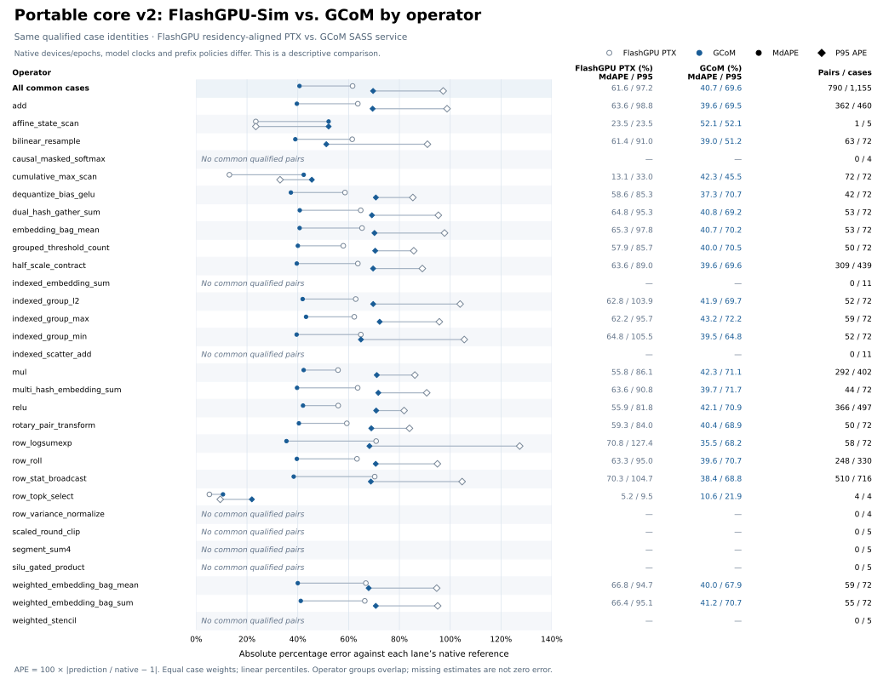
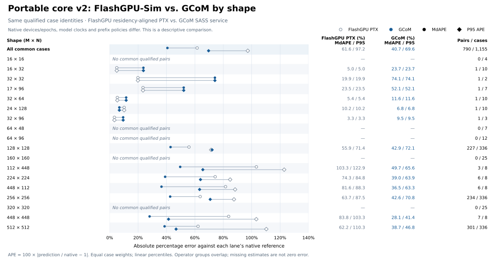

# FlashGPU-Sim and GCoM against H100: canonical and portable core v2

Updated: 2026-11-27T15:18:11-08:00

## User request

```text
also generate a report with flashGPU-Sim and GCOM results for both canonical and portable_core v2 kernels. if canonical kernels results are not avaiable, let me know.
```

## Result and availability

**Portable_core v2 results exist for both simulators. The dedicated canonical PPP H100 campaign now has retained results.** Canonical completion and timing-qualified counts below come from its case ledger; this is not full-manifest closeout.

FlashGPU residency-aligned PTX has 1,155/1,155 numerical passes and 1,041 timing-qualified pairs. GCoM has 1,141 successful timing replays, 14 incomplete hardware acquisitions and 823 qualified single-program comparisons. Its independent batch64 H3 lane has 47 complete replays, 6 incomplete runs and 37 qualified comparisons.

The primary two-lane comparison uses **790 identical qualified case/program identities**. Each simulator retains its own native reference. Hardware devices/epochs, prefix policies and model clock domains differ, so the difference between error distributions is descriptive and cannot be attributed solely to simulator quality.

## Canonical benchmark kernels

Canonical means AMORA’s `benchmark_generators/ppp_canonical` workload families. The campaign now retains the standard 2,500-case H100 manifest plus nine minimum-work source pilots. It uses the unchanged canonical templates and a consistently warmup-disabled binary. Numerical correctness remains unevaluated because these templates have no independent output oracle.

| Canonical family | FlashGPU-Sim result | GCoM result | Measurement contract |
| --- | --- | --- | --- |
| aligned_gemm_fp16 | PTX 0 complete / 0 qualified; SASS 0 complete / 0 qualified | 1 complete / 0 qualified | `kernel_cycles` |
| embedding | PTX 19 complete / 0 qualified; SASS 0 complete / 0 qualified | 19 complete / 0 qualified | `kernel_cycles` |
| flash_attention_fwd | PTX 18 complete / 18 qualified; SASS 18 complete / 18 qualified | 18 complete / 18 qualified | `bounded_sampled_attention` |
| flashmla_dense_decode | PTX 18 complete / 18 qualified; SASS 18 complete / 18 qualified | 18 complete / 18 qualified | `bounded_sampled_attention` |
| gelu | PTX 0 complete / 0 qualified; SASS 0 complete / 0 qualified | 1 complete / 0 qualified | `kernel_cycles` |
| gelu_gemm_fp16 | PTX 0 complete / 0 qualified; SASS 0 complete / 0 qualified | 1 complete / 0 qualified | `fused_component_aggregate` |
| megamoe_fp8 | PTX 8 complete / 8 qualified; SASS 0 complete / 0 qualified | 8 complete / 8 qualified | `bounded_sampled_moe` |
| rmsnorm | PTX 18 complete / 0 qualified; SASS 0 complete / 0 qualified | 18 complete / 0 qualified | `kernel_cycles` |
| rmsnorm_gemm_fp16 | PTX 0 complete / 0 qualified; SASS 0 complete / 0 qualified | 1 complete / 1 qualified | `fused_component_aggregate` |

### Canonical timing-qualified results

| Lane | Qualified pairs | MdAPE (%) | P95 APE (%) |
| --- | ---: | ---: | ---: |
| FlashGPU aligned PTX | 44 | 112.50 | 129.57 |
| FlashGPU aligned SASS timing | 36 | 71.43 | 99.48 |
| GCoM | 45 | 8.74 | 19.86 |

Native completed: 137 unique cases. Full family/shape outcomes, raw pilot predictions, resource-deferred cases and timing limits are in the [canonical report](261126-2301-canonical-ppp-h100-report.md).
Native spans include component gaps; models retain their original service/launch policies and clock domains. Attention/MLA/MoE are the declared bounded templates; their names do not establish production kernel or native FP8 Tensor Core coverage. Do not pool canonical and portable errors.

Canonical follow-up request:

```text
Work on the Canonical PPP kernel results for both simulators.
```

Canonical unavailable, unsupported, incomplete and resource-deferred cases remain explicit in the linked campaign ledger.

## Portable core v2: independent reported cohorts

| Lane | Qualified pairs / planned cases | MdAPE (%) | P95 APE (%) | Reference / scope |
| --- | ---: | ---: | ---: | --- |
| FlashGPU stock PTX | 1,041 / 1,155 | 63.01 | 100.72 | Historical native H100 GPU 7 |
| FlashGPU residency-aligned PTX | 1,041 / 1,155 | 61.39 | 96.09 | Same historical native GPU 7 references |
| FlashGPU aligned SASS pilot | 3 / 35 pilot cases | 18.91 | 20.58 | 12 passes, 23 unsupported; only 3 timing pairs |
| GCoM single-program | 823 / 1,155 | 40.85 | 71.52 | Fresh per-device references on dedicated H100s |
| GCoM batch64 H3 | 37 / 53 | 31.35 | 63.56 | Separate executable/protocol; excluded from single-program pool |

These rows use different eligible populations. They are coverage summaries, not a paired ranking of the simulators. FlashGPU SASS has no full portable panel or comparable GCoM batch lane.

## Portable core v2: common case identities

| Lane on the common cohort | Cases | MdAPE (%) | P95 APE (%) | Signed median bias (%) | Pearson | Spearman |
| --- | ---: | ---: | ---: | ---: | ---: | ---: |
| FlashGPU stock PTX | 790 | 63.59 | 102.53 | 63.59 | 0.90 | 0.95 |
| FlashGPU residency-aligned PTX | 790 | 61.57 | 97.25 | 61.57 | 0.90 | 0.95 |
| GCoM | 790 | 40.66 | 69.64 | -40.66 | 0.93 | 0.82 |

The join validates case ID, case SHA-256, program SHA-256 and contained operators for every row. The unchanged CUDA realization is shared; inputs/oracle banks are the sealed portable corpus. Global weighting is one per unique case, not aliases or repeated samples. P95 uses linear interpolation.

### Operator and shape figures


[Operator PNG](assets/261126-2130-flashgpu-gcom-h100-comparison-portable-ape-by-operator.png)


[Shape PNG](assets/261126-2130-flashgpu-gcom-h100-comparison-portable-ape-by-shape.png)

The figures use the requested striped-row/table layout. FlashGPU PTX uses hollow gray markers and GCoM solid blue markers; circles denote MdAPE and diamonds P95. Counts use the common eligible intersection over the full group denominator. Missing groups are labeled.

### Operation and H3 suite breakdown

| Suite / profile | Common pairs / total | FlashGPU aligned MdAPE / P95 (%) | GCoM MdAPE / P95 (%) |
| --- | ---: | ---: | ---: |
| h3-programs/development | 23 / 84 | 82.87 / 108.20 | 38.35 / 68.07 |
| h3-programs/smoke | 1 / 6 | 19.88 / 19.88 | 74.10 / 74.10 |
| h3-semantics/development | 1 / 40 | 23.47 / 23.47 | 52.14 / 52.14 |
| h3-semantics/smoke | 0 / 7 | — / — | — / — |
| mechanism-controls/development | 3 / 9 | 5.39 / 9.70 | 9.49 / 11.40 |
| mechanism-controls/reference | 220 / 288 | 64.56 / 96.08 | 41.90 / 71.33 |
| mechanism-controls/smoke | 1 / 3 | 5.00 / 5.00 | 23.74 / 23.74 |
| operation-gate-v2/development | 220 / 288 | 64.56 / 96.08 | 41.90 / 71.33 |
| operation-gate-v2/reference | 542 / 720 | 59.48 / 100.00 | 40.42 / 69.37 |
| operation-gate-v2/smoke | 4 / 10 | 47.98 / 53.27 | 68.97 / 71.08 |

H3 development/smoke controls are covered. Both exact historical H3 reference profiles remain `blocked_missing_source`, and formal operation/H3 gate decisions remain `gate_not_evaluated` without approved splits and frozen acceptance criteria.

## Available H100 instruction microbenchmarks

These are kernel/window cycle probes from the earlier FlashGPU study, not PPP canonical application results. No corresponding admitted GCoM runs for these exact same-binary windows were found. The values are unchanged by the FlashGPU residency alignment.

| Probe / window | Native cycles | FlashGPU aligned PTX cycles / signed difference (%) | FlashGPU aligned SASS cycles / signed difference (%) | GCoM |
| --- | ---: | ---: | ---: | --- |
| f16_rs_n64_g1_o1_same · `median_issue_cycles` | 790.00 | 812.00 / 2.78 | 816.00 / 3.29 | Not available |
| f16_rs_n64_g1_o1_same · `median_wait_cycles` | 4160.00 | 5984.00 / 43.85 | 6080.00 / 46.15 | Not available |
| f16_rs_n64_g1_o1_same · `median_total_cycles` | 6277.00 | 7654.00 / 21.94 | 8159.00 / 29.98 | Not available |
| f16_rs_n64_g1_o8_same · `median_issue_cycles` | 6134.00 | 4333.00 / -29.36 | 5700.00 / -7.08 | Not available |
| f16_rs_n64_g1_o8_same · `median_wait_cycles` | 15296.00 | 16800.00 / 9.83 | 17664.00 / 15.48 | Not available |
| f16_rs_n64_g1_o8_same · `median_total_cycles` | 22764.00 | 21990.00 / -3.40 | 24635.00 / 8.22 | Not available |
| f16_rs_n128_g1_o1_same · `median_issue_cycles` | 726.00 | 813.00 / 11.98 | 784.00 / 7.99 | Not available |
| f16_rs_n128_g1_o1_same · `median_wait_cycles` | 6208.00 | 12128.00 / 95.36 | 8130.00 / 30.96 | Not available |
| f16_rs_n128_g1_o1_same · `median_total_cycles` | 8271.00 | 13797.00 / 66.81 | 10241.00 / 23.82 | Not available |
| tma-a16 · `mean_cycles_per_iteration` | 1065.00 | 1047.59 / -1.63 | 995.94 / -6.48 | Not available |
| tma-b32 · `mean_cycles_per_iteration` | 1218.53 | 1569.25 / 28.78 | 1271.44 / 4.34 | Not available |
| cp-async-complete · `mean_cycles_per_iteration` | 675.66 | 425.53 / -37.02 | Unavailable / abort | Not available |

WGMMA whole-region, issue and wait windows overlap and must not be pooled into a single application MdAPE. TMA/cp.async completion windows are separate protocols with their own native repeats.

## Archived AMORA diagnostic profile availability

The existing `out/gcom_cuda/hopper/gcom_h100-rerun-20260717-0300.json` and `out/nvidia/hopper/h100-80g.json` each contain 36 diagnostic probe records, not canonical workload cases. Five GCoM entries publish direct/bounded estimates. Their source/binary/native-reference provenance is not admitted by the current portable campaign, so they do not supply canonical benchmark accuracy.

| Diagnostic probe | Archived GCoM estimate | Unit | Fit status |
| --- | ---: | --- | --- |
| arithmetic_latency.dependent_chain | 10.92 | cycles | direct |
| arithmetic_throughput.independent_chains | 11.73 | cycles | direct |
| tensor_core.mma_latency | 33.11 | cycles | direct |
| tensor_core.mma_throughput | 0.00 | ops/cycle | bounded |
| tma_copy.async_copy_latency | 437.06 | cycles | bounded |

## Target, timing and limitations

- H100 target: CC 9.0, 132 SMs, 2,048 threads, 64 warps and 32 CTAs per SM for the aligned FlashGPU and GCoM lanes. Stock FlashGPU limits remain 1,536 threads/48 warps/24 CTAs in its separately identified baseline.
- FlashGPU clock domains retain 1500:1700:1700:2617 MHz; GCoM retains 1800:1800:1800:8000 MHz. Raw cycles from different core clocks are not interchangeable.
- FlashGPU uses historical free-running GPU 7 CUDA program spans. GCoM uses fresh device-matched spans from dedicated H100s; 99 common cases use physical GPU 7, but their native measurement epoch still differs.
- GCoM replays one validation graph, three warmup graphs and one target graph. Its scored service includes the configured 1,500-cycle CTA launch delay and models zero host submission gaps. The earlier FlashGPU PTX capture/run uses its own validation/sample prefix and process sharing; the two timing/cache policies are disclosed rather than treated as identical.
- GCoM’s five absent-feature sidecar overrides are documented in its report. Ordinary Hopper CTA barriers remain modeled. The CUDA executable is unchanged; the NVBit loader/handle adapter is identified separately from the untouched simulator timing model.
- Numerical correctness is checked natively against the independent oracle. GCoM replay admission is a timing-trace outcome, not a simulator arithmetic validation.
- The portable half-identity contraction is realized as vector scaling. It does not establish dense GEMM, Tensor Core, TMA, WGMMA or DSM application coverage.
- GCoM’s 14 hardware acquisition failures remain visible. Six batch runs contain 500 kernel counter blocks and are incomplete for their declared full batches; they do not contribute timing scores. Neither model was retuned to reduce error.

## Evidence and reproduction

- [Combined machine-readable comparison](../local_artifacts/flashgpu-gcom-comparison/comparison.json)
- [Common case/native/prediction crosswalk](../local_artifacts/flashgpu-gcom-comparison/common-portable-pairs.csv)
- [FlashGPU residency-aligned report](261124-2322-flashgpu-h100-residency-report.md)
- [GCoM report](261125-1804-gcom-portable-v2-h100-report.md)
- [Stock H100 probe report](261120-2307-stock-flashgpu-h100-report.md)
- [Canonical definitions](../../amora/benchmark_generators/ppp_canonical/kernels.py)
- [AMORA benchmark/probe distinction](../../amora/README.md)
- [GCoM audit](../local_artifacts/gcom-portable-v2/final-audit.json)

Reproduce from the Amora checkout with `PYTHONPATH=. <execution-env>/bin/python -m amora.benchmarking.portable_v2.combined_report --project /home/cliu/wk/gpu-perf`. This reparses saved data and does not run a simulator.

Source file hashes are included in the combined JSON. GCoM’s MICRO 2025 architectural model, ISPASS 2025 parallelization work and Accel-Sim ISCA 2020 citations are listed in the linked GCoM report.

## Revision History

- 2026-11-26T21:39:47-08:00: Created the combined report from retained evidence; verified the 790-case identity intersection and reported missing canonical cohorts explicitly. Generated figures in the requested reference layout; no simulation or hardware launch.
- 2026-11-26T23:09:57-08:00: Updated canonical availability and scores from the retained campaign ledger; portable identities and score arithmetic unchanged. No simulator was launched by report generation.
- 2026-11-26T23:32:41-08:00: Updated canonical availability and scores from the retained campaign ledger; portable identities and score arithmetic unchanged. No simulator was launched by report generation.
- 2026-11-27T00:18:51-08:00: Updated canonical availability and scores from the retained campaign ledger; portable identities and score arithmetic unchanged. No simulator was launched by report generation.
- 2026-11-27T11:04:37-08:00: Updated canonical availability and scores from the retained campaign ledger; portable identities and score arithmetic unchanged. No simulator was launched by report generation.
- 2026-11-27T15:18:11-08:00: Updated canonical availability and scores from the retained campaign ledger; portable identities and score arithmetic unchanged. No simulator was launched by report generation.
