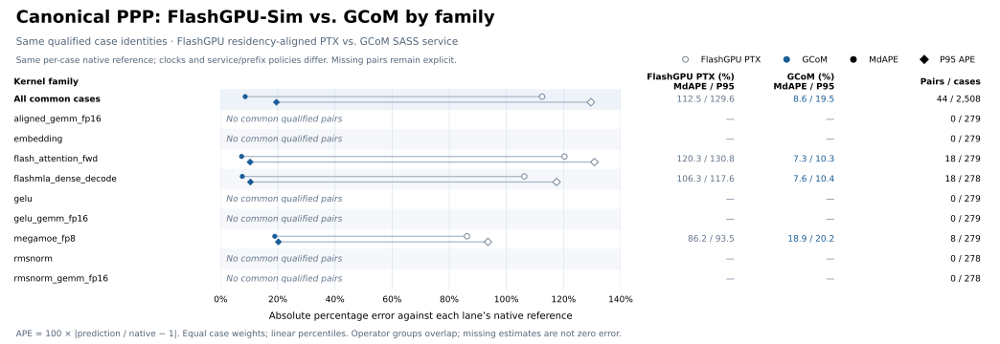

# Canonical PPP on H100: FlashGPU-Sim and GCoM

Updated: 2026-11-27T15:59:49-08:00

## User request

```text
Work on the Canonical PPP kernel results for both simulators.
```

## Campaign state

State: `cpu_continuation`. Native completion: **137 / 2508 unique planned cases**. The standard H100 manifest has 2,500 cases; the family pilot adds source-generator minimum-work shapes where absent.

Primary native completion: **129 / 2500**. Overall timing tables include supplemental source pilots; the primary population is also retained separately in the ledger. The full runner covers every primary identity; CPU/RAM/storage control in-flight work. GPU jobs require explicit user approval.

This is a canonical **timing** campaign. The current templates have no independent output oracle; native completion and simulator completion do not establish numerical correctness.

## Timing-qualified results

| Lane | Complete runs | Qualified pairs | MdAPE (%) | P95 APE (%) |
| --- | ---: | ---: | ---: | ---: |
| FlashGPU aligned PTX | 180 | 44 | 112.50 | 129.57 |
| FlashGPU aligned SASS timing | 93 | 36 | 71.43 | 99.48 |
| GCoM | 85 | 45 | 8.74 | 19.86 |

APE = 100 × abs(prediction/native − 1). Cases have equal weights; P95 uses linear interpolation. Native references require complete, dedicated captures, a median span of at least 10 µs and process-repeat CV at most 10%. Short or variable cases retain raw predictions without entering the accuracy summary.

## Common PTX and GCoM cases

| Lane | Common pairs | MdAPE (%) | P95 APE (%) | Pearson | Spearman |
| --- | ---: | ---: | ---: | ---: | ---: |
| FlashGPU aligned PTX | 44 | 112.50 | 129.57 | 0.98 | 0.87 |
| GCoM | 44 | 8.57 | 19.49 | 0.99 | 0.90 |

### Additional GCoM composite timing window

| Case | Native span (ms) | Median native body sum (µs) | GCoM service (µs) | APE (%) |
| --- | ---: | ---: | ---: | ---: |
| ppp_canonical:r1:generic:rmsnorm_gemm_fp16:r1:K64_M256_N256 | 44.331 | 4.577 | 5.812 | 99.99 |

A retained native capture has a 43.416 ms gap between its selected kernels. The native span includes that gap; GCoM's service timeline models zero host submission gaps. This case remains in the independent GCoM cohort and is absent from the common PTX/GCoM intersection because PTX does not complete it. Its timing-domain mismatch explains the large error and the negative independent-cohort Pearson correlation. Kernel body sums and model service retain their distinct meanings.


## Family coverage

| Family | Native completed / planned | PTX pairs: MdAPE / P95 (%) | SASS pairs: MdAPE / P95 (%) | GCoM pairs: MdAPE / P95 (%) |
| --- | ---: | ---: | ---: | ---: |
| aligned_gemm_fp16 | 19 / 279 | 0: — / — | 0: — / — | 0: — / — |
| embedding | 19 / 279 | 0: — / — | 0: — / — | 0: — / — |
| flash_attention_fwd | 18 / 279 | 18: 120.34 / 130.82 | 18: 60.55 / 64.75 | 18: 7.31 / 10.29 |
| flashmla_dense_decode | 18 / 278 | 18: 106.28 / 117.56 | 18: 90.21 / 100.04 | 18: 7.56 / 10.41 |
| gelu | 1 / 279 | 0: — / — | 0: — / — | 0: — / — |
| gelu_gemm_fp16 | 18 / 279 | 0: — / — | 0: — / — | 0: — / — |
| megamoe_fp8 | 8 / 279 | 8: 86.22 / 93.53 | 0: — / — | 8: 18.93 / 20.18 |
| rmsnorm | 18 / 278 | 0: — / — | 0: — / — | 0: — / — |
| rmsnorm_gemm_fp16 | 18 / 278 | 0: — / — | 0: — / — | 1: 99.99 / 99.99 |

## Family pilot measurements

| Family / shape | Native span (µs) / CV (%) | PTX prediction (µs) / status | SASS prediction (µs) / status | GCoM prediction (µs) / status |
| --- | ---: | --- | --- | --- |
| flashmla_dense_decode · B=1, H=1, S=384 | 15.36 / 0.20 | 32.00 / completed | 29.61 / completed | 16.65 / completed |
| aligned_gemm_fp16 · K=64, M=256, N=256 | 3.01 / 1.75 | — / failed_or_incomplete | — / failed_or_incomplete | 3.34 / completed |
| embedding · B=1, D=64, S=512, U=128, V=50000 | 1.79 / 0.00 | 4.97 / completed | — / failed_or_incomplete | 2.08 / completed |
| flash_attention_fwd · B=1, D=64, H=1, S=384 | 36.54 / 0.08 | 78.29 / completed | 57.23 / completed | 39.99 / completed |
| gelu · N=8192 | 1.41 / 1.08 | — / failed_or_incomplete | — / failed_or_incomplete | 1.79 / completed |
| gelu_gemm_fp16 · K=64, M=256, N=256 | 39934.93 / 18.74 | — / failed_or_incomplete | — / failed_or_incomplete | 5.30 / completed |
| megamoe_fp8 · B=1, D=1024, E=128, S=2048 | 27.14 / 0.11 | 51.06 / completed | — / failed_or_incomplete | 32.30 / completed |
| rmsnorm · B=1, D=128, N=32 | 2.05 / 0.02 | 5.48 / completed | — / failed_or_incomplete | 2.52 / completed |
| rmsnorm_gemm_fp16 · K=64, M=256, N=256 | 44331.36 / 1.93 | — / failed_or_incomplete | — / failed_or_incomplete | 5.81 / completed |

## Figures



These use the striped-row MdAPE/P95 layout of the portable comparison and plot the common qualified PTX/GCoM intersection. Independent SASS and GCoM-only results remain in the tables above.

[aligned_gemm_fp16 shape figure](assets/261126-2301-canonical-ppp-h100-aligned_gemm_fp16-ape-by-shape.svg)

[embedding shape figure](assets/261126-2301-canonical-ppp-h100-embedding-ape-by-shape.svg)

[flash_attention_fwd shape figure](assets/261126-2301-canonical-ppp-h100-flash_attention_fwd-ape-by-shape.svg)

[flashmla_dense_decode shape figure](assets/261126-2301-canonical-ppp-h100-flashmla_dense_decode-ape-by-shape.svg)

[gelu shape figure](assets/261126-2301-canonical-ppp-h100-gelu-ape-by-shape.svg)

[gelu_gemm_fp16 shape figure](assets/261126-2301-canonical-ppp-h100-gelu_gemm_fp16-ape-by-shape.svg)

[megamoe_fp8 shape figure](assets/261126-2301-canonical-ppp-h100-megamoe_fp8-ape-by-shape.svg)

[rmsnorm shape figure](assets/261126-2301-canonical-ppp-h100-rmsnorm-ape-by-shape.svg)

[rmsnorm_gemm_fp16 shape figure](assets/261126-2301-canonical-ppp-h100-rmsnorm_gemm_fp16-ape-by-shape.svg)


## Timing and implementation limits

- Identical source and binary are used for the native/SASS/trace lanes. The canonical `AMORA_GCOM_TRACE` build removes warmup launches and embedding's explicit L2 flush in every lane. These are cold-process measurements and must not be pooled with the earlier warmup-enabled canonical rank workflow.
- Native reference is the span from the first selected launch start to the last launch end, including fused-component submission gaps. Per-kernel body sums are retained separately. Models include their shipped service/CTA launch policies and model zero host gaps; raw body and service counters are not relabeled as identical estimands.
- Aligned H100 residency is 132 SMs, 2,048 threads, 64 warps and 32 CTAs per SM. FlashGPU retains a 1,500 MHz core model; GCoM retains 1,800 MHz. Neither model is fitted to these observations.
- `aligned_gemm_fp16` calls cuBLAS with uninitialized A/B buffers. Numerical and input-value equivalence cannot be claimed for that template. Fused GEMM templates use their defined byte initializations.
- Attention/MLA are bounded sampled templates. `megamoe_fp8` uses unsigned byte arithmetic and bounded routing; it is not evidence of production FP8 Tensor Core MoE execution.
- Real asynchronous/tensor instructions require their exact sidecar contract. The portable absent-feature override is refused for such traces. Unsupported sidecars remain explicit; missing results are not zero error.
- The 2,500-case primary study remains incomplete. The initial 128-case stage is historical; the full continuation removes case/work-score cutoffs and waits on explicit GPU approval and actual CPU/RAM/disk admission.

## Evidence

- [Case ledger](../local_artifacts/canonical-ppp-h100/case-ledger.json)
- [Sealed manifest](../local_artifacts/canonical-ppp-h100/manifest.json)
- [Source/tool/model admission](../local_artifacts/canonical-ppp-h100/admission.json)
- [Plan](../.plan/261126-2301-canonical-ppp-h100-validation-plan.md)
- [Tracker](../.plan/tracker/261126-2301-canonical-ppp-h100-validation.md)

Reparse with `PYTHONPATH=/home/cliu/wk/amora <execution-env>/bin/python -m amora.benchmarking.canonical_ppp.campaign report --root /home/cliu/wk/gpu-perf/local_artifacts/canonical-ppp-h100`. No simulator is invoked by report generation.

## Revision History

- 2026-11-26T23:07:09-08:00: Reparsed retained canonical evidence; native completed 0, complete simulator runs 0, state prepared.
- 2026-11-26T23:08:31-08:00: Reparsed retained canonical evidence; native completed 1, complete simulator runs 0, state family_pilot.
- 2026-11-26T23:08:33-08:00: Reparsed retained canonical evidence; native completed 2, complete simulator runs 0, state family_pilot.
- 2026-11-26T23:08:34-08:00: Reparsed retained canonical evidence; native completed 3, complete simulator runs 0, state family_pilot.
- 2026-11-26T23:08:35-08:00: Reparsed retained canonical evidence; native completed 5, complete simulator runs 0, state family_pilot.
- 2026-11-26T23:09:10-08:00: Reparsed retained canonical evidence; native completed 6, complete simulator runs 0, state family_pilot.
- 2026-11-26T23:09:26-08:00: Reparsed retained canonical evidence; native completed 7, complete simulator runs 0, state family_pilot.
- 2026-11-26T23:09:26-08:00: Reparsed retained canonical evidence; native completed 8, complete simulator runs 0, state family_pilot.
- 2026-11-26T23:11:30-08:00: Reparsed retained canonical evidence; native completed 8, complete simulator runs 0, state bounded_campaign_finished.
- 2026-11-26T23:14:57-08:00: Reparsed retained canonical evidence; native completed 9, complete simulator runs 6, state family_pilot.
- 2026-11-26T23:15:01-08:00: Reparsed retained canonical evidence; native completed 9, complete simulator runs 7, state family_pilot.
- 2026-11-26T23:15:03-08:00: Reparsed retained canonical evidence; native completed 9, complete simulator runs 8, state family_pilot.
- 2026-11-26T23:15:07-08:00: Reparsed retained canonical evidence; native completed 9, complete simulator runs 9, state family_pilot.
- 2026-11-26T23:15:09-08:00: Reparsed retained canonical evidence; native completed 9, complete simulator runs 10, state family_pilot.
- 2026-11-26T23:15:19-08:00: Reparsed retained canonical evidence; native completed 9, complete simulator runs 11, state family_pilot.
- 2026-11-26T23:22:57-08:00: Reparsed retained canonical evidence; native completed 9, complete simulator runs 12, state family_pilot.
- 2026-11-26T23:23:56-08:00: Reparsed retained canonical evidence; native completed 9, complete simulator runs 13, state family_pilot.
- 2026-11-26T23:24:57-08:00: Reparsed retained canonical evidence; native completed 10, complete simulator runs 13, state expansion.
- 2026-11-26T23:24:57-08:00: Reparsed retained canonical evidence; native completed 11, complete simulator runs 13, state expansion.
- 2026-11-26T23:24:59-08:00: Reparsed retained canonical evidence; native completed 12, complete simulator runs 13, state expansion.
- 2026-11-26T23:25:00-08:00: Reparsed retained canonical evidence; native completed 13, complete simulator runs 13, state expansion.
- 2026-11-26T23:25:00-08:00: Reparsed retained canonical evidence; native completed 14, complete simulator runs 13, state expansion.
- 2026-11-26T23:25:00-08:00: Reparsed retained canonical evidence; native completed 15, complete simulator runs 13, state expansion.
- 2026-11-26T23:25:01-08:00: Reparsed retained canonical evidence; native completed 16, complete simulator runs 13, state expansion.
- 2026-11-26T23:25:17-08:00: Reparsed retained canonical evidence; native completed 18, complete simulator runs 13, state expansion.
- 2026-11-26T23:25:23-08:00: Reparsed retained canonical evidence; native completed 19, complete simulator runs 13, state expansion.
- 2026-11-26T23:25:23-08:00: Reparsed retained canonical evidence; native completed 20, complete simulator runs 13, state expansion.
- 2026-11-26T23:25:25-08:00: Reparsed retained canonical evidence; native completed 21, complete simulator runs 13, state expansion.
- 2026-11-26T23:25:26-08:00: Reparsed retained canonical evidence; native completed 22, complete simulator runs 13, state expansion.
- 2026-11-26T23:27:25-08:00: Reparsed retained canonical evidence; native completed 23, complete simulator runs 13, state expansion.
- 2026-11-26T23:27:26-08:00: Reparsed retained canonical evidence; native completed 24, complete simulator runs 13, state expansion.
- 2026-11-26T23:27:26-08:00: Reparsed retained canonical evidence; native completed 25, complete simulator runs 13, state expansion.
- 2026-11-26T23:27:33-08:00: Reparsed retained canonical evidence; native completed 25, complete simulator runs 14, state expansion.
- 2026-11-26T23:27:34-08:00: Reparsed retained canonical evidence; native completed 25, complete simulator runs 15, state expansion.
- 2026-11-26T23:27:41-08:00: Reparsed retained canonical evidence; native completed 25, complete simulator runs 16, state expansion.
- 2026-11-26T23:27:44-08:00: Reparsed retained canonical evidence; native completed 25, complete simulator runs 17, state expansion.
- 2026-11-26T23:27:46-08:00: Reparsed retained canonical evidence; native completed 25, complete simulator runs 18, state expansion.
- 2026-11-26T23:27:46-08:00: Reparsed retained canonical evidence; native completed 25, complete simulator runs 19, state expansion.
- 2026-11-26T23:27:46-08:00: Reparsed retained canonical evidence; native completed 25, complete simulator runs 21, state expansion.
- 2026-11-26T23:27:48-08:00: Reparsed retained canonical evidence; native completed 25, complete simulator runs 22, state expansion.
- 2026-11-26T23:27:49-08:00: Reparsed retained canonical evidence; native completed 25, complete simulator runs 23, state expansion.
- 2026-11-26T23:27:51-08:00: Reparsed retained canonical evidence; native completed 25, complete simulator runs 24, state expansion.
- 2026-11-26T23:27:52-08:00: Reparsed retained canonical evidence; native completed 25, complete simulator runs 25, state expansion.
- 2026-11-26T23:27:53-08:00: Reparsed retained canonical evidence; native completed 25, complete simulator runs 26, state expansion.
- 2026-11-26T23:27:53-08:00: Reparsed retained canonical evidence; native completed 25, complete simulator runs 27, state expansion.
- 2026-11-26T23:27:56-08:00: Reparsed retained canonical evidence; native completed 25, complete simulator runs 28, state expansion.
- 2026-11-26T23:27:57-08:00: Reparsed retained canonical evidence; native completed 25, complete simulator runs 29, state expansion.
- 2026-11-26T23:27:58-08:00: Reparsed retained canonical evidence; native completed 25, complete simulator runs 30, state expansion.
- 2026-11-26T23:28:01-08:00: Reparsed retained canonical evidence; native completed 25, complete simulator runs 31, state expansion.
- 2026-11-26T23:28:02-08:00: Reparsed retained canonical evidence; native completed 25, complete simulator runs 32, state expansion.
- 2026-11-26T23:28:05-08:00: Reparsed retained canonical evidence; native completed 25, complete simulator runs 33, state expansion.
- 2026-11-26T23:28:21-08:00: Reparsed retained canonical evidence; native completed 25, complete simulator runs 34, state expansion.
- 2026-11-26T23:28:27-08:00: Reparsed retained canonical evidence; native completed 25, complete simulator runs 35, state expansion.
- 2026-11-26T23:28:33-08:00: Reparsed retained canonical evidence; native completed 25, complete simulator runs 36, state expansion.
- 2026-11-26T23:28:34-08:00: Reparsed retained canonical evidence; native completed 25, complete simulator runs 37, state expansion.
- 2026-11-26T23:28:42-08:00: Reparsed retained canonical evidence; native completed 25, complete simulator runs 38, state expansion.
- 2026-11-26T23:28:44-08:00: Reparsed retained canonical evidence; native completed 25, complete simulator runs 39, state expansion.
- 2026-11-26T23:28:57-08:00: Reparsed retained canonical evidence; native completed 25, complete simulator runs 40, state expansion.
- 2026-11-26T23:29:03-08:00: Reparsed retained canonical evidence; native completed 25, complete simulator runs 41, state expansion.
- 2026-11-26T23:29:24-08:00: Reparsed retained canonical evidence; native completed 25, complete simulator runs 42, state expansion.
- 2026-11-26T23:29:29-08:00: Reparsed retained canonical evidence; native completed 25, complete simulator runs 43, state expansion.
- 2026-11-26T23:29:42-08:00: Reparsed retained canonical evidence; native completed 25, complete simulator runs 44, state expansion.
- 2026-11-26T23:30:12-08:00: Reparsed retained canonical evidence; native completed 25, complete simulator runs 45, state expansion.
- 2026-11-26T23:35:38-08:00: Reparsed retained canonical evidence; native completed 25, complete simulator runs 46, state expansion.
- 2026-11-26T23:35:43-08:00: Reparsed retained canonical evidence; native completed 25, complete simulator runs 47, state expansion.
- 2026-11-26T23:36:08-08:00: Reparsed retained canonical evidence; native completed 25, complete simulator runs 48, state expansion.
- 2026-11-26T23:37:08-08:00: Reparsed retained canonical evidence; native completed 25, complete simulator runs 49, state expansion.
- 2026-11-26T23:37:55-08:00: Reparsed retained canonical evidence; native completed 25, complete simulator runs 50, state expansion.
- 2026-11-26T23:38:13-08:00: Reparsed retained canonical evidence; native completed 25, complete simulator runs 51, state expansion.
- 2026-11-26T23:38:14-08:00: Reparsed retained canonical evidence; native completed 25, complete simulator runs 51, state family_pilot.
- 2026-11-26T23:38:47-08:00: Reparsed retained canonical evidence; native completed 25, complete simulator runs 52, state family_pilot.
- 2026-11-26T23:38:52-08:00: Reparsed retained canonical evidence; native completed 25, complete simulator runs 53, state family_pilot.
- 2026-11-26T23:39:02-08:00: Reparsed retained canonical evidence; native completed 25, complete simulator runs 54, state family_pilot.
- 2026-11-26T23:39:55-08:00: Reparsed retained canonical evidence; native completed 26, complete simulator runs 54, state expansion.
- 2026-11-26T23:39:58-08:00: Reparsed retained canonical evidence; native completed 27, complete simulator runs 54, state expansion.
- 2026-11-26T23:40:00-08:00: Reparsed retained canonical evidence; native completed 28, complete simulator runs 54, state expansion.
- 2026-11-26T23:40:00-08:00: Reparsed retained canonical evidence; native completed 29, complete simulator runs 54, state expansion.
- 2026-11-26T23:40:01-08:00: Reparsed retained canonical evidence; native completed 30, complete simulator runs 54, state expansion.
- 2026-11-26T23:40:02-08:00: Reparsed retained canonical evidence; native completed 31, complete simulator runs 54, state expansion.
- 2026-11-26T23:40:03-08:00: Reparsed retained canonical evidence; native completed 32, complete simulator runs 54, state expansion.
- 2026-11-26T23:40:10-08:00: Reparsed retained canonical evidence; native completed 33, complete simulator runs 54, state expansion.
- 2026-11-26T23:40:21-08:00: Reparsed retained canonical evidence; native completed 34, complete simulator runs 54, state expansion.
- 2026-11-26T23:40:23-08:00: Reparsed retained canonical evidence; native completed 35, complete simulator runs 54, state expansion.
- 2026-11-26T23:40:25-08:00: Reparsed retained canonical evidence; native completed 37, complete simulator runs 54, state expansion.
- 2026-11-26T23:40:27-08:00: Reparsed retained canonical evidence; native completed 38, complete simulator runs 54, state expansion.
- 2026-11-26T23:40:27-08:00: Reparsed retained canonical evidence; native completed 39, complete simulator runs 54, state expansion.
- 2026-11-26T23:40:31-08:00: Reparsed retained canonical evidence; native completed 40, complete simulator runs 54, state expansion.
- 2026-11-26T23:40:44-08:00: Reparsed retained canonical evidence; native completed 41, complete simulator runs 54, state expansion.
- 2026-11-26T23:40:49-08:00: Reparsed retained canonical evidence; native completed 42, complete simulator runs 54, state expansion.
- 2026-11-26T23:40:51-08:00: Reparsed retained canonical evidence; native completed 43, complete simulator runs 54, state expansion.
- 2026-11-26T23:40:52-08:00: Reparsed retained canonical evidence; native completed 44, complete simulator runs 54, state expansion.
- 2026-11-26T23:41:24-08:00: Reparsed retained canonical evidence; native completed 45, complete simulator runs 54, state expansion.
- 2026-11-26T23:41:35-08:00: Reparsed retained canonical evidence; native completed 46, complete simulator runs 54, state expansion.
- 2026-11-26T23:41:35-08:00: Reparsed retained canonical evidence; native completed 47, complete simulator runs 54, state expansion.
- 2026-11-26T23:41:40-08:00: Reparsed retained canonical evidence; native completed 48, complete simulator runs 54, state expansion.
- 2026-11-26T23:41:41-08:00: Reparsed retained canonical evidence; native completed 49, complete simulator runs 54, state expansion.
- 2026-11-26T23:41:49-08:00: Reparsed retained canonical evidence; native completed 50, complete simulator runs 54, state expansion.
- 2026-11-26T23:41:52-08:00: Reparsed retained canonical evidence; native completed 51, complete simulator runs 54, state expansion.
- 2026-11-26T23:42:20-08:00: Reparsed retained canonical evidence; native completed 52, complete simulator runs 54, state expansion.
- 2026-11-26T23:42:21-08:00: Reparsed retained canonical evidence; native completed 53, complete simulator runs 54, state expansion.
- 2026-11-26T23:42:25-08:00: Reparsed retained canonical evidence; native completed 54, complete simulator runs 54, state expansion.
- 2026-11-26T23:42:33-08:00: Reparsed retained canonical evidence; native completed 55, complete simulator runs 54, state expansion.
- 2026-11-26T23:42:37-08:00: Reparsed retained canonical evidence; native completed 56, complete simulator runs 54, state expansion.
- 2026-11-26T23:42:42-08:00: Reparsed retained canonical evidence; native completed 57, complete simulator runs 54, state expansion.
- 2026-11-26T23:42:47-08:00: Reparsed retained canonical evidence; native completed 58, complete simulator runs 54, state expansion.
- 2026-11-26T23:43:21-08:00: Reparsed retained canonical evidence; native completed 59, complete simulator runs 54, state expansion.
- 2026-11-26T23:43:22-08:00: Reparsed retained canonical evidence; native completed 60, complete simulator runs 54, state expansion.
- 2026-11-26T23:43:25-08:00: Reparsed retained canonical evidence; native completed 61, complete simulator runs 54, state expansion.
- 2026-11-26T23:43:28-08:00: Reparsed retained canonical evidence; native completed 62, complete simulator runs 54, state expansion.
- 2026-11-26T23:43:31-08:00: Reparsed retained canonical evidence; native completed 63, complete simulator runs 54, state expansion.
- 2026-11-26T23:43:35-08:00: Reparsed retained canonical evidence; native completed 64, complete simulator runs 54, state expansion.
- 2026-11-26T23:43:41-08:00: Reparsed retained canonical evidence; native completed 65, complete simulator runs 54, state expansion.
- 2026-11-26T23:44:09-08:00: Reparsed retained canonical evidence; native completed 66, complete simulator runs 54, state expansion.
- 2026-11-26T23:44:14-08:00: Reparsed retained canonical evidence; native completed 67, complete simulator runs 54, state expansion.
- 2026-11-26T23:44:33-08:00: Reparsed retained canonical evidence; native completed 68, complete simulator runs 54, state expansion.
- 2026-11-26T23:44:35-08:00: Reparsed retained canonical evidence; native completed 69, complete simulator runs 54, state expansion.
- 2026-11-26T23:44:39-08:00: Reparsed retained canonical evidence; native completed 70, complete simulator runs 54, state expansion.
- 2026-11-26T23:45:23-08:00: Reparsed retained canonical evidence; native completed 71, complete simulator runs 54, state expansion.
- 2026-11-26T23:45:24-08:00: Reparsed retained canonical evidence; native completed 72, complete simulator runs 54, state expansion.
- 2026-11-26T23:45:24-08:00: Reparsed retained canonical evidence; native completed 73, complete simulator runs 54, state expansion.
- 2026-11-26T23:45:47-08:00: Reparsed retained canonical evidence; native completed 73, complete simulator runs 55, state expansion.
- 2026-11-26T23:45:53-08:00: Reparsed retained canonical evidence; native completed 73, complete simulator runs 56, state expansion.
- 2026-11-26T23:45:59-08:00: Reparsed retained canonical evidence; native completed 73, complete simulator runs 57, state expansion.
- 2026-11-26T23:46:00-08:00: Reparsed retained canonical evidence; native completed 73, complete simulator runs 58, state expansion.
- 2026-11-26T23:46:06-08:00: Reparsed retained canonical evidence; native completed 73, complete simulator runs 60, state expansion.
- 2026-11-26T23:46:08-08:00: Reparsed retained canonical evidence; native completed 73, complete simulator runs 61, state expansion.
- 2026-11-26T23:46:11-08:00: Reparsed retained canonical evidence; native completed 73, complete simulator runs 62, state expansion.
- 2026-11-26T23:46:11-08:00: Reparsed retained canonical evidence; native completed 73, complete simulator runs 63, state expansion.
- 2026-11-26T23:46:13-08:00: Reparsed retained canonical evidence; native completed 73, complete simulator runs 64, state expansion.
- 2026-11-26T23:46:18-08:00: Reparsed retained canonical evidence; native completed 73, complete simulator runs 65, state expansion.
- 2026-11-26T23:46:19-08:00: Reparsed retained canonical evidence; native completed 73, complete simulator runs 67, state expansion.
- 2026-11-26T23:46:22-08:00: Reparsed retained canonical evidence; native completed 73, complete simulator runs 68, state expansion.
- 2026-11-26T23:46:26-08:00: Reparsed retained canonical evidence; native completed 73, complete simulator runs 69, state expansion.
- 2026-11-26T23:46:30-08:00: Reparsed retained canonical evidence; native completed 73, complete simulator runs 70, state expansion.
- 2026-11-26T23:46:31-08:00: Reparsed retained canonical evidence; native completed 73, complete simulator runs 71, state expansion.
- 2026-11-26T23:46:32-08:00: Reparsed retained canonical evidence; native completed 73, complete simulator runs 72, state expansion.
- 2026-11-26T23:46:40-08:00: Reparsed retained canonical evidence; native completed 73, complete simulator runs 73, state expansion.
- 2026-11-26T23:46:40-08:00: Reparsed retained canonical evidence; native completed 73, complete simulator runs 74, state expansion.
- 2026-11-26T23:46:43-08:00: Reparsed retained canonical evidence; native completed 73, complete simulator runs 75, state expansion.
- 2026-11-26T23:46:44-08:00: Reparsed retained canonical evidence; native completed 73, complete simulator runs 76, state expansion.
- 2026-11-26T23:46:46-08:00: Reparsed retained canonical evidence; native completed 73, complete simulator runs 77, state expansion.
- 2026-11-26T23:46:48-08:00: Reparsed retained canonical evidence; native completed 73, complete simulator runs 78, state expansion.
- 2026-11-26T23:46:51-08:00: Reparsed retained canonical evidence; native completed 73, complete simulator runs 79, state expansion.
- 2026-11-26T23:46:55-08:00: Reparsed retained canonical evidence; native completed 73, complete simulator runs 80, state expansion.
- 2026-11-26T23:46:55-08:00: Reparsed retained canonical evidence; native completed 73, complete simulator runs 81, state expansion.
- 2026-11-26T23:46:56-08:00: Reparsed retained canonical evidence; native completed 73, complete simulator runs 82, state expansion.
- 2026-11-26T23:46:58-08:00: Reparsed retained canonical evidence; native completed 73, complete simulator runs 83, state expansion.
- 2026-11-26T23:47:00-08:00: Reparsed retained canonical evidence; native completed 73, complete simulator runs 84, state expansion.
- 2026-11-26T23:47:02-08:00: Reparsed retained canonical evidence; native completed 73, complete simulator runs 85, state expansion.
- 2026-11-26T23:47:13-08:00: Reparsed retained canonical evidence; native completed 73, complete simulator runs 86, state expansion.
- 2026-11-26T23:47:14-08:00: Reparsed retained canonical evidence; native completed 73, complete simulator runs 87, state expansion.
- 2026-11-26T23:47:16-08:00: Reparsed retained canonical evidence; native completed 73, complete simulator runs 88, state expansion.
- 2026-11-26T23:47:23-08:00: Reparsed retained canonical evidence; native completed 73, complete simulator runs 89, state expansion.
- 2026-11-26T23:47:23-08:00: Reparsed retained canonical evidence; native completed 73, complete simulator runs 90, state expansion.
- 2026-11-26T23:47:28-08:00: Reparsed retained canonical evidence; native completed 73, complete simulator runs 91, state expansion.
- 2026-11-26T23:47:35-08:00: Reparsed retained canonical evidence; native completed 73, complete simulator runs 92, state expansion.
- 2026-11-26T23:47:36-08:00: Reparsed retained canonical evidence; native completed 73, complete simulator runs 93, state expansion.
- 2026-11-26T23:47:50-08:00: Reparsed retained canonical evidence; native completed 73, complete simulator runs 94, state expansion.
- 2026-11-26T23:47:55-08:00: Reparsed retained canonical evidence; native completed 73, complete simulator runs 95, state expansion.
- 2026-11-26T23:48:10-08:00: Reparsed retained canonical evidence; native completed 73, complete simulator runs 96, state expansion.
- 2026-11-26T23:48:21-08:00: Reparsed retained canonical evidence; native completed 73, complete simulator runs 97, state expansion.
- 2026-11-26T23:48:44-08:00: Reparsed retained canonical evidence; native completed 73, complete simulator runs 98, state expansion.
- 2026-11-26T23:48:52-08:00: Reparsed retained canonical evidence; native completed 73, complete simulator runs 99, state expansion.
- 2026-11-26T23:49:05-08:00: Reparsed retained canonical evidence; native completed 73, complete simulator runs 100, state expansion.
- 2026-11-26T23:49:46-08:00: Reparsed retained canonical evidence; native completed 73, complete simulator runs 101, state expansion.
- 2026-11-26T23:50:01-08:00: Reparsed retained canonical evidence; native completed 73, complete simulator runs 102, state expansion.
- 2026-11-26T23:54:24-08:00: Reparsed retained canonical evidence; native completed 73, complete simulator runs 103, state expansion.
- 2026-11-26T23:54:31-08:00: Reparsed retained canonical evidence; native completed 73, complete simulator runs 104, state expansion.
- 2026-11-26T23:55:12-08:00: Reparsed retained canonical evidence; native completed 73, complete simulator runs 105, state expansion.
- 2026-11-26T23:55:15-08:00: Reparsed retained canonical evidence; native completed 73, complete simulator runs 106, state expansion.
- 2026-11-26T23:56:21-08:00: Reparsed retained canonical evidence; native completed 73, complete simulator runs 107, state expansion.
- 2026-11-26T23:57:11-08:00: Reparsed retained canonical evidence; native completed 73, complete simulator runs 108, state expansion.
- 2026-11-27T00:04:37-08:00: Reparsed retained canonical evidence; native completed 73, complete simulator runs 109, state expansion.
- 2026-11-27T00:05:04-08:00: Reparsed retained canonical evidence; native completed 73, complete simulator runs 110, state expansion.
- 2026-11-27T00:05:59-08:00: Reparsed retained canonical evidence; native completed 74, complete simulator runs 110, state expansion.
- 2026-11-27T00:06:02-08:00: Reparsed retained canonical evidence; native completed 75, complete simulator runs 110, state expansion.
- 2026-11-27T00:06:05-08:00: Reparsed retained canonical evidence; native completed 76, complete simulator runs 110, state expansion.
- 2026-11-27T00:06:08-08:00: Reparsed retained canonical evidence; native completed 77, complete simulator runs 110, state expansion.
- 2026-11-27T00:06:08-08:00: Reparsed retained canonical evidence; native completed 78, complete simulator runs 110, state expansion.
- 2026-11-27T00:06:09-08:00: Reparsed retained canonical evidence; native completed 79, complete simulator runs 110, state expansion.
- 2026-11-27T00:06:10-08:00: Reparsed retained canonical evidence; native completed 80, complete simulator runs 110, state expansion.
- 2026-11-27T00:06:10-08:00: Reparsed retained canonical evidence; native completed 81, complete simulator runs 110, state expansion.
- 2026-11-27T00:06:12-08:00: Reparsed retained canonical evidence; native completed 82, complete simulator runs 110, state expansion.
- 2026-11-27T00:06:21-08:00: Reparsed retained canonical evidence; native completed 83, complete simulator runs 110, state expansion.
- 2026-11-27T00:06:31-08:00: Reparsed retained canonical evidence; native completed 84, complete simulator runs 110, state expansion.
- 2026-11-27T00:06:32-08:00: Reparsed retained canonical evidence; native completed 85, complete simulator runs 110, state expansion.
- 2026-11-27T00:06:33-08:00: Reparsed retained canonical evidence; native completed 86, complete simulator runs 110, state expansion.
- 2026-11-27T00:06:34-08:00: Reparsed retained canonical evidence; native completed 87, complete simulator runs 110, state expansion.
- 2026-11-27T00:06:36-08:00: Reparsed retained canonical evidence; native completed 88, complete simulator runs 110, state expansion.
- 2026-11-27T00:06:38-08:00: Reparsed retained canonical evidence; native completed 89, complete simulator runs 110, state expansion.
- 2026-11-27T00:06:42-08:00: Reparsed retained canonical evidence; native completed 90, complete simulator runs 110, state expansion.
- 2026-11-27T00:06:54-08:00: Reparsed retained canonical evidence; native completed 91, complete simulator runs 110, state expansion.
- 2026-11-27T00:06:55-08:00: Reparsed retained canonical evidence; native completed 92, complete simulator runs 110, state expansion.
- 2026-11-27T00:06:57-08:00: Reparsed retained canonical evidence; native completed 93, complete simulator runs 110, state expansion.
- 2026-11-27T00:06:59-08:00: Reparsed retained canonical evidence; native completed 94, complete simulator runs 110, state expansion.
- 2026-11-27T00:06:59-08:00: Reparsed retained canonical evidence; native completed 95, complete simulator runs 110, state expansion.
- 2026-11-27T00:07:04-08:00: Reparsed retained canonical evidence; native completed 96, complete simulator runs 110, state expansion.
- 2026-11-27T00:07:06-08:00: Reparsed retained canonical evidence; native completed 97, complete simulator runs 110, state expansion.
- 2026-11-27T00:07:18-08:00: Reparsed retained canonical evidence; native completed 98, complete simulator runs 110, state expansion.
- 2026-11-27T00:07:19-08:00: Reparsed retained canonical evidence; native completed 99, complete simulator runs 110, state expansion.
- 2026-11-27T00:07:20-08:00: Reparsed retained canonical evidence; native completed 100, complete simulator runs 110, state expansion.
- 2026-11-27T00:07:25-08:00: Reparsed retained canonical evidence; native completed 101, complete simulator runs 110, state expansion.
- 2026-11-27T00:07:25-08:00: Reparsed retained canonical evidence; native completed 102, complete simulator runs 110, state expansion.
- 2026-11-27T00:07:27-08:00: Reparsed retained canonical evidence; native completed 103, complete simulator runs 110, state expansion.
- 2026-11-27T00:07:35-08:00: Reparsed retained canonical evidence; native completed 104, complete simulator runs 110, state expansion.
- 2026-11-27T00:07:41-08:00: Reparsed retained canonical evidence; native completed 106, complete simulator runs 110, state expansion.
- 2026-11-27T00:07:42-08:00: Reparsed retained canonical evidence; native completed 107, complete simulator runs 110, state expansion.
- 2026-11-27T00:07:45-08:00: Reparsed retained canonical evidence; native completed 108, complete simulator runs 110, state expansion.
- 2026-11-27T00:07:50-08:00: Reparsed retained canonical evidence; native completed 109, complete simulator runs 110, state expansion.
- 2026-11-27T00:08:09-08:00: Reparsed retained canonical evidence; native completed 110, complete simulator runs 110, state expansion.
- 2026-11-27T00:08:36-08:00: Reparsed retained canonical evidence; native completed 111, complete simulator runs 110, state expansion.
- 2026-11-27T00:08:40-08:00: Reparsed retained canonical evidence; native completed 112, complete simulator runs 110, state expansion.
- 2026-11-27T00:08:50-08:00: Reparsed retained canonical evidence; native completed 113, complete simulator runs 110, state expansion.
- 2026-11-27T00:08:52-08:00: Reparsed retained canonical evidence; native completed 114, complete simulator runs 110, state expansion.
- 2026-11-27T00:08:53-08:00: Reparsed retained canonical evidence; native completed 115, complete simulator runs 110, state expansion.
- 2026-11-27T00:08:54-08:00: Reparsed retained canonical evidence; native completed 116, complete simulator runs 110, state expansion.
- 2026-11-27T00:09:05-08:00: Reparsed retained canonical evidence; native completed 117, complete simulator runs 110, state expansion.
- 2026-11-27T00:09:20-08:00: Reparsed retained canonical evidence; native completed 118, complete simulator runs 110, state expansion.
- 2026-11-27T00:09:22-08:00: Reparsed retained canonical evidence; native completed 119, complete simulator runs 110, state expansion.
- 2026-11-27T00:09:37-08:00: Reparsed retained canonical evidence; native completed 120, complete simulator runs 110, state expansion.
- 2026-11-27T00:09:55-08:00: Reparsed retained canonical evidence; native completed 121, complete simulator runs 110, state expansion.
- 2026-11-27T00:09:57-08:00: Reparsed retained canonical evidence; native completed 122, complete simulator runs 110, state expansion.
- 2026-11-27T00:10:01-08:00: Reparsed retained canonical evidence; native completed 123, complete simulator runs 110, state expansion.
- 2026-11-27T00:10:06-08:00: Reparsed retained canonical evidence; native completed 124, complete simulator runs 110, state expansion.
- 2026-11-27T00:10:20-08:00: Reparsed retained canonical evidence; native completed 125, complete simulator runs 110, state expansion.
- 2026-11-27T00:10:24-08:00: Reparsed retained canonical evidence; native completed 126, complete simulator runs 110, state expansion.
- 2026-11-27T00:10:44-08:00: Reparsed retained canonical evidence; native completed 127, complete simulator runs 110, state expansion.
- 2026-11-27T00:10:56-08:00: Reparsed retained canonical evidence; native completed 128, complete simulator runs 110, state expansion.
- 2026-11-27T00:11:08-08:00: Reparsed retained canonical evidence; native completed 129, complete simulator runs 110, state expansion.
- 2026-11-27T00:11:22-08:00: Reparsed retained canonical evidence; native completed 130, complete simulator runs 110, state expansion.
- 2026-11-27T00:11:40-08:00: Reparsed retained canonical evidence; native completed 131, complete simulator runs 110, state expansion.
- 2026-11-27T00:11:42-08:00: Reparsed retained canonical evidence; native completed 132, complete simulator runs 110, state expansion.
- 2026-11-27T00:11:47-08:00: Reparsed retained canonical evidence; native completed 133, complete simulator runs 110, state expansion.
- 2026-11-27T00:11:57-08:00: Reparsed retained canonical evidence; native completed 134, complete simulator runs 110, state expansion.
- 2026-11-27T00:12:02-08:00: Reparsed retained canonical evidence; native completed 135, complete simulator runs 110, state expansion.
- 2026-11-27T00:12:14-08:00: Reparsed retained canonical evidence; native completed 136, complete simulator runs 110, state expansion.
- 2026-11-27T00:12:21-08:00: Reparsed retained canonical evidence; native completed 137, complete simulator runs 110, state expansion.
- 2026-11-27T00:12:39-08:00: Reparsed retained canonical evidence; native completed 137, complete simulator runs 111, state expansion.
- 2026-11-27T00:12:46-08:00: Reparsed retained canonical evidence; native completed 137, complete simulator runs 112, state expansion.
- 2026-11-27T00:12:47-08:00: Reparsed retained canonical evidence; native completed 137, complete simulator runs 113, state expansion.
- 2026-11-27T00:12:47-08:00: Reparsed retained canonical evidence; native completed 137, complete simulator runs 114, state expansion.
- 2026-11-27T00:12:51-08:00: Reparsed retained canonical evidence; native completed 137, complete simulator runs 115, state expansion.
- 2026-11-27T00:12:53-08:00: Reparsed retained canonical evidence; native completed 137, complete simulator runs 116, state expansion.
- 2026-11-27T00:12:54-08:00: Reparsed retained canonical evidence; native completed 137, complete simulator runs 117, state expansion.
- 2026-11-27T00:12:55-08:00: Reparsed retained canonical evidence; native completed 137, complete simulator runs 118, state expansion.
- 2026-11-27T00:12:57-08:00: Reparsed retained canonical evidence; native completed 137, complete simulator runs 119, state expansion.
- 2026-11-27T00:12:59-08:00: Reparsed retained canonical evidence; native completed 137, complete simulator runs 120, state expansion.
- 2026-11-27T00:13:01-08:00: Reparsed retained canonical evidence; native completed 137, complete simulator runs 121, state expansion.
- 2026-11-27T00:13:03-08:00: Reparsed retained canonical evidence; native completed 137, complete simulator runs 122, state expansion.
- 2026-11-27T00:13:05-08:00: Reparsed retained canonical evidence; native completed 137, complete simulator runs 123, state expansion.
- 2026-11-27T00:13:06-08:00: Reparsed retained canonical evidence; native completed 137, complete simulator runs 124, state expansion.
- 2026-11-27T00:13:07-08:00: Reparsed retained canonical evidence; native completed 137, complete simulator runs 125, state expansion.
- 2026-11-27T00:13:08-08:00: Reparsed retained canonical evidence; native completed 137, complete simulator runs 126, state expansion.
- 2026-11-27T00:13:08-08:00: Reparsed retained canonical evidence; native completed 137, complete simulator runs 127, state expansion.
- 2026-11-27T00:13:13-08:00: Reparsed retained canonical evidence; native completed 137, complete simulator runs 128, state expansion.
- 2026-11-27T00:13:14-08:00: Reparsed retained canonical evidence; native completed 137, complete simulator runs 129, state expansion.
- 2026-11-27T00:13:15-08:00: Reparsed retained canonical evidence; native completed 137, complete simulator runs 131, state expansion.
- 2026-11-27T00:13:18-08:00: Reparsed retained canonical evidence; native completed 137, complete simulator runs 132, state expansion.
- 2026-11-27T00:13:22-08:00: Reparsed retained canonical evidence; native completed 137, complete simulator runs 133, state expansion.
- 2026-11-27T00:13:23-08:00: Reparsed retained canonical evidence; native completed 137, complete simulator runs 134, state expansion.
- 2026-11-27T00:13:32-08:00: Reparsed retained canonical evidence; native completed 137, complete simulator runs 135, state expansion.
- 2026-11-27T00:13:35-08:00: Reparsed retained canonical evidence; native completed 137, complete simulator runs 136, state expansion.
- 2026-11-27T00:13:36-08:00: Reparsed retained canonical evidence; native completed 137, complete simulator runs 137, state expansion.
- 2026-11-27T00:13:38-08:00: Reparsed retained canonical evidence; native completed 137, complete simulator runs 138, state expansion.
- 2026-11-27T00:13:40-08:00: Reparsed retained canonical evidence; native completed 137, complete simulator runs 139, state expansion.
- 2026-11-27T00:13:41-08:00: Reparsed retained canonical evidence; native completed 137, complete simulator runs 140, state expansion.
- 2026-11-27T00:13:48-08:00: Reparsed retained canonical evidence; native completed 137, complete simulator runs 141, state expansion.
- 2026-11-27T00:13:49-08:00: Reparsed retained canonical evidence; native completed 137, complete simulator runs 142, state expansion.
- 2026-11-27T00:13:50-08:00: Reparsed retained canonical evidence; native completed 137, complete simulator runs 143, state expansion.
- 2026-11-27T00:13:52-08:00: Reparsed retained canonical evidence; native completed 137, complete simulator runs 144, state expansion.
- 2026-11-27T00:13:52-08:00: Reparsed retained canonical evidence; native completed 137, complete simulator runs 145, state expansion.
- 2026-11-27T00:13:54-08:00: Reparsed retained canonical evidence; native completed 137, complete simulator runs 146, state expansion.
- 2026-11-27T00:13:55-08:00: Reparsed retained canonical evidence; native completed 137, complete simulator runs 147, state expansion.
- 2026-11-27T00:13:57-08:00: Reparsed retained canonical evidence; native completed 137, complete simulator runs 148, state expansion.
- 2026-11-27T00:13:59-08:00: Reparsed retained canonical evidence; native completed 137, complete simulator runs 149, state expansion.
- 2026-11-27T00:14:00-08:00: Reparsed retained canonical evidence; native completed 137, complete simulator runs 150, state expansion.
- 2026-11-27T00:14:05-08:00: Reparsed retained canonical evidence; native completed 137, complete simulator runs 151, state expansion.
- 2026-11-27T00:14:06-08:00: Reparsed retained canonical evidence; native completed 137, complete simulator runs 152, state expansion.
- 2026-11-27T00:14:12-08:00: Reparsed retained canonical evidence; native completed 137, complete simulator runs 153, state expansion.
- 2026-11-27T00:14:14-08:00: Reparsed retained canonical evidence; native completed 137, complete simulator runs 154, state expansion.
- 2026-11-27T00:14:16-08:00: Reparsed retained canonical evidence; native completed 137, complete simulator runs 155, state expansion.
- 2026-11-27T00:14:16-08:00: Reparsed retained canonical evidence; native completed 137, complete simulator runs 156, state expansion.
- 2026-11-27T00:14:17-08:00: Reparsed retained canonical evidence; native completed 137, complete simulator runs 157, state expansion.
- 2026-11-27T00:14:19-08:00: Reparsed retained canonical evidence; native completed 137, complete simulator runs 158, state expansion.
- 2026-11-27T00:14:23-08:00: Reparsed retained canonical evidence; native completed 137, complete simulator runs 159, state expansion.
- 2026-11-27T00:14:36-08:00: Reparsed retained canonical evidence; native completed 137, complete simulator runs 160, state expansion.
- 2026-11-27T00:14:36-08:00: Reparsed retained canonical evidence; native completed 137, complete simulator runs 161, state expansion.
- 2026-11-27T00:14:37-08:00: Reparsed retained canonical evidence; native completed 137, complete simulator runs 162, state expansion.
- 2026-11-27T00:14:39-08:00: Reparsed retained canonical evidence; native completed 137, complete simulator runs 163, state expansion.
- 2026-11-27T00:14:42-08:00: Reparsed retained canonical evidence; native completed 137, complete simulator runs 164, state expansion.
- 2026-11-27T00:14:44-08:00: Reparsed retained canonical evidence; native completed 137, complete simulator runs 165, state expansion.
- 2026-11-27T00:14:47-08:00: Reparsed retained canonical evidence; native completed 137, complete simulator runs 166, state expansion.
- 2026-11-27T00:14:52-08:00: Reparsed retained canonical evidence; native completed 137, complete simulator runs 167, state expansion.
- 2026-11-27T00:14:54-08:00: Reparsed retained canonical evidence; native completed 137, complete simulator runs 168, state expansion.
- 2026-11-27T00:14:55-08:00: Reparsed retained canonical evidence; native completed 137, complete simulator runs 169, state expansion.
- 2026-11-27T00:14:56-08:00: Reparsed retained canonical evidence; native completed 137, complete simulator runs 170, state expansion.
- 2026-11-27T00:15:00-08:00: Reparsed retained canonical evidence; native completed 137, complete simulator runs 171, state expansion.
- 2026-11-27T00:15:01-08:00: Reparsed retained canonical evidence; native completed 137, complete simulator runs 172, state expansion.
- 2026-11-27T00:15:02-08:00: Reparsed retained canonical evidence; native completed 137, complete simulator runs 173, state expansion.
- 2026-11-27T00:15:03-08:00: Reparsed retained canonical evidence; native completed 137, complete simulator runs 174, state expansion.
- 2026-11-27T00:15:04-08:00: Reparsed retained canonical evidence; native completed 137, complete simulator runs 175, state expansion.
- 2026-11-27T00:15:05-08:00: Reparsed retained canonical evidence; native completed 137, complete simulator runs 176, state expansion.
- 2026-11-27T00:15:06-08:00: Reparsed retained canonical evidence; native completed 137, complete simulator runs 177, state expansion.
- 2026-11-27T00:15:16-08:00: Reparsed retained canonical evidence; native completed 137, complete simulator runs 178, state expansion.
- 2026-11-27T00:15:20-08:00: Reparsed retained canonical evidence; native completed 137, complete simulator runs 179, state expansion.
- 2026-11-27T00:15:23-08:00: Reparsed retained canonical evidence; native completed 137, complete simulator runs 180, state expansion.
- 2026-11-27T00:15:25-08:00: Reparsed retained canonical evidence; native completed 137, complete simulator runs 181, state expansion.
- 2026-11-27T00:15:32-08:00: Reparsed retained canonical evidence; native completed 137, complete simulator runs 182, state expansion.
- 2026-11-27T00:15:38-08:00: Reparsed retained canonical evidence; native completed 137, complete simulator runs 183, state expansion.
- 2026-11-27T00:15:42-08:00: Reparsed retained canonical evidence; native completed 137, complete simulator runs 184, state expansion.
- 2026-11-27T00:15:42-08:00: Reparsed retained canonical evidence; native completed 137, complete simulator runs 185, state expansion.
- 2026-11-27T00:15:44-08:00: Reparsed retained canonical evidence; native completed 137, complete simulator runs 186, state expansion.
- 2026-11-27T00:15:54-08:00: Reparsed retained canonical evidence; native completed 137, complete simulator runs 187, state expansion.
- 2026-11-27T00:16:00-08:00: Reparsed retained canonical evidence; native completed 137, complete simulator runs 188, state expansion.
- 2026-11-27T00:16:05-08:00: Reparsed retained canonical evidence; native completed 137, complete simulator runs 189, state expansion.
- 2026-11-27T00:16:06-08:00: Reparsed retained canonical evidence; native completed 137, complete simulator runs 190, state expansion.
- 2026-11-27T00:16:12-08:00: Reparsed retained canonical evidence; native completed 137, complete simulator runs 191, state expansion.
- 2026-11-27T00:16:13-08:00: Reparsed retained canonical evidence; native completed 137, complete simulator runs 192, state expansion.
- 2026-11-27T00:16:20-08:00: Reparsed retained canonical evidence; native completed 137, complete simulator runs 193, state expansion.
- 2026-11-27T00:16:29-08:00: Reparsed retained canonical evidence; native completed 137, complete simulator runs 194, state expansion.
- 2026-11-27T00:16:40-08:00: Reparsed retained canonical evidence; native completed 137, complete simulator runs 195, state expansion.
- 2026-11-27T00:17:01-08:00: Reparsed retained canonical evidence; native completed 137, complete simulator runs 196, state expansion.
- 2026-11-27T00:17:03-08:00: Reparsed retained canonical evidence; native completed 137, complete simulator runs 197, state expansion.
- 2026-11-27T00:17:14-08:00: Reparsed retained canonical evidence; native completed 137, complete simulator runs 198, state expansion.
- 2026-11-27T00:17:24-08:00: Reparsed retained canonical evidence; native completed 137, complete simulator runs 199, state expansion.
- 2026-11-27T00:18:17-08:00: Reparsed retained canonical evidence; native completed 137, complete simulator runs 200, state expansion.
- 2026-11-27T00:18:20-08:00: Reparsed retained canonical evidence; native completed 137, complete simulator runs 201, state expansion.
- 2026-11-27T00:18:40-08:00: Reparsed retained canonical evidence; native completed 137, complete simulator runs 202, state expansion.
- 2026-11-27T00:18:45-08:00: Reparsed retained canonical evidence; native completed 137, complete simulator runs 202, state bounded_campaign_finished.
- 2026-11-27T11:03:59-08:00: Reparsed retained canonical evidence; native completed 137, complete simulator runs 202, state bounded_campaign_finished.
  Added the 44-case common comparison and retained native inter-kernel gap evidence for the additional GCoM fused case; no metric, mask or simulator input changed.
- 2026-11-27T15:14:11-08:00: Reparsed retained canonical evidence; native completed 137, complete simulator runs 202, state waiting_for_user_gpu_approval.
- 2026-11-27T15:39:14-08:00: Reparsed retained canonical evidence; native completed 137, complete simulator runs 202, state cpu_continuation.
- 2026-11-27T15:40:04-08:00: Reparsed retained canonical evidence; native completed 137, complete simulator runs 213, state cpu_continuation.
- 2026-11-27T15:41:23-08:00: Reparsed retained canonical evidence; native completed 137, complete simulator runs 227, state cpu_continuation.
- 2026-11-27T15:44:34-08:00: Reparsed retained canonical evidence; native completed 137, complete simulator runs 251, state cpu_continuation.
- 2026-11-27T15:46:31-08:00: Reparsed retained canonical evidence; native completed 137, complete simulator runs 266, state cpu_continuation.
- 2026-11-27T15:49:00-08:00: Reparsed retained canonical evidence; native completed 137, complete simulator runs 289, state cpu_continuation.
- 2026-11-27T15:50:32-08:00: Reparsed retained canonical evidence; native completed 137, complete simulator runs 299, state cpu_continuation.
- 2026-11-27T15:51:27-08:00: Reparsed retained canonical evidence; native completed 137, complete simulator runs 304, state cpu_continuation.
- 2026-11-27T15:54:49-08:00: Reparsed retained canonical evidence; native completed 137, complete simulator runs 327, state cpu_continuation.
- 2026-11-27T15:57:49-08:00: Reparsed retained canonical evidence; native completed 137, complete simulator runs 346, state cpu_continuation.
- 2026-11-27T15:59:49-08:00: Reparsed retained canonical evidence; native completed 137, complete simulator runs 358, state cpu_continuation.
